# AI-driven inspection: MVP report

1 October 2026. Describes the system as it stood at the demo of 22 September 2026
(code revision `884d895`). All numbers were computed from the code or from recorded
runs; the selection rule is stated next to each one.

## 1. Summary

The MVP is a robot arm with a wrist camera that answers a free-text question about an
object on a table. An operator types the question, for example "what is the serial
number on this box?". The system decides where to look, moves the camera there, reads
what it sees, and returns a verdict with the fields it read and the pictures that
support it.

Nothing about the inspection is programmed per object. There is no taught path and no
object-specific code. A general language model picks the next viewpoint from a list of
safe options, and ordinary robotics software turns that pick into motion.

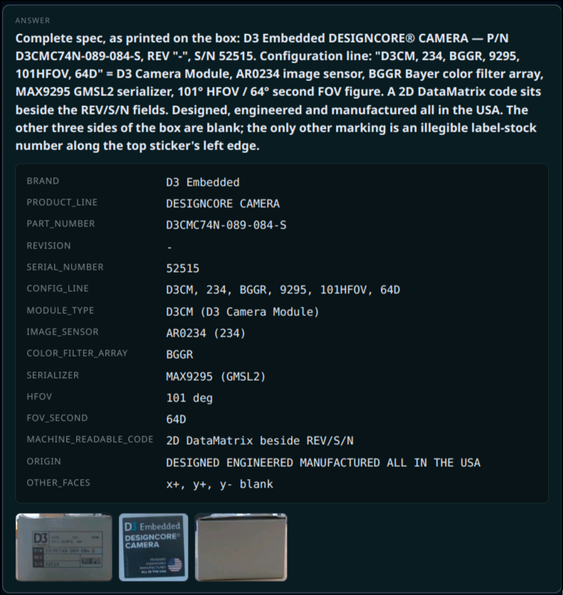

*One answer card: the verdict, the fields read from the object, and the cited evidence crops.*

Key facts:

| | |
|---|---|
| Robot | UR5e arm, wrist-mounted Intel RealSense D405 camera |
| Models | Claude Opus 5 (planning), Gemini Robotics ER-2 (vision), SAM 3 and PP-OCRv6 (local tools) |
| Training | None. All models are used as shipped |
| Typical run | About 9 minutes, 3 to 14 camera positions |
| Autonomy | Every move is approved by an operator before the arm moves |
| Object shapes | Evidence views are computed for box-shaped objects only |
| Code | 44.8k lines of Python plus 11.8k lines of tests, no ROS |

## 2. The idea

Software agents such as coding assistants follow one recipe: a general model, a small
set of tools, and a harness that runs the tools and feeds the results back. The model
reasons and plans. The harness does the work.

This project applies the same recipe to a robot. The model is the same kind of general
model, with no fine-tuning. Only the tools change: instead of reading and editing
files, the agent moves a camera, asks about a view, and gives an answer.

This is not a vision-language-action model. The model never outputs joint angles,
camera poses, distances or trajectories. It chooses from addresses that the harness
offers, and everything physical is computed by code.

The agent loop itself (turn-taking, retries, context handling) is the Claude Agent
SDK. What was built here is the harness: the tool bodies, the safety gate, the text
the agent reads, and the evidence record. The agent's instructions are about 110 lines
of prompt; the harness is the rest of the code base.

## 3. System overview

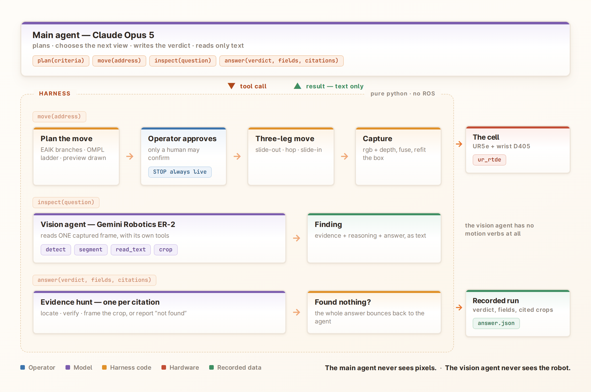

### Two agents

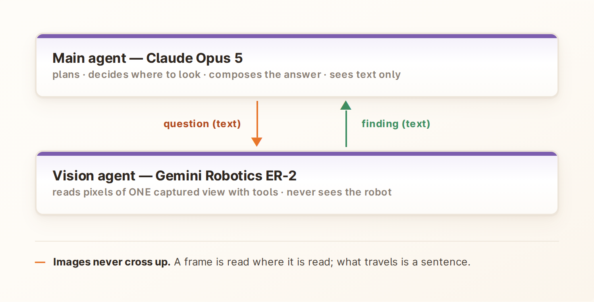

- **Main agent (Claude Opus 5).** Plans the inspection, decides where to look next,
  and writes the answer. It reads text only and never receives an image.
- **Vision agent (Gemini Robotics ER-2).** Reads the pixels of one captured view,
  using its own tools. It cannot move the robot and cannot look at another view.

A question goes down as text and a finding comes back as text: the evidence the
vision agent saw, its reasoning, and its answer. Keeping images out of the main
agent's context is what lets a run of 5 to 30 steps stay within one conversation.

### Four actions

The main agent has exactly four tools and no others.

| Tool | What it does |
|---|---|
| `plan(criteria)` | Called once, first. Breaks the question into checkable criteria |
| `move(address)` | Go to a view, capture, and have the vision agent read the new view. Waits for operator approval |
| `inspect(question, address)` | Ask the vision agent a new question about a view already captured. No motion |
| `answer(verdict, fields, citations)` | End the run. Up to three citations, each checked before the answer is accepted |

An address is one of 36 numbered cells around the object, or one of five face views
once the object's box has been fitted. The agent sees these as a text menu, refreshed
after every tool call (abridged from a recorded run):

```
STATE · turn 2 · at [1, 2] — azimuth 30°, elevation level 2
        visited 1 of 31 reachable · findings 2

MOVES · turn 2 · you are at [1, 2]
  move([2, 2])    30° right     · not visited
  move([0, 2])    30° left      · not visited
  move([7, 2])   180° opposite  · not visited
FACES (orthogonal evidence):
  ["face", "x+"] — settling
  ["face", "top"] — settling
```

The menu is computed by code. Which cells are reachable, which were visited, and how
far off head-on a face view is are facts the harness states; the model does not
author them.

### One step

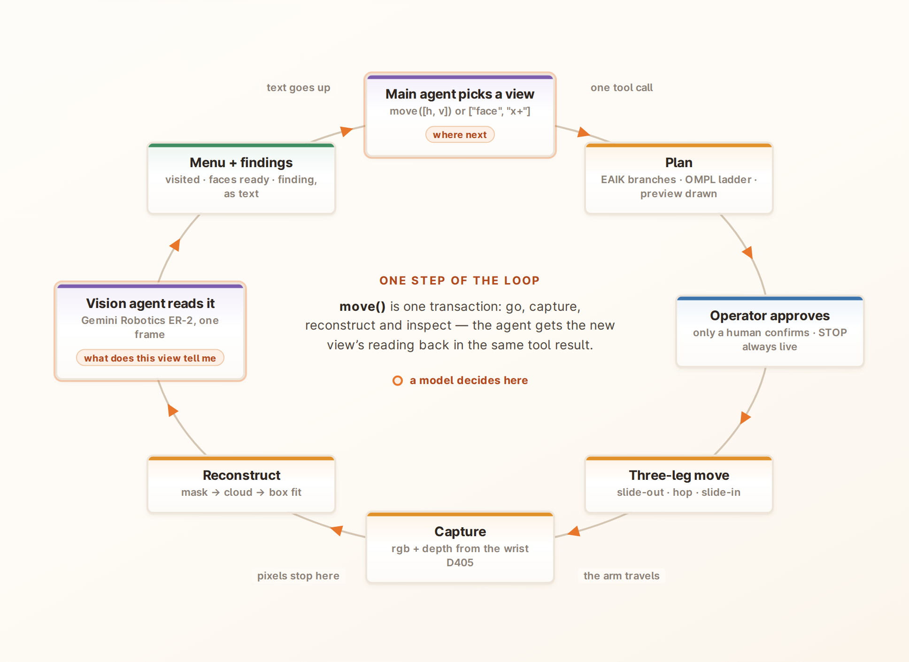

A `move` is one transaction: plan the path, wait for the operator, move, capture,
update the 3D model of the object, and have the vision agent read the new view. The
result returns to the main agent as text together with the updated menu. The model
makes two decisions per step: where to go next, and what the view tells it.

## 4. Motion and safety

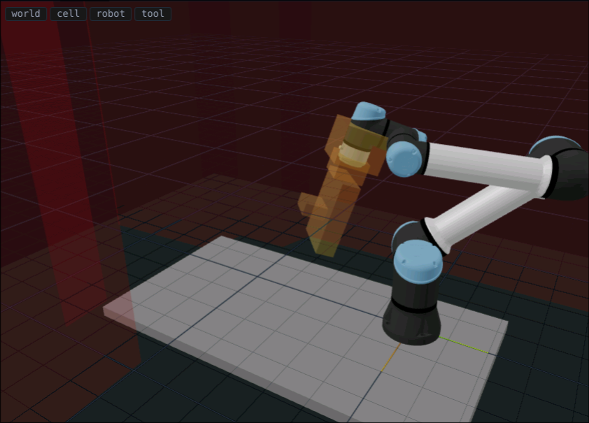

*The collision model of the cell: table, taught keep-out regions (red), the arm and the tool.*

Every move is planned against a model of the cell that was measured with the robot
itself.

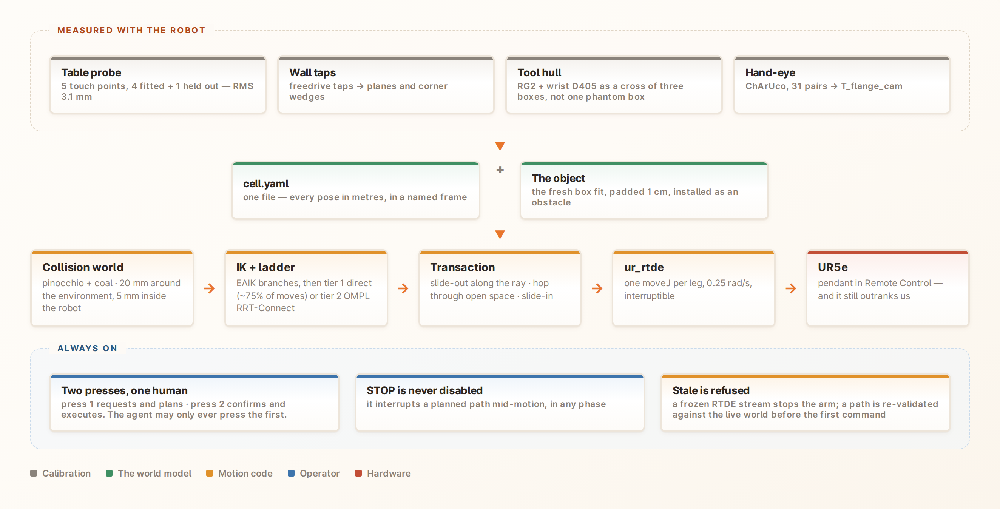

**Measured once.**

- Table position: five touch points with the robot, fit error 3.1 mm RMS.
- Walls and corners: taught by guiding the arm by hand and tapping the surfaces. The
  same regions are also entered into the robot controller's own safety planes.
- Tool shape: the gripper and camera are modelled as three boxes in a cross. A single
  bounding box was tried first and blocked 15 of 36 view cells with empty volume.
- Camera position on the arm (hand-eye calibration): ChArUco board, 31 poses,
  residual 2.5 mm median.

**Collision world.** These measurements live in one file and are loaded into a
collision checker (Pinocchio with the coal library). Margins are 20 mm around the
environment and 5 mm between parts of the robot itself. The inspected object is added
as an obstacle and updated after every capture, with a total standoff of 3 cm. The
system looks at the object and never touches it.

**Planning.** Inverse kinematics is analytic (EAIK) and returns every arm
configuration that reaches a pose. Path planning has two tiers:

1. A straight joint-space move, checked for collisions along its whole length. About
   75% of moves succeed here, in about 25 ms.
2. A sampling planner (OMPL RRT-Connect, best of several short runs) with path
   smoothing and a quality limit of 2.5 times the straight-line length.

If neither tier finds a path, the move is refused and the agent is told why.

**Three-leg moves.** A move between two views is never one path. The arm slides
straight back from the object along its current line of sight, travels through open
space, then slides straight in along the new line of sight. The long leg stays where
planning is easy, and the close approach cannot sweep sideways into the object.

**Execution.** Motion commands go through ur_rtde at 0.25 rad/s (about 14°/s). Before
any motion the path is checked again against the current world, and the arm's actual
position must match the start of the path. A frozen state stream from the controller
is detected and refused rather than trusted.

**Operator gate.** The agent can only request a move. The operator sees the planned
path in the 3D view and confirms it with a second press. A STOP button is always
active and interrupts motion in any phase. In the recorded runs the operator's
approval took a median of 3.3 seconds per step.

## 5. Where the camera may stand

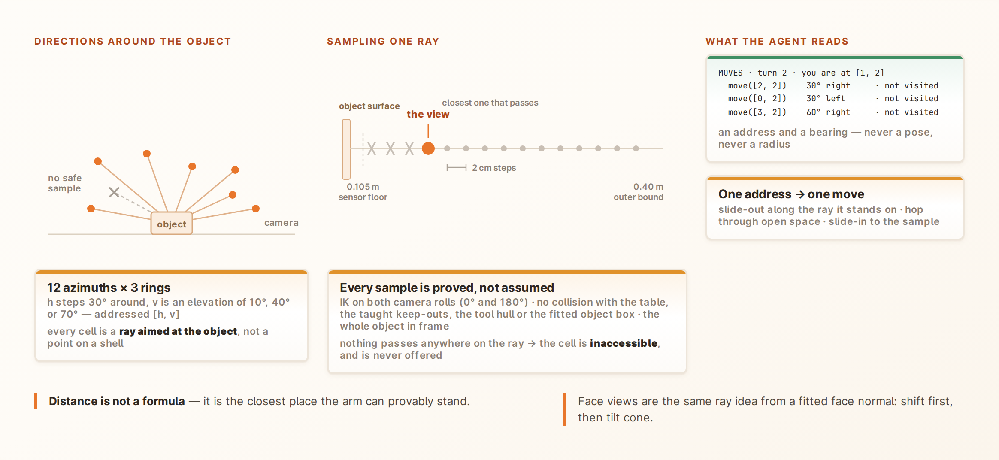

The 36 cells are directions around the object: 12 steps of 30° around it, at
elevations of 10°, 40° and 70° above the table. Each cell is a ray aimed at the
object, and the view is the closest point on that ray where the arm can provably
stand.

Points on the ray are tested in 2 cm steps, from the camera's minimum range of
10.5 cm out to 40 cm. A point passes only if it is beyond the camera's minimum depth
range, the arm can reach it, nothing collides, and the whole object is in frame. The
first point that passes is the view. If nothing passes, the cell is marked
inaccessible and is not offered to the agent.

So distance is not a setting. It follows from the object's size and the arm's reach,
and it is recomputed after every capture because the object model changes. Refreshing
all 36 cells takes about 0.18 seconds. In the demo runs, 25 to 33 of the 36 cells
were reachable once the object model had settled.

## 6. Perception

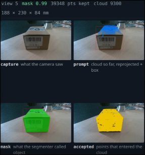

*One view: the camera image, the prompt box projected from the cloud so far, the mask, and the points accepted into the cloud.*

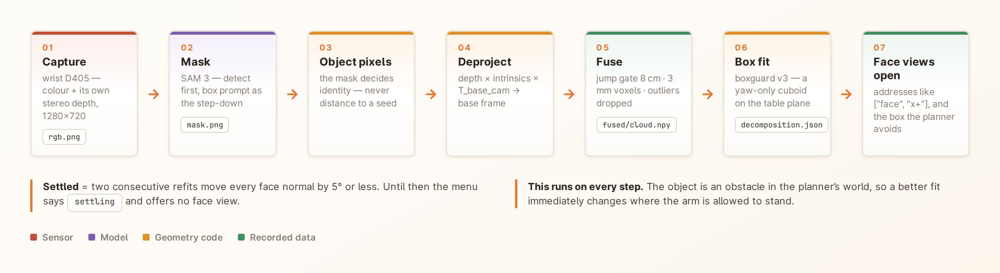

Every captured view goes through the same steps.

1. **Capture.** The D405 delivers colour and stereo depth at 1280×720. Frames are
   taken only while the arm is stationary, and are stamped with the camera pose
   computed from the arm's joint angles and the hand-eye calibration.
2. **Mask.** SAM 3 segments the object. The prompt comes from geometry rather than
   words: the point cloud built so far is projected into the new view, and the
   detected instance that contains it is kept. A mask is accepted only above a score
   of 0.5 and 200 pixels. If no mask is accepted the view falls back to a depth-only
   method, and the record says so.
3. **Object pixels.** The mask decides which depth pixels belong to the object.
   Distance-based rules alone could not separate a cable lying against the object.
4. **To 3D.** Masked depth pixels are converted to points in the robot's base frame.
   The table is found by plane fitting and removed.
5. **Check.** If the fitted table plane disagrees with the measured table by more
   than 30 mm or 5°, and the arm is not confirmed at its planned pose, the view is
   rejected and nothing from it is kept.
6. **Fuse.** New points join the accumulated cloud after three filters: points more
   than 8 cm from the existing cloud are dropped, the cloud is reduced to a 3 mm grid,
   and statistical outliers are removed.
7. **Fit.** A box is fitted to the cloud. It stands on the measured table and may
   rotate only about the vertical axis.

The fit produces two boxes with different jobs. The tight box describes where the
object is and is used to frame it in the camera. The padded box is the obstacle the
motion planner avoids.

In one recorded run of nine views, seven were segmented by mask and two fell back to
depth. The final cloud held 12,417 points, and the fitted long side stayed within
2 mm over the last four refits. The physical box was not measured, so this is
stability and not accuracy.

## 7. The vision agent

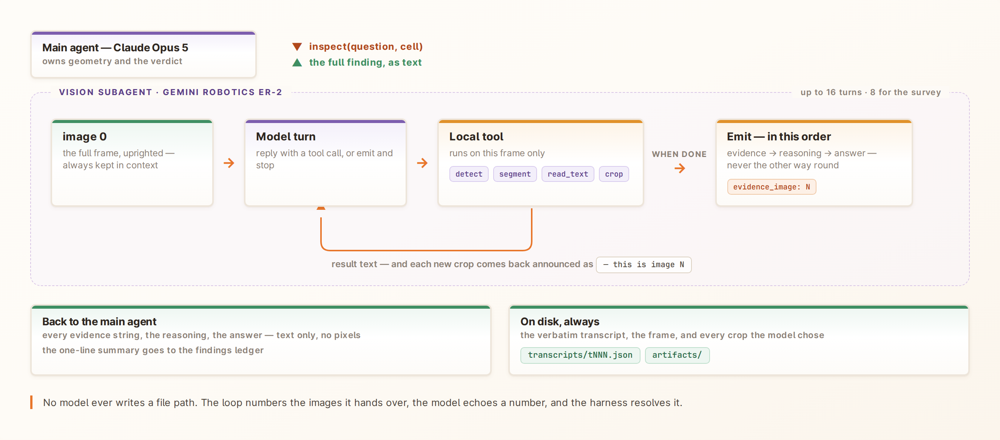

The vision agent receives one frame and a task, and works in a short loop of its own
(up to 16 turns). Its tools run locally on the workstation GPU.

| Tool | Backed by | Returns |
|---|---|---|
| `detect(phrase)` | SAM 3 | Labelled boxes with scores |
| `segment(box)` | SAM 3 | Size of the masked region |
| `read_text(box)` | PP-OCRv6 | Text strings with scores, above 0.5 only |
| `crop(box)` | Image slice | A zoomed image added to its context |
| `note(text)` | Ledger | Records a remark for the planner |

Rules that are fixed in the loop and cannot be switched off by a prompt:

- The reply states evidence first, then reasoning, then the answer.
- There is no confidence score. Self-reported confidence from these models is not
  reliable enough to act on.
- The full frame stays in context next to every crop.
- Descriptions are relative to the camera ("at the right edge"). The main agent,
  which knows the camera pose, converts that into a direction.
- A repeated identical tool call is refused with the earlier result.

The same loop is used in three roles: describing the object once at the start,
inspecting a view against a task, and hunting for evidence when an answer is checked.

Everything the vision agent does is stored: the prompt, each turn, the frame as it
saw it, and each crop it chose.

## 8. Evidence views

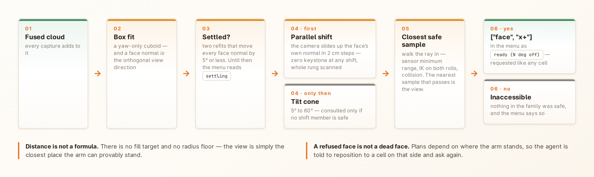

A label read from an oblique angle is often misread. In one run the origin text read
"Made in Italy" from an oblique cell, and "MADE IN CHINA" from the head-on view of the
same face. Evidence should therefore come from the view that faces a surface
squarely.

Once the fitted box has been stable for two consecutive refits (face directions
changing by 5° or less), each of its five visible faces gets its own view. The
outward direction of a face is the direction of its head-on view.

For each face the system looks for the best reachable view in this order:

1. **Parallel shift.** The camera stays parallel to the face and is moved up in 2 cm
   steps. A surface parallel to the sensor is imaged without perspective distortion
   at any shift.
2. **Tilt.** Only if no shifted position is safe, the camera is tilted, from 5° up to
   60°.

Along the chosen line of sight the closest safe point is taken, as for the cells. The
menu then shows the face as ready together with how many degrees off head-on the
view is. A face with no safe view is reported as unreachable.

A face view can be refused because no collision-free path exists from where the arm
currently stands. The refusal message tells the agent that plans depend on the
starting position and suggests moving to a cell on that side of the object first.
This recovered the face view in three of the demo runs.

The agent's instructions make the rule explicit: text read from an oblique view shows
where to look, and only a face view is evidence for what is written.

Evidence views exist for boxes only. Other shapes have no fitter yet.

## 9. The answer

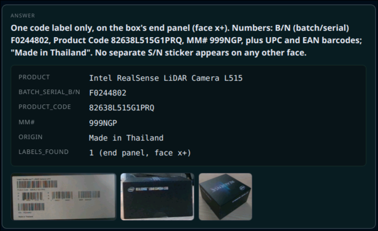

An answer has three parts: a verdict in plain language, a set of structured fields
(codes, serials, counts, states) holding only values that were read from pixels, and
up to three citations. A citation names a view and what the picture must show.

Each citation is checked before the answer is accepted. A separate vision agent run,
the evidence hunt, looks at the cited view for the named thing and either returns a
crop of it or reports that it is not there. The hunt is not told the verdict, so it
is not pushed toward confirming it.

If a hunt finds nothing, the whole answer is returned to the main agent. It can move
to a better view, cite a different view, or submit again and ship with the gap on
record. For a negative answer the agent cites the surfaces that would have shown the
feature, so the record shows it looked.

Examples from recorded runs:

- Two oblique reads of a code label disagreed. The agent repositioned, captured the
  head-on face view, read the label twice consistently, and cited that view.
- A device's front panel and its rear sticker gave different model numbers. The
  answer reported both readings, and decided between them from the port count and the
  power rating.
- A small number along a label edge read differently on three attempts. The answer
  stated this and did not report the number.

## 10. Recorded runs

Every run is a folder of plain files.

```
runs/<run>/
├─ run.json · session.json · config.json · events.jsonl
├─ steps/NNN/   rgb.png · depth · ir pair · mask.png · chain_*.png · fused cloud
│               step.json · view_state.json · decomposition.json
├─ ai/NNN/      trace.jsonl · transcripts/ · artifacts/ · answer.json · menu/
└─ manifest.json
```

- **Steps** hold what the camera captured at each position, the mask, the object
  cloud as of that step, and the box fit.
- **`config.json`** holds the conditions of the run: code revision, the full cell
  model, the calibration file, every tuning constant, and the models used.
- **`events.jsonl`** is the approval trail: requested, awaiting approval, approved,
  captured.
- **`ai/`** holds the agent's side: every tool call and result, every vision agent
  transcript, every crop, and the final answer.
- **`manifest.json`** lists each binary file with its checksum.

The operator UI is built on this record. It shows the 3D scene, the camera image, the
agent's trace, and the answer card. Watching a live run and re-opening a finished one
use the same code, because the UI renders the trace file in both cases.

Two things the record does not provide. Arm trajectories are not stored, so motion
cannot be replayed or benchmarked from a run. Re-running the agent against recorded
data is designed but not built.

The purpose of recording from the start is that these runs are the dataset for later
work: evaluation sets now, and training data for a learned viewpoint policy later.

## 11. Technology

| Layer | Technology | Role |
|---|---|---|
| Arm | Universal Robots UR5e | 6-axis collaborative arm |
| Tool | OnRobot RG2 gripper | Carries the camera; not used for grasping |
| Camera | Intel RealSense D405 | Close-range stereo depth and colour, 1280×720 |
| Compute | Workstation with NVIDIA RTX 5090 | Runs the local models and all harness code |
| Main agent | Claude Opus 5, via the Claude Agent SDK | Plans, chooses views, writes the answer |
| Vision agent | Gemini Robotics ER-2 (preview) | Reads one view |
| Segmentation | SAM 3 | Object masks and detection, local |
| Text reading | PP-OCRv6 | OCR, local |
| Shape fit | In-house box fitter | Box on the table plane, yaw only |
| Kinematics, collision | Pinocchio, coal | Robot model and collision checks |
| Inverse kinematics | EAIK | Analytic, all solutions |
| Path planning | OMPL (RRT-Connect) | Second planning tier |
| Robot interface | ur_rtde | State and motion commands |
| Point clouds | Open3D, NumPy | Plane fit, downsampling, filtering |
| Calibration | OpenCV (ChArUco, hand-eye) | Camera-to-arm transform |
| Operator UI | Browser UI over a message bus | 3D scene, trace, approval, STOP |
| Language | Python, no ROS | 44.8k lines plus 11.8k lines of tests |

The two agent models run as cloud services. Segmentation, text reading, geometry,
planning and control run locally.

The test suite has 488 tests. Five of them drive the full application end to end in
a headless browser against a simulated rig.

## 12. Results

The archive holds 78 run folders (3.0 GB). The figures below cover the 39 runs
recorded on 21 and 22 September, after the current view method was in place.

**Completion.** 18 of the 39 runs ended with a recorded answer. Of the other 21, 13
were closed without an answer, 5 were never closed, and 3 were opened and closed
without a question. Most of these lasted under three minutes and were operator
restarts. Two ran for 7 and 18 minutes with 8 and 9 refused moves each and were
stopped before an answer was recorded.

**The 18 answered runs.**

| Measure | Value |
|---|---|
| Time from start to last agent action, median | 8.9 min (range 2.7 to 19.0) |
| Operator approval per step, median | 3.3 s |
| Motion and capture per step, median | 17.9 s |
| Model time per step, median | 24.3 s |
| Face views captured | 55 |
| Face views exactly head-on (0°) | 32 |
| Face views within 10° of head-on | 43 |
| Worst face view | 35° off |
| Moves refused by the planner | 54 |
| Answers returned to the agent by a failed citation | 6 |

Planning a move takes a median of 0.4 seconds, and under 2.1 seconds in 95% of
cases. The model accounts for the largest share of each step, the arm for the second
largest, and the operator for the smallest.

Of the six returned answers, three were caused by a parsing error that has since been
fixed. In the other three the evidence hunt looked at the cited view and did not find
what was claimed, and the agent revised its answer.

**Objects and questions.** The answered runs cover cardboard product boxes, a network
switch, a fanless industrial PC and a red ball with coloured dots. Questions ranged
from one value ("what is the serial number?") to open requests ("inspect this machine
in detail and give the complete spec"). On the ball the system answered from the
numbered cells alone ("how many green dots are on the side?" gave 3).

**What has not been measured.** Answers have not been scored against ground truth, so
there is no accuracy figure. Known errors exist: one run read a brand name with one
wrong letter, and small print is sometimes misread. The original target question, a
logo on a cup, has no completed run under the current view method.

## 13. Limits

- **Small text is misread.** At a few pixels per character the vision model
  reconstructs text and can invent characters with no sign of doubt. Head-on views,
  OCR and repeated reads reduce this and do not remove it. The camera's resolution
  is the main constraint.
- **Boxes only.** Evidence views need a fitted box. The fitter assumes a box and does
  not decline other shapes: on the ball it fitted a box and offered box faces.
- **Text is the interface.** The main agent never sees an image. This works for
  tasks whose evidence can be put into words, such as labels, codes and counts. It is
  untested for tasks such as surface anomaly detection, where the evidence may not
  survive being described.
- **Refused moves.** The planner refused about three moves per answered run. A
  refusal costs a turn and sometimes an extra reposition.
- **Reachability.** Between 3 and 11 of the 36 view cells could not be reached,
  depending on the object and where it stood.
- **Not autonomous.** A person approves every move. Removing that gate is a designed
  option and has not been built.
- **Run time.** About 9 minutes per question, with model calls as the largest part.
- **Surfaces.** The camera has no pattern projector, so its stereo depth has holes on
  textureless surfaces. Transparent objects are out of scope. All demo objects were
  opaque.
- **One object.** The pipeline assumes a single object on the table. Questions
  comparing two objects were tried and did not complete.
- **Robustness and throughput** beyond demo conditions were out of scope.

## 14. Next steps

Already identified in the design documents:

- **More shapes.** Fitters beyond the box, starting with the cylinder, and an
  obstacle model built from several shapes. The fitter is a named plug-in point and
  the rest of the pipeline depends only on the kind of shape.
- **Evaluation.** Attach ground-truth labels to runs, define evaluation sets, and
  score verdicts. This is what will give an accuracy figure and settle the tuning
  values that are engineering defaults today.
- **Replay.** Re-run the agent against recorded runs, so prompts and models can be
  compared without the robot.
- **Autonomy.** Let the system confirm its own moves where that is acceptable.
- **A learned viewpoint policy.** Each run records the scene, the question, the
  candidate views, the chosen view and whether it resolved the question. That is the
  supervision a learned policy for view selection needs.

Under discussion and not yet decided: using the 3D data more directly, with a richer
scene representation than a single fitted box, and what that would let the planner
reason about.
