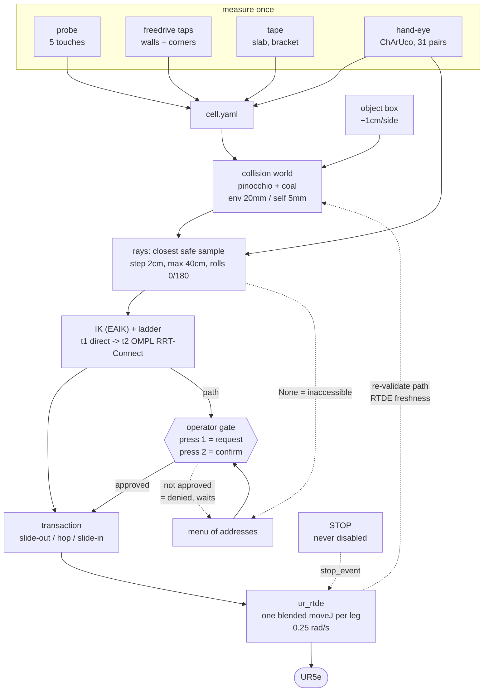

# Section 4 — Motion & safety (source notes)

Spine line: *cell measured → cell.yaml → kinematics + collision world; object is an
obstacle; operator gate (two-press approve, STOP always live).*

Everything below was read out of the tree or out of a run artifact on 2026-09-22.
Paths are repo-relative to `/home/anton/projects/robotics`.

---

## Facts

### 1. The cell model comes from measurements, not from CAD

- The world file is one YAML: `inspection/cell/cell.yaml`. Units m, pose =
  `[x,y,z,roll,pitch,yaw]` in the PARENT frame, box pose = box CENTER
  (`cell/cell.yaml:3-4`).
- Frame tree is deliberate: `base` = robot base frame, the frame the solver works in;
  `table` probed ONCE with the robot (welded, permanent); shelf poses tape-measured in
  the table frame — "only probe transforms that involve the robot"
  (`cell/cell.yaml:6-15`).
- **Table probe.** 5 touch points, 4 used for the fit + 1 holdout, fitted by
  `calib/probe_fit.py` on `calib/table_probe_2026-08-18.yaml`. **Fit RMS 3.1 mm,
  holdout 5.7 mm**, axes parallel to <0.05 deg (`cell/cell.yaml:20-24`). Result pose:
  `[-0.1718, -0.7849, -0.0049, -0.00070, 0.00060, 0.00004]` (`cell/cell.yaml:25`).
- The tabletop sits **5 mm below the base origin** — the robot stands on a ~5 mm
  mounting plate on the slab (`cell/cell.yaml:23-24`).
- The raw probe data carries its own gotcha, worth one line if Albert likes war
  stories: the pendant readings were taken with Feature = "View", not "Base", so every
  z was off by a constant **+399.47 mm**; re-touching P5 with Feature=Base found it
  (`calib/table_probe_2026-08-18.yaml:10-19`). The 5 points and both frames are listed
  at `calib/table_probe_2026-08-18.yaml:22-38`.
- **Keep-outs are taught by freedrive taps**, rebuilt 2026-08-31 after the workcell
  move. Raw taps in `calib/planes_2026-08-31.yaml`, fitted by `calib/plane_fit.py`,
  tapped with `calib/tap_probe.py` (RTDE `getActualTCPPose`, Base frame, closed RG2
  tip) (`calib/planes_2026-08-31.yaml:1-8`).
  - Corner recipe: 2 taps ON the wall-wall junction line + 1 tap per wall
    (`calib/planes_2026-08-31.yaml:5-7`).
  - Tripod recipe: 3 taps `[wallA end, APEX, wallB end]`, planes forced VERTICAL
    (`calib/planes_2026-08-31.yaml:7-8`).
  - Standalone wall: 3 spread taps → exact plane
    (`calib/planes_2026-08-31.yaml:38-39`).
- Two representations, and the difference is the whole point
  (`cell/cell.yaml:30-35`):
  - `planes:` — a standalone wall. Keep-out is the **whole half-space behind it**.
  - `corners:` — keep-out is the **INTERSECTION** of the two half-spaces (the wedge
    between the walls), i.e. one convex obstacle, **not** two global half-space cuts.
- 4 corners + 2 walls are taught today (`cell/cell.yaml:37-86`). Two honest caveats
  live in the file itself:
  - `corner2` apex was moved by hand on 2026-09-17 (y -0.7982 → -0.9298) because the
    wedge was biting into the front workspace (`cell/cell.yaml:47-49`).
  - `corner3` is annotated **"Anton: WRONG, reprobe pending"** (dihedral 71.7 deg)
    (`cell/cell.yaml:58`).
- The taught set is **mirrored to PolyScope safety planes by hand** once complete —
  the software model is not the only guard (`cell/cell.yaml:36`).
- **"Never below table" is a box, not a keep-in volume.** The room is open, so there
  are no side bounds; the one real bound is "don't dive below table level", modeled as
  a wide floor slab: `floor` dims `[2.15, 2.14, 0.10]`, pose
  `[0.275, -0.279, -0.11]`, **top face at z = -0.06** (`cell/cell.yaml:88-95`). The
  keep-in mechanism was removed 2026-08-18 (`cell/AGENTS.md:70-72`). A canned
  "dives below table level" config is kept as a truth-table case,
  `Q_FLOOR` (`cell/world.py:623`).
- `table_slab` dims `[0.529, 1.00, 0.03]` — the 52.9 cm width is TAPE-MEASURED
  2026-08-18 (the CAD sketch said 53.5) (`cell/cell.yaml:100-104`). Posts and bottom
  bar were disassembled in the 2026-08-31 move and removed from the model
  (`cell/cell.yaml:106`).

### 2. The tool hull is a CROSS of three boxes

- Tool boxes are declared under `tool:` in `cell/cell.yaml:133-163` and are rigid to
  the **flange** frame (`ur_description` `flange`, +X out of the tool face)
  (`cell/cell.yaml:108-110`).
- Why a cross and not one box (`cell/cell.yaml:111-118`): the old model was ONE box
  258 x 149 x 170 mm, taking each axis's worst value independently — closed length AND
  max-open width AND full bracket height. "That describes a gripper which never
  exists, and its four corners are pure phantom volume." Under tilt those corners
  swept into the robot's own upper arm: on run `2408-cup1` at a 0.226 m shell the
  phantom box **blocked 15 of 36 viewsphere cells**.
- Reachability recovered by the cross, same run: **4→19 cells at r=0.22, 21→28 at
  r=0.24, 29→31 at r=0.28** (`cell/cell.yaml:130-132`).
- The three boxes (`cell/cell.yaml:133-158`):
  - `rg2_base` — dims `[0.0580, 0.0900, 0.0790]`, X -18..40 mm, |Y| 45, Z -42..+37.
    The only genuinely tall section (base castings), and it stops at X=36.
  - `rg2_body` — dims `[0.2000, 0.1490, 0.0500]`, X 40..240, |Y| 74.5, Z -25..+25.
    Width stays at max-open 149 mm; measured, narrowing 149→100 mm gains 1 cell.
  - `cam_stack` — dims `[0.0340, 0.0800, 0.0600]`, X 125.4..159.4, |Y| 40,
    **Z -85..-25**.
- `cable_loop` (dims `[0.10,0.12,0.12]`, pose `[-0.05,0,0]`) is explicitly a
  **PLACEHOLDER**, "eyeball generously" (`cell/cell.yaml:160-163`). It overlaps
  `wrist_1` by design (`cell/AGENTS.md:69-70`).
- **Today's change (2026-09-22): `cam_stack` is ONE-SIDED.** It used to span
  Z -100..+70 because the blue angled bracket on the +Z face of the gripper was part
  of the stack. Anton unscrewed it; only the D405 + its black bracket remain, hanging
  off the -Z face. Lens at Z -47.5, bracket bottom 6 cm below the body face (Anton,
  tape, 2026-09-22) → **Z -85..-25**, starting exactly where the body box ends
  (Z -25) so the union has no gap (`cell/cell.yaml:148-158`). Same edit mirrored in
  the blueprint script (`investigation/tool_hull/hull_blueprint.py:60-64`).
  Commit `7e4531b` "cell: cam_stack is one-sided — the blue bracket came off the
  gripper".
- Provenance of the numbers is mixed and the file says which is which
  (`cell/cell.yaml:119-130`): per-part bounds from Antonio's USD via
  `investigation/tool_hull/tool_hull_from_usd.py`; bracket height MEASURED by hand
  2026-08-18; lens position from the 2026-08-19 hand-eye calibration. The USD's
  default `--slide-mm=-22` is a VISUAL nudge, not physical — real flange X =
  USD(-22) + 28 mm, and that 28 mm IS the mount stack the USD does not model.
- `investigation/tool_hull/hull_blueprint.py` renders the hull against the CAD and
  ASSERTS every one of the 22 parts, the lens and the TCP sit inside the union;
  cell.yaml says re-run it after ANY edit (`cell/cell.yaml:128-131`,
  `investigation/tool_hull/hull_blueprint.py:166-183`).

### 3. Hand-eye calibration

- Artifact: `inspection/calib/T_flange_cam_2026-08-19.npy` (4x4, meters), provenance
  in `inspection/calib/T_flange_cam_2026-08-19.yaml`.
- Date 2026-08-19, robot UR5e 192.168.2.50, camera RealSense D405 serial
  123622270954, left eye = color/IR-left/depth frame
  (`calib/T_flange_cam_2026-08-19.yaml:4-6`).
- Method: **ChArUco 8x6 / 20 mm on IR-left, `cv2.calibrateHandEye` PARK, 31 pairs**,
  freedrive + stationarity-gate auto-capture (`perception/handeye.py`)
  (`calib/T_flange_cam_2026-08-19.yaml:8-9`).
- Result: camera at flange **[+142.4, -8.3, -47.5] mm**, optical axis tilt
  **1.07 deg**. The -8.3 lateral IS the left-eye half-baseline (18.03/2) — body
  centered (`calib/T_flange_cam_2026-08-19.yaml:14-18`). Verified by loading the npy:
  translation reads `[142.447, -8.2987, -47.4833]` mm.
- Residuals (`calib/T_flange_cam_2026-08-19.yaml:20-23`):
  - cross-method: PARK vs Horaud **0.01 mm / 0.03 deg**; PARK vs Daniilidis
    **0.32 mm / 0.22 deg**.
  - board-in-base residual **median 2.52 mm, max 4.41 mm** (this is the nominal-DH FK
    floor, not the calibration's own error).
  - independent external check: Anthonio's `D405_to_TCP.txt` agrees to ~2 mm.
- FK is nominal DH; raw joints are stored per pair so the whole thing can be re-FK'd
  and re-solved once the factory DH calibration is extracted from the controller
  (`calib/T_flange_cam_2026-08-19.yaml:10-12`).
- `calib/AGENTS.md:14-18` — calibration artifacts are committed **source**, not build
  products; the scripts write numbers into `cell/cell.yaml`, they are never imported
  at runtime.

### 4. `ur base` vs `base_link` — the frame note

This is a real bug story and it is written up twice:

- `inspection/calib/frame_check.py:1-25` — a read-only check that closes the one loop
  nothing else closes: does the MODEL's idea of a joint configuration land where the
  CONTROLLER says it does? "That gap hid a 180 deg base-frame error for three days:
  `cell.yaml` holds pendant readings (UR controller `base` frame) while FK ran in the
  URDF `base_link` frame, which the vendor's own URDF declares is `base` rotated pi
  about Z. Every viewer agreed, because they all drew the same self-consistent, wrong
  model." Tolerance 2.0 mm (`calib/frame_check.py:30`). It commands nothing and never
  moves the arm (`calib/frame_check.py:20-21`).
- The fix side: `inspection/motion/ik.py:14-25` — "WE WORK IN THE CONTROLLER'S `base`
  FRAME — the one the teach pendant shows". `cell/world.py` mounts the pinocchio model
  with the matching rotation (`_mount_in_controller_base`, `cell/world.py:342`) so both
  kinematics engines agree.

### 5. From yaml to a collision world

- Library: **pinocchio + coal** (`cell/world.py:36-37`). The robot geometry is
  `ur5e_description` loaded through `robot_descriptions`
  (`cell/world.py:336-339`). open3d appears elsewhere in the package (point clouds,
  fitting) but **not** in the collision world.
- One object, one truth: every motion tier asks the same two questions —
  `is_colliding(q)` and `path_valid(path)` — against the same geometry
  (`cell/world.py:1-8`).
- **Tool boxes are welded to the flange**: the loader looks up the `flange` frame,
  takes its parent joint, and composes `flange.placement * pose_from_yaml` so the box
  rides the joint (`cell/world.py:352-359`). Static cell boxes go on joint 0
  (`cell/world.py:361-367`).
- **Keep-outs become concrete shapes** (`cell/world.py:53-71`, builder
  `build_keepouts` at `cell/world.py:87-101`):
  - walls → thick **slabs** with one face exactly on the plane — deliberately not coal
    `Halfspace`s, whose narrow phase against the UR5e BVH link meshes is not a
    validated path; slabs reuse the box pipeline end to end.
  - corners → ONE **convex prism** each (the wedge). Two separate geoms would OR the
    half-spaces and eat the free space beside each wall.
  - sizing: nothing on arm+tool leaves a ~1.35 m ball around the base
    (`REACH_BALL = 1.35`, `cell/world.py:74-75`); shapes are clipped just past that, and
    to a top-view bounding square, so the model looks like the room
    (`cell/world.py:96-101`).
- **Split margins, one world** (`cell/world.py:41-49`, `cell/world.py:424-434`):
  - `DEFAULT_PADDING = 0.020` m — coal `security_margin` for environment/object pairs.
  - `SELF_PADDING = 0.005` m — robot/tool internal pairs. The UR5e's own design
    clearances at park are 17-19 mm, so a 20 mm blanket margin false-positives the
    HOME pose.
  - `DEFAULT_STEP = 0.015` rad (L1), `LEVER_M = 1.10` m → 16.5 mm swept per step,
    under the 20 mm padding. This is a **contract, asserted at runtime**, not an
    assumption: `path_valid` raises if `step * LEVER_M >= padding`
    (`cell/world.py:472-479`).
- **The inspected object IS a hard obstacle** (Anton 2026-08-18, reversing an earlier
  soft-object rule). `set_object(name, dims, pose)` swaps the reconstructed primitive
  into the collision world every perception step; collision pairs are built once,
  updates are cheap (`cell/world.py:486-506`, `cell/AGENTS.md:73-77`).
  "We look, we never touch — endpoint validity at env padding doubles as the
  standoff." Caveat in the same note: the START config must be valid too; a park pose
  hovering over the object dies at step 0.
- **The object box itself** is `geometry.object_box` — ONE helper, so the planner's
  obstacle, the yellow box the UI draws and the sweep's ranking world all say the same
  thing (`cell/geometry.py:325-340`). It is a min-yaw AABB with a 1.0% percentile trim
  (`BOX_PCT = 1.0`, `cell/geometry.py:63-65`), inflated by `BOX_MARGIN_M` per side and
  floored at 5 cm in any dimension (`cell/geometry.py:339`).
- **The 2026-09-21 margin change**: `BOX_MARGIN_M` went **2 cm → 1 cm per side** for
  the ray-views demo. Total object standoff is then 1 cm (box) + 2 cm (coal padding)
  = **3 cm**, still ~3x the measured 5-10 mm hand-eye/FK pose-error floor
  (`cell/geometry.py:66-70`). Commit `28f8216` "geometry: object-box margin is a knob —
  2 cm -> 1 cm per side for the demo".
- Installed by the machine at `run/machine.py:1341-1349` (`_recenter`): min-yaw box
  first, then `world.set_object("object", ...)`, then the cell map — because the rays
  are resolved against the LIVE planner world, so this box is both the obstacle they
  must clear and the belief they must frame.
- `keepout_blob0.obj` / `keepout_blob1.obj` **in a run directory** are the taught
  keep-outs as display meshes: `world.keepout_display_meshes()` returns the union
  footprint extruded once per watertight blob, and the publisher writes each as a
  Wavefront OBJ into the run dir (already served at the capture mount) and publishes a
  `mesh_node` for the browser 3D view. A `?v=<crc32>` query busts the cache when the
  cell is re-taught between runs (`ui/publisher.py:291-322`). Display-only — the
  builder is the same one the solver's shapes came from ("what you see IS what the
  solver checks", `cell/world.py:88-90`), but a failure degrades to boxes-only and
  never blacks out the scene (`ui/publisher.py:319-322`). Today's runs carry
  **2 blobs**, 518 + 736 lines.

### 6. Kinematics + planning

- **IK: EAIK**, analytic subproblem decomposition, all branches, flange frame
  (`motion/ik.py:1-3`, import `from eaik.IK_DH import DhRobot` at `motion/ik.py:32`).
  - Runs on **nominal DH** — the closed form does not survive the arm's factory
    calibration (calibrated alpha2=0.00139 breaks the three-parallel-axes condition).
    Error until the calibration is extracted is **1-2 mm, inside the 20 mm padding**;
    a Newton-refine hook is reserved (`motion/ik.py:3-7`).
  - Frame adapters verified against pinocchio, residual **< 1e-9** over 200 random
    configs (`motion/ik.py:9-12`).
  - EAIK marks approximate solutions with `is_LS` — **always filtered**; unfiltered
    they carry centimeter-level FK error and look like real branches
    (`motion/ik.py:27-28`).
- **The ladder** is `plan_viewpoint()` in `inspection/motion/plan.py:31-89`. Two rungs:
  - **tier 1 — validated direct joint move** (`motion/direct.py:23-26`): straight joint
    interpolation `q_now → q_goal`, exactly what the robot's `moveJ` will execute,
    judged config-by-config by the world. No search. Measured **~75% of viewpoint
    moves land here** (`motion/direct.py:1-6`, `motion/AGENTS.md:40-41`).
  - **tier 2 — OMPL best-of-N + smoothing + gate** (`motion/rrt.py`): algorithm is
    **RRT-Connect** (`motion/rrt.py:111`, `og.RRTConnect(si)`). Budgets:
    `SINGLE_RUN = 0.05` s per run, `BUDGET = 0.20` s stage A, `ESCALATED = 0.60` s
    stage B, quality `GATE = 2.5` x the straight line (`motion/rrt.py:57-63`).
    Exploration resolution `CHECK_RESOLUTION = 0.002` — coarser than the validator on
    purpose; the fine-step gate in `world.path_valid` remains the safety authority
    (`motion/rrt.py:65-68`).
  - The goal is a **SET** (`ob.GoalStates` over every free IK branch), so the search
    picks the cheapest branch rather than committing to the nearest-by-L1 one
    (`motion/AGENTS.md:21-23`, `motion/plan.py:69-71`).
  - A third rung (radial retract via an outer shell) was **removed 2026-08-19** —
    measured 0/11 hard cases (`motion/plan.py:10-12`, `motion/AGENTS.md:84-90`).
  - `None` is an honest refusal, with a `reason` distinguishing "no collision-free IK
    branch" from "reachable but only badly" (`motion/plan.py:33-46`,
    `motion/plan.py:64-66`).
- **Why OMPL, not pyroboplan** (`motion/AGENTS.md:46-56`): pyroboplan takes ONE global
  `collision_distance_padding`; we need two margins (env 20 mm, self 5 mm). Expressing
  two margins through one number forced a second inflated "planning world", and the two
  worlds disagreed exactly at the boundary — which is where viewpoints live, since
  looking closely at a cup on a table means hugging the table. OMPL takes a validity
  CALLBACK, so the planner explores exactly the set we accept: one world, seam and
  workarounds deleted.
- **Why best-of-N, not an asymptotically optimal planner** (`motion/AGENTS.md:57-69`),
  benchmarked on 15 hard cases at equal budget: RRTC best-of-N 0.2 s solved 15/15,
  0 hangs, detour median 1.13; AORRTC 0.2 s solved 7/15, 2 hangs, detour median 1.03.
  AORRTC's hang rate GROWS with budget (a 1 s budget observed running 9.5 min) —
  OMPL's timed termination condition only works if the planner polls it, and a C++
  `solve()` holding the GIL cannot be preempted from Python.
- **Smoothing** is planner-agnostic and is what actually fixes path quality:
  `smooth.partial_shortcut` straightens ONE joint at a time; full-DOF shortcutting can
  never undo a single wrapped joint. Measured on the same planner: median detour
  1.84 → 1.15, worst 8.97 → 3.50 (`motion/AGENTS.md:16-20`).
- **Never `moveL` between viewpoints** — the chord passes through the object
  (`motion/AGENTS.md:70`).

### 7. The three-leg move transaction

`inspection/motion/transaction.py` — "A move between two ray addresses is never one
plan. It is three legs" (`motion/transaction.py:1-15`):

1. **slide-out** — radially outward on the CURRENT ray, joint-space straight lines
   between consecutive samples, **roll-locked**.
2. **hop** — the two-tier ladder through open space; **the only leg where the wrist may
   flip roll**.
3. **slide-in** — radially inward on the TARGET ray to its closest safe sample (the
   view pose), roll-locked, one IK branch.

- Rationale: the long move stays in open space where planning is easy, and the delicate
  approach is short, straight and radial — **it cannot laterally sweep the object**
  (`motion/transaction.py:13-15`).
- The search is **pinned and linear**: entry pinned to the farthest sample its slide
  corridor reaches, out-depths walked current-depth-first, one plan each — ~18 plans,
  not the ~18x18 (~10 s) a product would cost. Widening is bounded by
  `MAX_ENTRY_TRIES = 3` (`motion/transaction.py:17-21`, `:74-78`).
- It is also **two-pass**: pass 1 probes every candidate with TIER 1 ONLY
  (milliseconds); only if that whole sweep refuses does pass 2 spend TIER 2 (OMPL) on
  the first `MAX_LADDER_TRIES` candidates. Before this, a refusal measured **20.5 s**
  against a design budget of ~2 s; now a refusal costs ~18 probes + 3 searches and the
  common case costs ONE direct move (`motion/transaction.py:23-31`).
- **The corridor is a HINT, not a gate** (Anton's ruling 2026-09-21, from demo5;
  commit `dbadeaa`): "the whole hop-then-slide structure exists to make reaching the
  view EASIER — we should not restrict it, we should encourage it only." So the hop is
  COMMANDED onto the corridor's own IK branch (the probe already computed the exact
  joint config at every corridor sample), which makes the slide-in the pre-validated
  probe chain walked inward. And when the whole corridor search still refuses, **one
  plain full-ladder plan to the view pose itself is the last resort** — the view any
  way it is reachable beats a refusal (`motion/transaction.py:33-43`).
  The mechanism that makes the hop land on the right branch is `plan_viewpoint`'s
  `q_goal=` argument — land on EXACTLY this joint configuration instead of on any IK
  branch of the target pose (`motion/plan.py:41-46`).
- Roll lock is enforced, not assumed: `_roll_locked` cuts the sample list at the first
  roll change (`motion/transaction.py:132-143`), and `SLIDE_BRANCH_MAX = pi/4` rejects a
  branch jump mid-slide — a 2 cm ray step moves every joint by <= 0.19 rad, while the
  nearest free branch at a corridor break jumped 3.09 rad (a collision-free wrist flip
  that would still have executed as an ugly mid-slide motion)
  (`motion/transaction.py:86-93`).
- Every leg is validated against the world passed in, and that world travels with the
  legs (`Legs.world`) so execution can re-validate against the world the legs were
  planned under (`motion/transaction.py:45-48`, `Legs` at `motion/transaction.py:72`).
- The machine runs them one `rig.move` at a time, each under its own phase:
  `_LEG_PHASES = (("out","adjusting"), ("hop","executing"), ("slide_in","adjusting"))`
  (`run/machine.py:93-98`, loop at `run/machine.py:1121-1133`). "A slide is a delicate
  radial approach that cannot laterally sweep the object; the hop is the ordinary
  free-space move."

### 8. Execution on the real arm

`inspection/motion/execute.py` — **the ONLY module that commands robot motion**
(`motion/execute.py:1-4`).

- Transport: **ur_rtde** (`rtde_control` / `rtde_receive` / `rtde_io`,
  `motion/execute.py:237-247`). Robot IP `192.168.2.50` (`motion/execute.py:31`).
  Requires the pendant in **Remote Control** mode; state reads work in any mode,
  motion does not (`motion/execute.py:11-12`).
- **Limits**: `SPEED_RAD_S = 0.25` (~14 deg/s), `ACC_RAD_S2 = 0.5`,
  `SPEED_SLIDER = 1.0` (`motion/execute.py:35-47`). Effective top joint speed =
  speed x slider, so today **0.25 rad/s ≈ 14.3 deg/s** against Anthonio's 50 deg/s
  pendant cap. (Note: the inline comment still reads `0.25 -> 0.5 (08-24) -> 0.75
  (08-25)` and `motion/AGENTS.md:73-75` still says slider 50% — both are STALE; the
  shipped value is 1.0, raised in commit `5220f02` on 2026-09-14.)
- **The speed slider is code-authoritative**: `UR5eArm.__init__` calls `setSpeedSlider`
  on every connect, which writes THROUGH to the PolyScope pendant — a value set on the
  pendant is silently reverted the moment the loop connects
  (`motion/execute.py:37-40`, `motion/AGENTS.md:76-79`).
- Speed is **decoupled from collision safety**: the path and `world.path_valid` are pure
  geometry, unaffected by traversal rate. What speed costs is stopping distance after a
  software stop, which is why it moves in steps (`motion/execute.py:43-46`).
- **Refusals before any motion** (`motion/execute.py:368-393`): start mismatch
  (current `q` must match `path[0]` within `START_TOL_RAD = 0.02` ≈ 1.1 deg), world
  re-validation of the FULL path against the live world ("a stale path is a refused
  path"), and safety/robot mode must be NORMAL/RUNNING (`ROBOT_MODE_RUNNING = 7`,
  `SAFETY_MODE_NORMAL = 1`, `motion/execute.py:56-57`).
- **One blended path move per leg** (changed 2026-09-21, commit `c56c9d3` "execute: one
  blended path move per leg — the slide stops stuttering"). The whole leg runs as ONE
  asynchronous `moveJ(rows, True)` so it can be interrupted; the controller blends
  through interior waypoints instead of decelerating to a stop at every sample —
  per-waypoint `moveJ` made a 2 cm-stepped slide visibly steppy on the live rig. Slide
  waypoints are collinear along the ray, so the blend cuts no corner off the validated
  path (`motion/execute.py:373`, `:395-402`, `:422`).
  - Blend radius `BLEND_M = 0.005` m, which must undercut half the shortest adjacent
    TCP segment — a slide step is `RAY_STEP_M = 2 cm` of travel, so 5 mm
    (`motion/execute.py:50-52`). Any segment shorter than `MIN_BLEND_SEG_RAD = 0.02`
    rad has its blend zeroed, and the **endpoint is always reached exactly**
    (`rows[-1][8] = 0.0`, `motion/execute.py:53`, `:403-410`).
- **Software stop**: `stop_event` set → `stopJ(2.0)`, reported as
  `{"stopped": True}` — a normal outcome, not an error. Safety is polled every 50 ms by
  the wait loop and a change mid-path raises (`motion/execute.py:373-376`, `:424-433`).
  Waypoints-done is deliberately **undercounted** (the row in flight is not credited),
  because an overcount would make the retreat retrace forward through a waypoint the
  stop prevented (`motion/execute.py:427-431`).
- **RTDE freshness guard — `_assert_fresh`** (`motion/execute.py:284-353`):
  - Every `q()` read calls it first (`motion/execute.py:355-357`); `_safety_ok` raises
    rather than returning False on a stale stream (`motion/execute.py:359-361`).
  - It polls for a controller-**timestamp advance** within `stale_window = 0.10` s
    (`motion/execute.py:217-221`).
  - Why it exists: ur_rtde's receive thread can die silently (upstream #307, #235), and
    the getters keep returning the last value forever. A frozen `q` is how run
    `2108-ui` stamped five views with the survey pose (see the plane gate below).
  - On a dead stream it takes an **autopsy first** (the reconnect replaces the very
    socket you would want to inspect), then reconnects and re-verifies; a reconnect that
    still yields a frozen timestamp **raises** (`motion/execute.py:320-353`).
  - Reconnect attempts are rate-limited: `reconnect_backoff = 2.0` s, class-level so
    plural callers share it — otherwise ~50 reconnects a second against the controller
    (`motion/execute.py:223-233`, `:329-337`).
- **The RTDE subscription is minimal on purpose** (`motion/execute.py:59-86`): only
  `["timestamp","actual_q","robot_mode","safety_mode"]` at `RECV_FREQUENCY = 125.0` Hz.
  ur_rtde subscribes to EVERY output variable when `variables` is empty (~30 fields);
  at that rate the kernel receive buffer overflows after ~0.22 s of the receive thread
  not being scheduled — the entire stall budget on a machine also running a planner, a
  websocket bus and a software-Vulkan Chromium. Four variables give ~67 B at 125 Hz
  ≈ 8.4 KB/s, so the same buffer takes ~15 s to fill: a **~68x larger stall budget**.

### 9. Views are rays (short — section 6 covers evidence views)

Design doc: **`inspection/docs/2026-09-17-ray-views-design.md`**.

- "A view is a ray, not a point. Distance is the closest sample on the ray that is
  provably safe." No fill formula, no floors, no closeness slider
  (`docs/2026-09-17-ray-views-design.md:25-33`, restated at `view/rays.py:1-6`).
- Anton's requirement, verbatim: *"Get as much object as possible in the frame, never
  collide with the object, and always be able to escape the position."*
  (`docs/2026-09-17-ray-views-design.md:20-23`). The three mechanisms that replace the
  formulas: closest safe sample wins / every sample validated in the sandbox before
  motion / the exit leg is part of every move's plan
  (`docs/2026-09-17-ray-views-design.md:29-33`).
- **What "provably safe" means, per sample** (`view/rays.py:47-93`): sensor floor
  (`clear_m + MIN_RANGE_M`), IK solves, and the world says the configuration is
  collision-free. Both rolls are candidates at every depth and ONE roll's whole run is
  returned (a slide is roll-locked, so a list that changed roll partway out would have
  to be cut — on cell {3,1} of the bench box that left a ONE-sample corridor)
  (`view/rays.py:63-72`).
- Constants: `RAY_STEP_M = 0.02` m — one knob for depth AND face-shift sampling
  (`view/rays.py:17-18`); `MIN_RANGE_M = 0.105` m — D405 minimum depth range at 720p,
  datasheet + `perception/camera.py` note (`view/rays.py:19-20`); `R_MAX = 0.40` m —
  outer bound on ray sampling, "past this reachability collapses (24/36 cells
  measured). Arm physics, not framing" (`view/grid.py:24-27`); `FOV_MARGIN_PX = 14.0`
  containment margin, because the D405's principal point is not at the frame centre
  (ppy≈356.7 vs 360, measured -2 px corner cuts on the bench) (`view/rays.py:21-25`).
- **Do not confuse two `MIN_RANGE_M`s.** `view/rays.py:20` = 0.105 m, the sensor's
  minimum depth (a *view-planning* floor). `cell/geometry.py:72` = 0.13 m, the
  deprojection clip that cuts the gripper fingers out of every cloud (a *perception*
  filter). Different jobs.
- Rolls are restricted to **{0, 180} deg** and nothing else (`ROLLS = np.deg2rad([0,
  180])`, `view/viewsphere.py:32-39`). Both are lossless to undo in image space and
  both keep the frame landscape, so every capture reaches the VLM in one orientation.
  Measured on the demo cup at r=0.244: {0,180} reaches **26/36 cells — exactly what the
  old twelve-roll ladder reached**; the nine intermediate rolls bought no reachability
  at all, only tilted images no de-rotation can fix without interpolating.
- The grid: **12 azimuth bins x 3 elevations = 36 cells** (`H_BINS = 12`,
  `V_ELEVATIONS = (10, 40, 70)` deg above the table, `view/grid.py:16-17`).
- **`cell_map` returns the WHOLE grid, always** — an inaccessible cell is an explicit
  `None`, not a missing key. "A key that was never asked must not be
  indistinguishable from a ray that was asked and had nothing provably safe on it."
  That dict IS the machine's accessibility gate (`view/rays.py:353-372`, read as
  `.get(cell) is None` at `run/machine.py` `_reach`).
- Rays validate against **the same world the planner uses** (Anton's ruling
  2026-09-17), i.e. the one carrying `geometry.object_box` — "so an accessible cell is
  accessible to the thing that will actually move the arm"
  (`run/machine.py:1287-1295`).
- Honest about what the gate promises: `q_near` is deliberately NOT the arm's current
  configuration, so the map is a fact about the CELL, not about the stance. The gate is
  therefore a **WEAKER promise than a plan**: "some safe q exists for this cell", not
  "the arm can get there from where it stands" (`run/machine.py:1307-1316`).

### 10. Operator gate & safety

- Phase vocabulary (`run/machine.py`): `idle` → `planning` → `previewing` →
  `executing` / `adjusting` → `capturing` → `fusing` → `idle`, plus `fault` and
  `done`. `_BUSY_PHASES = ("adjusting","executing","capturing","fusing","fault")`
  (`run/machine.py:87`); `_MOVING_PHASES = ("adjusting","executing")`
  (`run/machine.py:91`).
- **Two presses, verified in the UI.** `inspection/ui/src/panels/ActionsPanel.tsx:87-88`:
  ```ts
  const press = (state, target) =>
    send(state === 'previewing' ? 'view/confirm' : 'view/request', target);
  ```
  The same button is pressed twice. Press 1 sends `view/request` → the machine plans
  (phase `planning`) and, on success, enters `previewing` and the button re-labels to
  `preview` (`ActionsPanel.tsx:65-69`). Press 2 sends `view/confirm` → the machine
  executes. `data-testid="confirm-button"` is attached only while the cell/face/survey
  is in `previewing` (`ActionsPanel.tsx:134`, `:147`, `:158`, `:173`, `:190`, `:207`).
- Machine side: `view/request` → `_start_planning` bumps `self.gen`, writes a
  `requested` record row, sets phase `planning`, spawns the plan worker
  (`run/machine.py:472-486`). On `plan_done` with a path it writes an
  **`awaiting_approval`** record row and sets phase `previewing`
  (`run/machine.py:625-631`). `view/confirm` writes an **`approved`** row and sets phase
  `executing` (`run/machine.py:511-521`). Commands are dispatched at
  `run/machine.py:371-379`.
- **There is no deny command, on purpose.** From `brain/live.py`, quoted in the UI:
  *"brain may press view/request. Only a human may press view/confirm."* Not approving
  IS the deny — the mover blocks un-timed (`ActionsPanel.tsx:14-17`).
- **STOP is never disabled** (`ActionsPanel.tsx:222-228`): *"A stop button that has to
  be re-enabled before it works is a stop button you cannot hit in a hurry."*
  `run/stop` sets `stop_event` while in a moving phase, and is a logged no-op otherwise
  (`run/machine.py:528-532`); `stop_event` is cleared only between actions, at
  `view/confirm` and on the exec/retreat completion paths (`run/machine.py:504`,
  `:685`, `:788`, `:908`). `run/exit` during an action stops first, then defers teardown
  until the in-flight worker reaches a terminal event — never mid-capture, never with a
  plan worker still live (`run/machine.py:545-559`).
- **Generation counter = "a stale button can never move the arm"** (design FR11). One
  dispatcher thread owns every bit of run state; workers talk back only by putting
  events on a queue; every `view/request` bumps `self.gen`, every worker event carries
  the gen it was spawned with, and the dispatcher **drops anything whose gen has gone
  stale** (`run/machine.py:1-9`, drop site `run/machine.py:344-346`).
  - Related: exactly one action worker is alive at a time, enforced not assumed.
    `plan_viewpoint`/OMPL cannot be cancelled mid-call, so a superseding request while
    `phase == "planning"` never spawns a second planner — it is deferred
    (`self._pending_request`, **last one wins**) (`run/machine.py:18-28`, `:448-460`).
    A request arriving in a busy phase is dropped with a warning to the log panel
    (`run/machine.py:412-414`).
  - **This is visible in run 2109-box-ray-demo19**: a `requested` for `face y+` at
    t+330.3 s never produced an `awaiting_approval` — a request for cell `[3,1]` landed
    4.5 s later and won; `face y+` was re-requested at t+377.3 s and went through.
- **On refusal**: the target is added to `self.blocked`, a warning goes to the log
  panel, and `_plan_fails` increments (`run/machine.py:602-606`). After
  `RETREAT_AFTER_FAILS = 3` consecutive refusals from an unmoved stance the machine
  **retreats radially** by `RETREAT_M = 0.05` m instead of refusing forever
  (`run/machine.py:100-113`, `:607-610`). The trap it fixes is real (run
  `1409-lan-ai_bench1`): `_recenter()` refits the object box from the grown cloud while
  the arm still STANDS at the viewpoint that produced the points, a stance accepted
  with millimetres of margin goes into collision, and from an invalid start every plan
  refuses — tier 1 fails at config 0, OMPL cannot initialize its start tree, and the
  refusals blame the targets. A found path disproves the trap and resets the counter
  (`run/machine.py:614-616`).
- **Table-plane view gate** (`inspection/run/settle.py`). Every captured view's RANSAC
  table plane is checked against the probed cell: tolerances `PLANE_Z_TOL_M = 0.03`,
  `PLANE_TILT_TOL_DEG = 5.0` (`run/settle.py:29-30`), evaluated at the workspace centre
  rather than at the base origin (`run/settle.py:36-48`).
  - Why: "a view whose RANSAC plane lands far from that was placed with a wrong camera
    pose — whatever the cause." Run `2108-ui`: a silently frozen RTDE `q` stamped five
    views with the survey pose; their planes came out at z 90 / -490 / 242 mm, tilted up
    to 48 deg. Rejecting on the plane catches ANY pose error, not just the one failure
    mode already met (`run/settle.py:21-28`).
  - The gate sits **before** anything from the view is kept: a rejected view must not
    touch the accumulator, publish a capture, or mark the cell visited
    (`run/settle.py:105-116`). One waiver: if the arm is confirmed at the planned pose,
    the failure is a plane-FIT problem (grazing view) and it fuses anyway, with a
    warning (`run/settle.py:109-113`).
- **"Never below table"** is the `floor` slab described above — a hard box in the
  collision world with its top face at z = -0.06, not a soft check
  (`cell/cell.yaml:88-95`).

---

## Numbers

| Number | Value | Source |
|---|---|---|
| Table probe points | 5 (4 fit + 1 holdout) | `cell/cell.yaml:20-21` |
| Table fit RMS / holdout | **3.1 mm / 5.7 mm** | `cell/cell.yaml:21` |
| Table axes parallel | < 0.05 deg | `cell/cell.yaml:24` |
| Tabletop below base origin | 5 mm (mounting plate) | `cell/cell.yaml:23-24` |
| Pendant "View" frame z offset (the bug) | +399.47 mm | `calib/table_probe_2026-08-18.yaml:12-13` |
| Hand-eye camera at flange | **[+142.4, -8.3, -47.5] mm** | `calib/T_flange_cam_2026-08-19.yaml:17`; verified from the .npy |
| Optical axis tilt | 1.07 deg | `calib/T_flange_cam_2026-08-19.yaml:18` |
| Hand-eye pairs / method | 31 pairs, ChArUco 8x6/20 mm, `calibrateHandEye` PARK | `calib/T_flange_cam_2026-08-19.yaml:8` |
| PARK vs Horaud / Daniilidis | 0.01 mm / 0.03 deg · 0.32 mm / 0.22 deg | `calib/T_flange_cam_2026-08-19.yaml:21` |
| Board-in-base residual | median 2.52 mm, max 4.41 mm | `calib/T_flange_cam_2026-08-19.yaml:22` |
| Independent check (Anthonio) | agrees ~2 mm | `calib/T_flange_cam_2026-08-19.yaml:23` |
| `cam_stack` extent today | Z **-85..-25 mm** (was -100..+70) | `cell/cell.yaml:148-158` |
| Old single tool box | 258 x 149 x 170 mm; blocked **15 of 36** cells on 2408-cup1 | `cell/cell.yaml:112-118` |
| Cross-hull reachability gain (2408-cup1) | 4→19 @ r=0.22 · 21→28 @ r=0.24 · 29→31 @ r=0.28 | `cell/cell.yaml:131-132` |
| CAD parts asserted inside the hull | 22 (+ lens + TCP) | `cell/cell.yaml:128-131`, `investigation/tool_hull/hull_blueprint.py:182` |
| Env collision padding | **20 mm** (coal `security_margin`) | `cell/world.py:44` |
| Self / tool-vs-robot padding | **5 mm** (UR5e design clearances are 17-19 mm at park) | `cell/world.py:45-49` |
| Validator step / lever | 0.015 rad L1 x 1.10 m = **16.5 mm swept**, asserted < padding | `cell/world.py:42-43`, `:472-479` |
| Object box margin | **1 cm/side** (was 2 cm, changed 2026-09-21) → total standoff **3 cm** | `cell/geometry.py:66-70` |
| Object box percentile trim / floor | 1.0% each end · min 5 cm per dimension | `cell/geometry.py:63-65`, `:339` |
| Reach ball (keep-out clipping) | 1.35 m (0.85 reach + wrist stack + 0.24 tool) | `cell/world.py:74-75` |
| IK error on nominal DH | 1-2 mm, inside the 20 mm padding | `motion/ik.py:6-7` |
| IK frame-adapter residual vs pinocchio | < 1e-9 over 200 configs | `motion/ik.py:9-10` |
| Tier 1 share of moves | **~75%**, ~25 ms | `motion/direct.py:6`, `motion/AGENTS.md:40-41` |
| Tier 2 cost | ~400 ms wall against a 0.2 s budget; fires on ~10% of moves | `motion/AGENTS.md:40-41`, `:93-95` |
| OMPL budgets | single run 0.05 s · stage A 0.20 s · stage B 0.60 s | `motion/rrt.py:59-62` |
| Path-quality gate | detour ≤ **2.5x** the straight line | `motion/rrt.py:63` |
| Planner bench (15 hard cases, equal budget) | RRTC best-of-N: 15/15, 0 hangs, detour med 1.13 · AORRTC: 7/15, 2 hangs, med 1.03 | `motion/AGENTS.md:60-63` |
| Smoothing effect | median detour 1.84 → 1.15, worst 8.97 → 3.50 | `motion/AGENTS.md:19-20` |
| Transaction refusal cost | was **20.5 s**, now ~18 tier-1 probes + 3 OMPL searches | `motion/transaction.py:23-31` |
| Slide branch guard | `SLIDE_BRANCH_MAX = pi/4`; 2 cm step moves joints ≤ 0.19 rad vs a 3.09 rad branch jump | `motion/transaction.py:86-93` |
| Joint speed / accel | 0.25 rad/s (~14 deg/s) · 0.5 rad/s² · slider 1.0 | `motion/execute.py:35-47` |
| Pendant cap for comparison | 50 deg/s | `motion/execute.py:33` |
| Start tolerance | 0.02 rad ≈ 1.1 deg | `motion/execute.py:49` |
| Blend radius / min blendable segment | 5 mm · 0.02 rad; endpoint blend forced to 0 | `motion/execute.py:50-53`, `:410` |
| RTDE recipe | 4 variables @ 125 Hz ≈ 8.4 KB/s; full recipe would overflow the buffer in ~0.22 s vs ~15 s | `motion/execute.py:66-86` |
| RTDE stale window / reconnect backoff | 0.10 s (~12 packets) · 2.0 s | `motion/execute.py:217-233` |
| Ray step | `RAY_STEP_M = 0.02` m (depth AND face shift) | `view/rays.py:17-18` |
| Sensor minimum range | `MIN_RANGE_M = 0.105` m (D405 @ 720p) | `view/rays.py:19-20` |
| Outer ray bound | `R_MAX = 0.40` m — past this reachability collapses (24/36 cells measured) | `view/grid.py:24-27` |
| FOV containment margin | 14 px (D405 ppy≈356.7 vs 360) | `view/rays.py:21-25` |
| Rolls | {0, 180} deg only; reaches 26/36 cells — same as the old 12-roll ladder | `view/viewsphere.py:32-39` |
| Grid | 12 azimuths x 3 elevations (10/40/70 deg) = 36 cells | `view/grid.py:16-17` |
| Retreat trigger / distance | 3 consecutive refusals from an unmoved stance → back out 5 cm | `run/machine.py:109-113` |
| Table-plane gate tolerances | z 30 mm · tilt 5 deg | `run/settle.py:29-30` |

### Measured from run artifacts (read-only)

**`inspection/data/runs/2109-box-ray-demo19/events.jsonl`** — 9 approved moves
(1 survey, 3 cells, 5 faces). Timings are wall-clock deltas between record rows:

- **`requested` → `awaiting_approval`** (the whole planning pass: refit, 36-cell ray
  map, three-leg transaction search): **n=9, min 0.27 s, median 0.64 s, max 1.29 s**.
  Per move: 0.38, 0.77, 0.27, 0.28, 0.36, 0.64, 0.78, 1.26, 1.29 s.
- **`approved` → `captured`** (three legs executed + settle + capture + fuse):
  **n=9, min 8.0 s, median 25.2 s, max 34.9 s**. Per move: 14.0, 31.6, 34.9, 18.3,
  28.2, 12.9, 25.2, 8.0, 32.1 s.
- Useful framing: **planning is sub-second; the time is the arm moving**, at
  14 deg/s. Whole run from first request to last capture: 454 s ≈ 7.6 min.
- Same file shows the operator approval latency directly (`awaiting_approval` →
  `approved`): 1.1 s to 17.4 s — i.e. the machine really does wait un-timed.

**Reachable-cell counts, today's runs** (menu text in `ai/000/trace.jsonl`, of 36
cells total):

| Run | "of N reachable" | Peak visited |
|---|---|---|
| `2209-smallcam-ray-demo5` | 32-33 | visited 3 of 33 |
| `2209-bigcam-ray-demo5` | 29-31 | |
| `2209-compute-ray-demo5` | 21, 31, 32 | |
| `2209-box-ray-demo4` | 22 → 28 (grows as the box settles) | |
| `2209-box-ray-demo1` | 22, 29, 30 | |
| `2209-box-ray-demo2` | 22 | |

Reading: **roughly 30 of 36 cells are honestly reachable** for the small objects, and
the count *rises* during a run as the object box refits tighter. The low-20s numbers
are early-run, before the belief settles.

**Ray-resolver bench** —
`inspection/investigation/ray_views/evidence/bench_summary.txt` (4 runs,
`--world guard`, i.e. the obstacle is `geometry.object_box(fused cloud)` exactly as
`machine._recenter` installs it):

- **36-cell refresh: 179-184 ms measured vs a 230 ms design estimate** (ratio
  0.78-0.80). Repeats are tight: 178.7 / 178.6 / 180.1 ms. This is the budget the
  machine pays once per plan and once per fuse.
- One ray's validity: ~5.0 ms over ~12 depths; per-ray spread median 4.2-4.7 ms,
  max 11.9-13.9 ms (n=108).
- Ray views land **closer to the surface** than the old formula did: on
  `1709-cam-ai-demo1`, **9/11 views closer, 0 inaccessible, mean surface distance
  0.194 → 0.158 m**.
- Sensor floor holds: "all 11 executed rows along-ray >= 0.105 m OK (min 0.141 m)".
- Endpoints inside the box: **0** (min surface distance 0.120 m).
- The one honest over-estimate: face family shift rung measured 51-66 ms against a
  20 ms estimate (2.6-3.3x OVER).

---

## Evidence to show

| What | Path | State |
|---|---|---|
| Tool hull blueprint vs CAD (the CROSS) | `inspection/investigation/data/tool/hull_blueprint.png` | **Exists**, 128 KB, regenerated today 2026-09-22 12:27 — after the `cam_stack` change (12:18). This is the picture for "measured, not drawn". |
| CAD part bounds behind it | `inspection/investigation/data/tool/usd_parts.json` | Exists, 3.8 KB |
| Cell top view | `inspection/cell/topview.png` | Exists, 130 KB (2026-08-31 — predates today's tool change; the cell layout is still current) |
| Taught keep-outs as they were published to the browser, per run | `inspection/data/runs/2209-smallcam-ray-demo5/keepout_blob0.obj`, `keepout_blob1.obj` | Exist, 518 + 736 lines. Every run dir has them. |
| Ray-resolver bench, full text | `inspection/investigation/ray_views/evidence/bench_summary.txt` | 16.9 KB |
| Old-vs-ray view comparison renders | `inspection/investigation/ray_views/evidence/1709-demo1_comparison.png`, `..._comparison_guard.png` | Exist |
| Per-cell frames, ray views | `inspection/investigation/ray_views/evidence/1709-demo1_frames_cells.png` (and `..._frames_faces.png`) | Exist |
| Approval trail, one run, machine-readable | `inspection/data/runs/2109-box-ray-demo19/events.jsonl` | 46 rows: requested / awaiting_approval / approved / captured |
| Live world viewers (if a screenshot is wanted; both meshcat, **do not run during the demo**) | `p inspection/cell/viewer.py`, `p inspection/cell/world.py --demo` | Source exists; GUI |

---

## Diagram



Plain-text version (5 lines):

```
measure  probe 5 pts · freedrive taps · tape · hand-eye  ->  cell.yaml
world    cell.yaml + tool cross on the flange + object box  ->  pinocchio/coal (20mm env, 5mm self)
choose   ray per cell -> closest provably-safe sample (IK both rolls + collision) -> menu; None = inaccessible
move     EAIK IK -> ladder (t1 direct / t2 OMPL) -> 3 legs: slide-out, hop, slide-in -> ur_rtde
gate     press 1 = request/plan · press 2 = confirm/execute · STOP always live · stale gen = dead button
```

---

## Claims to avoid

- **No fixed-radius viewsphere.** `R_MIN`, `derive_r_floor`, `FILL_TARGET`,
  `CLOSENESS`, `radius_for_extent` and the per-run shell floor were **deleted today**
  (commit `48fd128` "view: the fixed-position viewsphere dies — Stage D deletes the old
  path"; `2685a6a` cleaned up the cross-references). Verified: none of those symbols
  survive in shipped code — the only surviving mention is a comment in
  `inspection/tests/test_machine.py:1106` describing what died. `view/viewsphere.py` is
  now a ~4 KB drawing helper; its `r` is only the radius the cell frame is DRAWN at
  (`view/viewsphere.py:8-14`), fed the **mean resolved depth** by `_recenter`, falling
  back to `grid.DEFAULT_R = 0.35` before anything has resolved (`view/grid.py:18-23`,
  `run/machine.py:1324-1339`). Do not describe distance as a formula or a shell.
- **Do not say "the SO-ARM101"** — no SO-ARM/SO-101 hardware is driven anywhere in
  `inspection/` (grepped `so-arm|so-101|so101|feetech` across the package's Python and
  YAML: zero hardware matches). The hardware is UR5e + wrist D405 + OnRobot RG2. The
  only SO-101 mention in the motion path is a historical tilt-tolerance comparison in
  `run/settle.py:27-28` ("4-13 deg of tilt was historic for the SO-101; the UR5e fits
  within ~2 deg and ~10 mm") — that is a nice line to steal, not a piece of the cell.
- **Do not say a VLA controls the joints.** No model outputs joint targets, camera
  poses or distances. The agent picks an address from a menu; everything physical is
  code (`view/grid.py:9-10` — "Move legality comes from motion (`rays.cell_map`)").
- **Do not say "blends off".** That was true until 2026-09-21. It is now ONE blended
  `moveJ` per leg with a 5 mm blend radius and the endpoint forced to exact
  (`motion/execute.py:395-410`). `motion/execute.py:6` and `motion/AGENTS.md:33-37`,
  `:73` still say "blends off" — both are stale.
- **Do not quote the 50% speed slider.** `motion/AGENTS.md:73-75` says 50% and
  ~7.2 deg/s; the shipped `SPEED_SLIDER` is **1.0** (`motion/execute.py:47`), so it is
  ~14 deg/s. The inline comment on that line is also stale.
- **Do not say "2 cm of margin per side" for the object box.** It is 1 cm since
  2026-09-21 (`cell/geometry.py:70`). `run/machine.py:1298` still says 2 cm — that
  docstring is stale (flagged below).
- **Do not say the corridor gates the move.** Since 2026-09-21 it is a hint: the hop is
  *encouraged* onto the corridor branch, and a plain full-ladder plan to the view pose
  is the last resort (`motion/transaction.py:33-43`).
- **Do not claim three planning tiers.** There are two; the radial-retract rung was
  deleted 2026-08-19 after measuring 0/11 (`motion/plan.py:10-12`). `cell/world.py:3`
  still lists "radial retract" in its docstring — stale.
- **Do not claim the keep-out model is complete.** `corner3` is marked
  "Anton: WRONG, reprobe pending" (`cell/cell.yaml:58`) and `cable_loop` is an
  explicit PLACEHOLDER (`cell/cell.yaml:160-163`). If Albert asks, these are known and
  written down — which is the better story than pretending otherwise.
- **Do not claim the model alone is the safety system.** The taught planes are mirrored
  to PolyScope safety planes by hand (`cell/cell.yaml:36`), and the arm's own safety
  mode is polled every 50 ms during motion (`motion/execute.py:375`).
- **Do not say "pyroboplan" or "cuRobo"** as current — pyroboplan was replaced by OMPL
  on 2026-08-19; cuRobo is ruled out; VAMP is ruled out for now (ships precompiled UR5,
  not UR5e) (`motion/AGENTS.md:46-56`, `:71-72`).

---

## Open questions for Anton

1. **Speed slider** — `SPEED_SLIDER = 1.0` was set in commit `5220f02` (2026-09-14, an
   "in-flight push" that bundled the data-engine work), and both the inline comment and
   `motion/AGENTS.md` still describe 0.75 / 50%. Was 1.0 deliberate? It changes the
   headline number from ~7 to ~14 deg/s, which is worth getting right on a slide about
   safety.
2. **Stale docstring** — `run/machine.py:1298` says the object box carries "2 cm of
   margin per side"; `cell/geometry.py:70` has been 1 cm since 2026-09-21. Harmless to
   the runtime (the value is read from the constant), but it is the one place the demo
   narrative could pick up the wrong number. Want it fixed before the talk?
3. **Slide-in resolve timing** is listed as "not measured (Stage B: segment
   validation)" in `bench_summary.txt`. If you want a per-leg breakdown on a slide, the
   only numbers I could verify are the end-to-end `approved → captured` deltas above.
4. **`inspection/cell/topview.png`** is from 2026-08-31 and predates the one-sided
   `cam_stack`. Fine as a room layout; say so if you show it, or regenerate with
   `p inspection/cell/topview.py` (I did not run it — it writes into the tree).
5. **hull_blueprint.png** was regenerated at 12:27 today, 9 minutes after the
   `cam_stack` commit, so it should show the one-sided slab — but I only checked the
   mtime, not the pixels. Worth a 5-second look before it goes on a slide.
