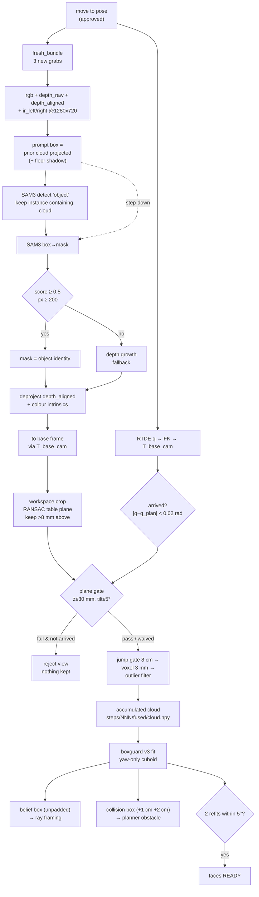
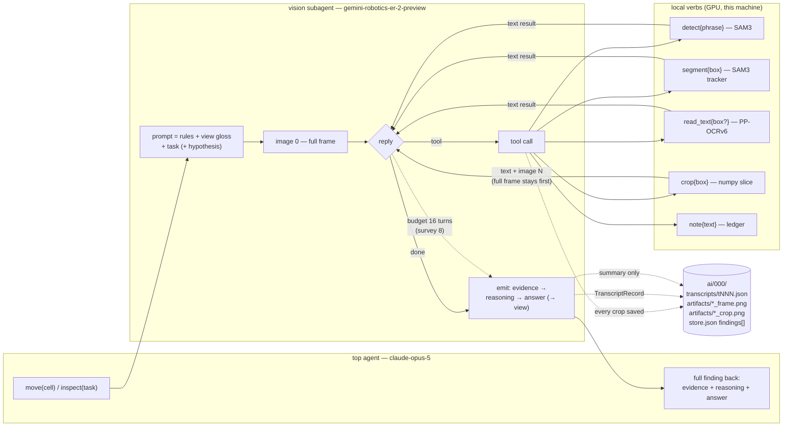

# Section 5 — Vision, two flows

Source document for slide-building. Every claim below is anchored to `file:line` or a
run artifact and was verified by reading code / reading run files (read-only, no
hardware, no GPU). Reference run throughout: `inspection/data/runs/2109-box-ray-demo19`
(live, real rig, 9 steps, completed 2026-09-21).

Paths are relative to `/home/anton/projects/robotics/` unless absolute.

---

## Flow A — Facts

### A0. Camera and capture

| Fact | Value | Source |
|---|---|---|
| Sensor | Intel RealSense **D405**, wrist-mounted, serial `123622270954` | `inspection/perception/camera.py:17` |
| Streams enabled | color (rgb8), depth (z16), infrared 1, infrared 2 — **all four at the same resolution** | `inspection/perception/camera.py:45-48` |
| Resolution / fps | **1280 x 720 @ 15 fps**, set 2026-09-14 | `inspection/perception/camera.py:32` (comment at `:25-31`) |
| Why 720p | D405 has no RGB sensor — colour is the *left stereo imager* demosaiced by an ISP; 848x480 decimates below native (measured chroma fringing + unreadable label text on `1409-box-ai_bench1` vs a sharp `ir_left` of the same frame). Min-Z rises ~7 → 10.5 cm, safe at r≈0.24 m. | `inspection/perception/camera.py:25-31` |
| Depth used | **native D405 stereo depth** (`rs.stream.depth`, hardware z16), aligned to the colour viewport via `rs.align(rs.stream.color)` | `inspection/perception/camera.py:46,52` |
| Learned stereo | **not in the pipeline.** The IR pair is stored *so that* Fast-FoundationStereo could be compared on byte-identical frames later. No code anywhere in `inspection/` calls it. | `inspection/perception/camera.py:7-8`; grep for `FoundationStereo` hits only `perception/camera.py` + the Aug-2026 project-definition doc |
| Capture discipline | camera must be stationary; `capture_bundle` sleeps then flushes 3 frames so the bundle postdates arrival | `inspection/perception/camera.py:127-137`; contract stated in `inspection/perception/AGENTS.md` ("Capture only while stationary — motion corrupts depth by up to 5 cm") |
| Intrinsics recorded once per run | `session.json`: per-stream intrinsics + distortion model + IR1→IR2 extrinsics + depth scale | `inspection/perception/camera.py:61-95`, written by `RunWriter.write_session` (`run/app.py:317`) |

Measured intrinsics in demo19 (`2109-box-ray-demo19/session.json`):
colour `fx 647.47, fy 646.94, ppx 629.83, ppy 356.70`, inverse-brown-conrady;
depth/IR `fx = fy = 640.51`; depth scale `1.0e-4 m/unit`; IR baseline `-17.92 mm`.

### A1. The per-view pipeline, in order

1. **Move → capture.** A step directory is allocated *after* the move: "a step directory
   means the arm stood somewhere and a camera was pointed at it" (`run/machine.py:1191-1215`).
   `RealRig.capture` takes a **fresh** bundle — `CameraWorker.fresh_bundle(min_new=3)`
   blocks until 3 new grabs have landed since the call, 3 s timeout, raises
   `"camera produced no fresh frames"` otherwise (`run/rigs.py:186-195`, used at
   `run/rigs.py:294`).

2. **Pose stamping.** RTDE `getActualQ` → `UR5eIK.fk` flange → `T_base_cam = T_base_flange @ T_flange_cam`
   (calibrated hand-eye, 2026-08-19). Every bundle is base-frame placeable.
   (`run/rigs.py:295-299`; `perception/capture.py:114-123`; `cell/geometry.py:76`)

3. **Freshness / arrival gate (pose).** The stamped joints are compared against the
   *planned* endpoint (the slide-in's last waypoint): `max|q_cap - q_end| < 0.02 rad`
   (~1.1°) → `arrived = True`. 0.02 rad is far above controller settle wobble and far
   below the ≥30° between cells a *frozen* RTDE `q` would show.
   (`run/machine.py:1226-1239`)

4. **Orientation policy.** Viewsphere roll is `{0, 180}` only, so a half-turn capture is
   rotated **once, at disk-write time**: `rgb.png` and `depth_aligned.npy` rotate
   together (they share the colour viewport); `depth_raw.npy` and the IR pair stay RAW,
   because the reconstruction deprojects `depth_raw` against `T_base_cam`.
   (`perception/capture.py:56-76`; roll set at `view/viewsphere.py:39`)

5. **Segmentation — the two-rung prompt chain** (`run/segmenter.py`, class
   `ObjectSegmenter` at `:75`). This is what `chain_prompt.png` / `chain_mask.png` /
   `chain_kept.png` are pictures of:
   - **Prompt box from geometry, not from text.** The accumulated cloud plus the arm's
     own pose already say where the object must appear: project the cloud into *this*
     view and take its bounding box (`cell/geometry.py:389-429`, `prompt_box`). On the
     survey (no cloud yet) the source is this frame's own depth cluster
     (`run/segmenter.py:215`). `floor_z` extrudes the known cloud down to the table
     before projecting, so a run that opened top-down does not stay anchored on the top
     face forever (`cell/geometry.py:404-417`; measured on `0809-0809box`: side view 015
     went 856 → 4171 fused points).
   - **Rung 1 — detect.** `LocalVerbs.instances(frame, "object")` → SAM 3 returns
     instances; keep the instance whose mask **contains** the projected prior cloud
     (containment ≥ `MIN_CONTAINMENT = 0.5`, detector score ≥ `MIN_DET_SCORE = 0.2`),
     ranked by `score * containment`. The phrase is deliberately generic — identity
     comes from the containment test, not the words. Purpose: a box prompt is an extent
     *ceiling*, so a partially reconstructed object would yield a partial mask forever.
     (`run/segmenter.py:44-55, 97-128`)
   - **Rung 2 — box prompt (step-down).** Segment the `prompt_box` directly.
     (`run/segmenter.py:158-183`)
   - **Acceptance policy.** Mask is believed only if `score ≥ MIN_MASK_SCORE = 0.5`
     **and** `px ≥ MIN_MASK_PX = 200`. A miss is an ordinary outcome, not an error —
     the caller falls back to the depth-only path. A backend that *raises* is treated
     identically: "a model failure must never take the run down with it."
     (`run/segmenter.py:37-40, 130-183`)
   - **Backend.** `Sam3Backend` — `facebook/sam3`, **two model classes off one
     checkpoint**: `Sam3Model` + `Sam3Processor` for text→instances,
     `Sam3TrackerModel` + `Sam3TrackerProcessor` for box→mask. `Sam3Model.input_boxes`
     are *concept exemplars*, not "segment this box" — using them for that returns
     plausible nonsense. (`eyes/verbs_local.py:156-248`, esp. `:238-239`)
   - **Rotation handling.** The model is shown an upright frame and the mask is rotated
     back, so box-in and mask-out are both in the caller's raw frame. SAM 3 tolerates
     rotation but not aspect change, and a half turn keeps the frame landscape.
     (`run/segmenter.py:146-157, 169`)

6. **"The mask defines object identity."** When a mask is given to
   `object_in_base(...)` it **is** the answer — `seed`/`eps` are ignored.
   Why: every purely geometric guard reasons about *distance*, and on run `2408-cup2`
   view 003 a cable was within 20 mm of the cup in 3D — genuinely adjacent, so distance
   had nothing to say. Measured there: object extent **175.8 mm → 89.1 mm**.
   (`cell/geometry.py:438-455`; the same story at `run/segmenter.py:5-10`)
   The masked points are deliberately **not** workspace-cropped — `WORKSPACE` is a
   *scene* filter and a masked pixel is by definition not scene clutter (run `2408-cup4`:
   cropping amputated 22% of every masked view, 92.8 mm instead of 126.9 mm, and the
   missing half faced the robot). (`cell/geometry.py:495-511`)

7. **Geometry stays pure numpy.** `cell/geometry.py` may not import `eyes`, and
   `perception/` is barred from `eyes` too; the model lives in `run/` (one tier above
   both) and the mask is passed **down as data**. (`run/segmenter.py:12-16`)

8. **Deprojection.** `deproject(depth, intr, depth_scale, stride=2)` → camera-frame
   points, then `cam_to_base` with `T_base_cam`.
   - Mask path uses `depth_aligned` + **colour** intrinsics (mask was computed on rgb —
     mask/depth/rgb are pixel-paired by construction); depth fallback uses `depth_raw` +
     **IR** intrinsics. The two agree to 2.6 mm, under the hand-eye residual.
     (`run/segmenter.py:234-238`, `cell/geometry.py:447-451`)
   - Range clip `MIN_RANGE_M = 0.13` / `MAX_RANGE_M = 0.60`. The min acts as the v1 arm
     mask: the gripper fingers hover 7–12 cm in front of the wrist camera and otherwise
     become the largest above-table cluster. (`cell/geometry.py:71-73, 126-134`)

9. **Plane removal + workspace crop.**
   - Workspace crop `WORKSPACE = x (0.05, 0.60), y (-0.45, 0.45), z (-0.10, 0.50)` m —
     applied to the *scene*, so the table fit and the depth fallback see the workcell,
     not the room. (`cell/geometry.py:42, 160-170`)
   - Table plane: Open3D RANSAC, inlier threshold `TABLE_DIST_M = 0.006` m, `ransac_n=3`,
     500 iterations, normal forced +z. **Always fitted on the FULL view, never on the
     masked subset** — the plane needs the table and the mask deliberately removes it.
     (`cell/geometry.py:172-182`, `:453-455`)
   - Keep points `ABOVE_TABLE_M = 0.008` m above the fitted plane. (`cell/geometry.py:45, 184-192`)

10. **The table-plane gate** (`run/settle.py`). The cell's table is *probed* ground truth
    at z=0 in the base frame. A view whose fitted plane lands far from that was placed
    with a wrong camera pose. Tolerances: `PLANE_Z_TOL_M = 0.03`, `PLANE_TILT_TOL_DEG = 5.0`,
    height evaluated at the workspace centre, not at the base origin.
    (`run/settle.py:21-55`)
    - Origin story: run `2108-ui` — a silently frozen RTDE `q` stamped five views with
      the survey pose; their planes came out at z 90 / -490 / 242 mm, tilted up to 48°.
    - **Waiver:** with `pose_confirmed=True` (step 3 above) a bad plane is a bad *fit*,
      not a bad pose — the 10° ring sees almost no table so RANSAC fits a grazing sliver.
      The gate then warns and fuses instead of rejecting. (`run/settle.py:86-93, 108-117`)
    - A rejected view touches nothing: no accumulator, no capture publish, no cell marked
      visited — but the bytes stay on disk with `outcome="rejected"` and a reason.
      (`run/settle.py:105-117`; `run/machine.py:1243-1250`)
    - A survey view with no centroid is refused as `"NO OBJECT above the table"`.
      (`run/settle.py:119-122`)

11. **Fusion into the accumulated cloud** (`cell/geometry.py:552-650`, `CloudAccumulator`).
    - **Jump gate** first: points further than `JUMP_GATE_M = 0.08` m from anything
      already accumulated are rejected as detached (cKDTree query). Measured on
      `2408-cup1`: every legitimate view put its new points within 28 mm of the existing
      cloud; the cable view reached 140 mm. (`cell/geometry.py:62, 592-598`)
    - Then `voxel_down_sample(VOXEL_M = 0.003)` — **3 mm voxels**. (`cell/geometry.py:46, 604`)
    - Then `remove_statistical_outlier(nb_neighbors=16, std_ratio=2.5)` when >50 points.
      (`cell/geometry.py:605-606`)
    - Colours ride every filter the points do; a contribution with no colour fuses
      mid-grey (128) so row alignment can never break. (`cell/geometry.py:555-557, 585-590`)
    - `acc.last_kept` is a diagnostic side-channel: what *this* view contributed, which
      after voxelisation is otherwise unrecoverable. (`cell/geometry.py:565-571`)

12. **Refit + world refresh** (`run/machine.py:1341-1400`, `_recenter`). Fires after every
    successful fuse: `object_box(acc.points)` → installed in the planner world as the
    obstacle `"object"`; then the cell rays are re-resolved against that live world.

13. **The box fit — boxguard** (`inspection/fit/box.py`, `BOX_VERSION = "v3"`).
    Runs on the dispatcher after every fuse (`run/machine.py:1415-1473`, `_fit_step`),
    eating `steps/NNN/fused/cloud.npy` and writing `steps/NNN/decomposition.json`.
    - Fits a **yaw-only cuboid**: bottom face on the recorder's table plane, gravity
      fixes the axis (1-DOF yaw search, no twin ambiguities), extents are the **outer
      fuzz envelope** (q99.5-style), never a density mode. (`fit/box.py:1-20, 44-132`)
    - Yaw: start from `min_yaw_aabb(pct=1.0)`, re-search ±10° at 0.5° by *wall
      sharpness*, adopt only on a ≥15% win. (`fit/box.py:83-93`)
    - Height: `z_top = percentile(z, 99.5)` minus the table z at the centre. (`fit/box.py:55-59`)
    - Per-face `side_conf` {x+, x-, y+, y-}: wall-band evidence, the hook the view planner
      reads to send the camera at unseen walls. (`fit/box.py:100-130, 175-182`)
    - Hard rule inherited from the completion bench: **nothing here may read `truth/`**.
      Priors come from the cloud and the probed scene only. (`fit/box.py:16-17`)
    - Bench result quoted in the docstring: wf 1.000 on 8/9 GT box runs (parked on b2 x-).

14. **"Settled" = the face-stability gate.** `_update_face_gate` compares the new
    boxguard primitive's face normals to the previous one via
    `normals_delta_deg` (max angular change of any of the 5 face normals);
    `≤ FACE_STABLE_TOL_DEG_DEFAULT = 5.0°` increments a counter (capped at 2), anything
    larger resets it to 0 **and voids every cached ray resolution** (the box moved, so
    every achieved theta is stale). The face menu is gated on `_face_stable >= 2` —
    **two consecutive stable refits**.
    (`run/machine.py:268, 1476-1490, 1535`; `view/faceview.py:26-35, 94-102`)
    Face statuses: `settling` → `ready` → `visited` (or `unreachable`).
    (`run/machine.py:1531-1549`)

15. **The two envelopes.** These are different objects and the distinction is load-bearing:
    - **Belief box** — the boxguard fit's own **unpadded** oriented box. Its 8 oriented
      corners (`view/rays.py:169-186`, `box_corners`) are what a ray's containment floor
      is measured against. Using the *oriented* box matters: a yawed box's AABB inflates
      up to ~20%/dim and that tax is centimetres of standoff. (`view/rays.py:188-211`,
      `belief_bounds`; `run/machine.py:1287-1320`)
    - **Collision / padded box** — `object_box(points)`: `min_yaw_aabb(pct = BOX_PCT = 1.0)`
      then `dims + 2 * BOX_MARGIN_M` with a 5 cm floor. `BOX_MARGIN_M = 0.01` m per side
      (reduced 2 cm → 1 cm for the ray-views demo, Anton 21-09), on top of which the
      world's query-time padding of 2 cm rides → **total object standoff 3 cm**, ~3x the
      measured 5–10 mm hand-eye/FK pose-error floor. This is the yellow box the UI draws,
      what the planner avoids, and the sweep's ranking world — one helper, three callers.
      (`cell/geometry.py:64-70, 325-341`)
    - Before any fit exists the padded hull is the only bound there is and is used as the
      conservative fallback; feeding those margins to the ray resolver once a fit exists
      would push every cell's sensor floor outward from what the bench measured.
      (`view/rays.py:196-211`)
    - **`keepout_blob*.obj` is NOT an object envelope.** It is the **cell's taught
      keep-outs** (walls + corner wedges from `cell/cell.yaml`), unioned as a 2D polygon
      and extruded once, written as Wavefront OBJ into the run dir purely so the browser
      3D scene can draw them (the scene protocol has no inline-triangles kind).
      Display only — collision keeps the separate convex shapes.
      (`ui/publisher.py:291-321`; `cell/world.py:298-327`)
      demo19 has two blobs: `keepout_blob0.obj` (174 v / 344 f), `keepout_blob1.obj`
      (244 v / 492 f).

### A2. What is written per step

`steps/NNN/` (verified against `2109-box-ray-demo19/steps/000/`):

| File | What |
|---|---|
| `rgb.png` | 1280x720 colour, **upright** (half-turn already corrected) |
| `depth_raw.npy` | uint16 1280x720, RAW orientation, IR intrinsics frame |
| `depth_aligned.npy` | uint16 1280x720, aligned to colour viewport, rotated with rgb |
| `ir_left.png`, `ir_right.png` | raw stereo pair, never rotated |
| `mask.png` | the object mask, 255 = object. **Only present when a mask was believed** |
| `chain_prompt.png` | rgb + reprojected prior cloud (orange dots) + the prompt box (red) |
| `chain_mask.png` | rgb + the returned mask (green, alpha 0.55) + the box |
| `chain_kept.png` | rgb + the points that actually entered the cloud (yellow dots) |
| `fused/cloud.npy`, `fused/colors.npy` | the whole accumulated cloud **as of this step** |
| `step.json` | the step record |
| `view_state.json` | the candidate set the next choice was made from |
| `decomposition.json` | the step's ONE belief about the object |

Writers: bytes by `perception/capture.py:save_bundle` (`:37`) and `save_mask` (`:90`);
chain overlays by `perception/overlay.py:save_chain` (`:64`, files named at `:39-41`),
called from `run/machine.py:1049`; records by `record/writer.py` via
`run/machine.py:735-745` (`write_fused`) and `:1415` (`_fit_step`).

**`step.json` keys** (`record/schema.py:172-204`, `StepRecord`, schema_version 2):
`schema_version, provenance, synthesized, step_id, view{method,address}, t_arrived,
outcome(captured|rejected|failed), phase(captured|fused), detail, t_captured, joints_rad,
T_base_flange, T_base_cam, rgb_rotation_deg(0|180), segmentation{score,box,px},
geometry{offered,kept,dropped,fused_points,source(mask|depth),fallback_reason,extent_mm,plane}`.

**`view_state.json` keys** (`record/schema.py:285-301`, `ViewState`):
`schema_version, provenance, synthesized, step_id, t, candidates[]{address,pose,status,roll,scores},
centroid, extent, r, chosen, decider`. In demo19 step 000: 36 candidates, `chosen="survey"`,
`decider="ai"`.

**`decomposition.json` keys** (`record/schema.py:239-260`, `DecompositionRecord`):
`schema_version, provenance, synthesized, step_id, source("fused/cloud.npy"), n_points,
method("boxguard"), method_version("v3"), abstain, reason,
primitives[]{kind,pose(4x4),params{extents,side_conf},label,residual_mm,support,inliers}`.

Run-level: `run.json` (id, object, question, status, `view_methods`, ordered `steps`,
`q_survey`, `conventions`), `session.json` (intrinsics/baseline/depth scale),
`config.json` (git sha, embedded `cell.yaml` + its sha256, calib file identity, the
tuning constants in effect, `models` roles), `events.jsonl` (operator gate:
requested / awaiting_approval / approved / captured), `manifest.json`,
`fused/cloud.npy` + `fused/colors.npy` (final), `keepout_blob*.obj`, `ai/NNN/`.

---

## Flow A — Numbers

All from `inspection/data/runs/2109-box-ray-demo19` (read-only).
Run wall time: created `1789993599.73` → closed `1789994320.13` = **720 s / 12.0 min** for 9 steps.
Object: `"box"`, question `"inspect this box"`. Config `models`: `{vlm: real, segmenter: sam3, fit: boxguard}`.

### Per-step fusion accounting (`steps/NNN/step.json` → `geometry`)

| step | view | source | mask score / px | offered | dropped | fused cloud | fused extent mm |
|---|---|---|---|---|---|---|---|
| 000 | survey | mask | 0.984 / 61 208 | 14 969 | 0 | **5 061** | 182.1 x 192.5 x 67.7 |
| 001 | cell [1,2] | mask | 0.926 / 277 494 | 65 652 | 0 | **7 234** | 181.9 x 190.5 x 77.4 |
| 002 | cell [7,2] | mask | 0.984 / 281 574 | 70 063 | 0 | **7 081** | 185.4 x 191.9 x 67.7 |
| 003 | face `top` | **depth** | — (`object mask lifted no depth`) | 0 | 0 | 7 081 | unchanged |
| 004 | face `x+` | **depth** | — (`no object mask`) | 4 141 | 0 | **5 724** | 184.6 x 217.3 x 92.6 |
| 005 | face `x-` | mask | 0.988 / 135 300 | 31 214 | 0 | **6 188** | 189.4 x 226.2 x 91.6 |
| 006 | cell [3,1] | mask | 0.988 / 100 150 | 24 541 | **2** | **9 293** | 188.2 x 211.2 x 90.1 |
| 007 | face `y+` | mask | 0.984 / 61 914 | 14 259 | 0 | **10 905** | 185.3 x 212.5 x 86.4 |
| 008 | face `y-` | mask | 0.988 / 197 518 | 42 593 | 0 | **12 417** | 206.3 x 214.4 x 82.6 |

- 7 of 9 views went through the **mask** path; 2 fell back to depth, each with its
  reason recorded in `fallback_reason` — the record distinguishes "the mask was
  abandoned" from "there was no segmenter".
- Mask scores on the accepted views: **0.926 – 0.988** (floor is 0.5).
- Only **2 points** were ever rejected by the jump gate in the whole run (step 006).
- Final `fused/cloud.npy`: **12 417 points**, float64 (N,3), + `colors.npy` uint8 (N,3).
  Raw AABB of the final cloud: 216.8 x 247.5 x 93.6 mm (this is the *cloud* hull,
  which is looser than the boxguard fit — it includes the table-adjacent fuzz).
- `depth_aligned.npy` of step 000 is **93.3%** valid pixels.
- **Caveat for the slide:** step 003 records `kept = 70063` with `offered = 0`. That is
  stale — `acc.add` is skipped when a view offers nothing (`run/settle.py:123`), so
  `acc.last_kept` still holds step 002's array when `_geometry` reads it
  (`run/machine.py:1550-1556`). Quote `offered` / `fused_points`, not `kept`, for step 003.

### The boxguard fit, step by step (`steps/NNN/decomposition.json`)

| step | n_points | extents (mm) | yaw (deg) | side_conf x+ / x- / y+ / y- |
|---|---|---|---|---|
| 000 | 5 061 | 192.4 x 113.3 x 73.8 | 49.0 | F / F / T / T |
| 001 | 7 234 | 193.4 x 118.4 x 85.1 | 49.0 | F / F / T / F |
| 002 | 7 081 | 194.9 x 122.7 x 70.9 | 49.0 | F / F / T / F |
| 003 | 7 081 | 194.9 x 122.7 x 70.9 | 49.0 | F / F / T / F |
| 004 | 5 724 | 194.7 x 161.1 x 101.4 | 45.5 | F / F / T / F |
| 005 | 6 188 | 201.1 x 151.4 x 100.6 | 48.0 | F / T / T / F |
| 006 | 9 293 | 202.5 x 125.2 x 97.9 | 49.0 | F / T / T / T |
| 007 | 10 905 | 202.1 x 119.2 x 91.5 | 48.0 | F / T / T / F |
| 008 | 12 417 | **200.7 x 127.7 x 89.3** | 47.0 | F / T / T / T |

Final fitted box: **200.7 x 127.7 x 89.3 mm**, yaw 47.0°, centre
`[0.0687, -0.3847, 0.0474]` m in the base frame. `abstain: false` on every step.
No ground-truth measurement of the physical AI KIT box is recorded anywhere in the
repo — see *Open questions*.

### When the fit settled

- Gate rule: 2 consecutive refits with max face-normal delta ≤ 5°
  (`run/machine.py:1484-1490`, `run/machine.py:1535`).
- Recorded in `ai/000/trace.jsonl`, `kind: "state"` events, the `FACES (orthogonal
  evidence)` block:
  - turn 1 (seq 15), turn 2 (seq 32), turn 3 (seq 44): all five faces **`settling`**
  - **turn 4 (seq 57): all five faces `ready`** — i.e. immediately after step **002**'s
    boxguard refit (3rd fit; stable pairs are 000→001 and 001→002, both yaw 49.0°).
  - turn 5 (seq 70): `top` becomes `visited (0 deg off)`.
- Face views were then taken at steps 3, 4, 5, 7, 8 with recorded off-angles:
  `top 0°, x+ 0°, x- 10°, y+ 0°, y- 25°` (trace seq 198/210; also `answer.json` reasoning).
- Run params recorded in `run.json:view_methods`: method `face`, kind `boxguard-face`,
  `params {stable_tol_deg: 5.0, cone_max_deg: 60.0}`; method `vs`, kind `viewsphere`,
  `params {h_bins: 12, v_elevs: [10, 40, 70], r: 0.2529}` (r is the *mean resolved ray
  depth*, a Stage-B honesty stopgap, not a shell radius — `run/machine.py:1330-1340`).

### The plane gate firing, in this run (derived, not a recorded flag)

Steps 3 and 4 were fused despite planes that fail `_plane_error`; the only path that
does that is `pose_confirmed` (`run/settle.py:108-113`). Recomputed from the recorded
`geometry.plane`:

| step | tilt | plane height at workspace centre | tolerance |
|---|---|---|---|
| 003 (face `top`) | 0.95° | **+86.6 mm** | 30 mm |
| 004 (face `x+`) | **89.29°** | 27 986 mm | 5° / 30 mm |

Step 003's "table" is the box's own top face; step 004's is the box's side wall. Both
were waived because the arm was verifiably at the planned pose — exactly the case the
waiver was added for. Nice, honest slide material: the gate is a *pose* check, and the
system knows the difference between a wrong pose and a grazing fit.

---

## Flow A — Diagram



**Five-line text version**

1. Arrive at an approved pose; grab a fresh D405 bundle (rgb + native depth + IR pair, 1280x720) and stamp it with `T_base_cam` from RTDE joints → FK → hand-eye.
2. Build the SAM 3 prompt from geometry, not words: project the cloud so far into this view; detect "object" and keep the instance that contains it, else fall back to the projected box.
3. If the mask clears 0.5 score / 200 px it **is** the object — it decides which depth pixels count; otherwise the run falls back to depth growth and says so on the record.
4. Deproject to the base frame, crop to the workcell, fit the table by RANSAC and drop everything within 8 mm of it; refuse the view if the plane contradicts the probed table and the arm was not verifiably at the planned pose.
5. Fuse: reject points >8 cm from the cloud, voxel-downsample at 3 mm, filter outliers; refit a yaw-only cuboid (boxguard v3) and publish two envelopes — an unpadded belief box for framing, a padded collision box for the planner.

---

## Flow B — Facts

### B0. The shape of it

A subagent here is **not a function that returns a label**: it is a small agent with its
own tools, its own context and a transcript. It reads ONE frame, may call local verbs on
it, and returns what it saw plus an answer to its task.
(`eyes/agents/vlm_agent.py:1-11`)

**One loop, several specs.** `VlmAgent` (`eyes/agents/vlm_agent.py:286`) holds the control
flow; variants differ in **data only** — rules text, tool subset, emit fields, turn budget
— *never* in control flow. Anton 2026-08-27: "don't rebuild the agentic loop every time."
(`eyes/agents/vlm_agent.py:7-11`, `eyes/agents/__init__.py:1-6`)

### B1. The three variants

| | `inspect` | `survey` | `evidence` |
|---|---|---|---|
| Module | `eyes/agents/inspect_agent.py` | `eyes/agents/survey_agent.py` | `eyes/agents/evidence_agent.py` |
| Spec object | `INSPECT` (`:110-113`) | `SURVEY` (`:65-66`) | `EVIDENCE` (`:82-90`) |
| Turn budget | `MAX_TURNS = 16` (`:27`) | `SURVEY_MAX_TURNS = 8` (`:26`) | `EVIDENCE_MAX_TURNS = 16` (`:22`) |
| Tools | all 5 | all 5 | **`{detect, segment, read_text, crop}`** — `note` dropped |
| Emit | `evidence, reasoning, answer, view` | `evidence, reasoning, answer` | `evidence, reasoning, answer, evidence_image` |
| Job | describe ONE frame against a task | declare the object once, on the survey frame | hunt ONE named thing in ONE frame, or say it is not here |
| Entry fn | `inspect_view()` (`:120`) | `describe_survey()` (`:69`) | `hunt_evidence()` (`:104`) |

Notes worth a slide line each:

- **inspect** carries a `view` appendix — two strings, `saw` and `recommendation` — about
  the *viewpoint*, for whoever plans the next one. It uses a fixed phrase vocabulary
  ("slightly left" = 30°, "half left" = 60°, "far left" = 90°, "around left" = 150°),
  estimated from the compressed **width** of a turned surface. It may never name a cell,
  a compass direction, or say the arm should move. (`inspect_agent.py:45-67`)
- **survey** exists to fill one hole: before it, `plan()` knew nothing about the object
  (run `2608-aicam`'s plan literally asked "what kind of product is it?"). Tier split:
  **the eyes declare, the planner infers.** It must not guess where unseen features might
  be — "logos on film boxes sit on the front panel" is world knowledge, and world
  knowledge choosing where to point the camera is the orchestrator's job (that is the
  project's whole claim). (`survey_agent.py:1-21, 51-54`)
- **evidence** is deliberately given **no hypothesis and never the verdict**: a hunter
  told the expected answer is under confirmation pressure, and the honest miss is the
  whole point. "Not found" is a fully successful hunt. `note` is dropped as the
  AgentOccam lever applied to this variant's action set. (`evidence_agent.py:6-11, 51-53, 83-85`)

What every variant **structurally cannot do** (asserted by tests over `vlm_agent.py`):
move the robot (no import of `motion`/`run`), look at another view (`view_at`/`views_near`
are absent from `TOOLS`), or write geometry (it holds a `FindingWriter`, which has no
`add_view`). (`inspect_agent.py:9-16`; `tests/test_vlm_agent.py:44` —
`test_the_loop_is_never_given_a_way_to_move`)

### B2. The tools and what backs each

Tier verb surface, **fixed, not injectable** — "crop is here and `view_at` is not" is a
structural property of the eyes tier; a spec may choose a *subset*, nothing can add a
verb without editing that file. (`eyes/agents/vlm_agent.py:42-47`)

```python
TOOLS = frozenset({"detect", "segment", "read_text", "crop", "note"})
```

| Tool | Args | Backed by | Returns to the model |
|---|---|---|---|
| `detect` | `{phrase}` | **SAM 3** (`facebook/sam3`, `Sam3Model` + `Sam3Processor`, text→instances) | `"detect: <label> <score> at <box>, …"` best-first, score ≥ 0.3, boxes clipped to frame |
| `segment` | `{box}` | **SAM 3 tracker** (`Sam3TrackerModel` + `Sam3TrackerProcessor`, box→mask) | `"segment: N px (X.X% of frame)"` — **a number, no image** |
| `read_text` | `{box?}` | **PP-OCRv6** via **paddlex's `transformers` engine** (`PP-OCRv6_medium_det` + `_rec`), score ≥ 0.5, reading order | `"read_text in <box>: 'TEXT' 1.00, …"` or `"no legible text"` |
| `crop` | `{box}` | `ViewTools.crop` — pure numpy slice of the **original full frame**, clipped | text provenance **+ a new image**, announced as `"— this is image N"` |
| `note` | `{text}` | `FindingWriter.note` | `"note recorded"` — the escape hatch for "I want a view that does not exist"; something else decides whether it is worth the motion |

Sources: dispatch `eyes/agents/vlm_agent.py:157-201`; policy `eyes/verbs_local.py:55-123`;
SAM 3 backend `eyes/verbs_local.py:156-248`; OCR backend `eyes/verbs_local.py:251-301`;
both joined by `SamOcrBackend` `eyes/verbs_local.py:304-335`; crop `eyes/tools.py:200-211`.

Backend details worth knowing:

- **Not Florence, not Grounding-DINO.** `detect` and `segment` are both SAM 3, one
  checkpoint, two model classes. The documented Apache fallback (LLMDet-L + SAM 2.1) is
  a comment, not code. (`eyes/verbs_local.py:5-14`)
- **Not paddle's own runtime.** PaddleOCR runs through paddlex's *transformers* engine:
  the paddle engine needs a runtime deliberately not installed, and on Blackwell it dies
  with `cudaErrorLaunchFailure` after a handful of images (PaddleOCR #18235). The
  transformers engine has **no `box_type` parameter**, so output is always 4-point quads,
  never polygons. (`eyes/verbs_local.py:251-269`)
- `read_text`'s `min_score = 0.5` is not decoration: on a cup with no legible text the
  recogniser still returned `'三' 0.14, '2' 0.37, 'O' 0.49` (run `2408-seeded`). Passing
  that to a VLM as "text found on the object" would invent evidence. (`eyes/verbs_local.py:103-112`)
- Latency quoted in `eyes/AGENTS.md`: SAM 3 63–74 ms/frame warm, PP-OCRv6 ~16 ms
  (measured on the 5090). `verbs_local.py:267-268` adds: PP-OCRv6_medium detect ~12 ms,
  recognise ~4 ms per crop, first call ~200 ms. **Both figures were measured at
  848x480**, not at today's 1280x720 — see *Claims to avoid*.
- `SamOcrBackend` exists because the subagent calls all three verbs on ONE backend object
  and neither model class covers more than its own half. Before it, `StubBackend` was the
  only object that satisfied the surface — which is how a "live" run could still be
  answering from a fixed box at (10, 10, 100, 100). The SAM 3 instance is **shared** with
  `run/app.py`'s `ObjectSegmenter`, so the checkpoint loads onto the GPU once.
  (`eyes/verbs_local.py:304-326`; `eyes/cognition.py:46-64`; `run/app.py:325`)

### B3. Image numbering and the citation mechanism

- Images are numbered **as they are handed over**: `"image 0 — full frame"`, and each
  saved crop is announced back inside the tool-result text as `"— this is image N"`.
  Numbering counts **saved** images only, so it stays aligned by construction with the
  after-the-fact enumeration. (`eyes/agents/vlm_agent.py:33-37, 384-386, 441-456`)
- For inspect/survey this is inert extra text. For **evidence** it *is* the citation
  mechanism: the emit echoes `evidence_image: N`, and `hunt_evidence` resolves the number
  back into the transcript's saved path. **No model ever authors a file path.**
  (`evidence_agent.py:13-16, 114-133`)
- The resolver is lenient by standing decision (2026-08-26): it accepts `2`, `"2"`,
  `"image 2"`; anything unparseable is `None` and falls back to the last image the hunt
  took — a good hunt must not be discarded over a garbled citation.
  (`evidence_agent.py:62-79, 128-131`)

### B4. The emit contract (and why)

```python
EMIT_CORE = ("evidence", "reasoning", "answer")     # eyes/agents/vlm_agent.py:51
```

Enforced at **import time** by asserts in the `VlmAgent` constructor, so a broken spec
kills the import rather than failing at 2am (`eyes/agents/vlm_agent.py:292-301`):

```python
assert tuple(emit[:3]) == EMIT_CORE, "answer never precedes reasoning"
assert "confidence" not in emit,     "verbalized confidence ~ chance"
assert set(emit[3:]) == set(extras or {}), "every appendix trails answer and has a normaliser"
assert frozenset(tool_names) <= TOOLS
```

The research behind each rule, verbatim from the module docstring
(`eyes/agents/vlm_agent.py:13-31`) — these are properties of the **loop**, which is why
they move with it and no spec can disable them:

- **Field order is the contract.** Answer-first erases the entire chain-of-thought gain
  (LaMDA GSM8K 14.3 → 6.1), and JSON mode is precisely what causes it — 100% of GPT-3.5
  responses put `answer` before `reason`.
- **No confidence field.** Verbalized confidence is chance-level (AUROC 51.2) and clusters
  in the 80–100% band. If we need calibration, sample.
- **Zooming keeps the FULL FRAME in context** alongside the crop: global+crop beats
  crop-only (V*Bench 48.68 → 83.25); crop-only helps small objects and nothing else.
  Implementation: the full frame stays first in every request
  (`eyes/agents/vlm_agent.py:379-387`), and boxes are always interpreted against the
  original frame, never the last crop (`eyes/agents/vlm_agent.py:160-165`).
- **One image per turn, never a contact sheet** (10 separate images 97% vs a 4x4 grid 26.9%).
- **Camera-centric only** — the subagent says "fragment at the right edge", the
  orchestrator, which knows the pose, turns that into a direction.
- **Repeated identical tool calls are refused with the cached result** (ER-2 called
  `detect` four times with identical arguments and stalled). The refusal is a plain
  message: "…the result will not change. Use a different tool or give your answer now."
  (`eyes/agents/vlm_agent.py:410-422`)
- **Tool failures are categorical messages, never exceptions** (LLM3 `2403.11552`:
  40% → 60% success *and* fewer retries from naming the failure class).
  (`eyes/agents/vlm_agent.py:398-408, 428-435`)

**Box boundary, both directions.** Every box the model *writes* is converted in via
`to_pixel_box`; every box it *reads* is rendered via `to_model_box`. Round-trip is
identity, pinned by a test. ER-2 emits `[ymin, xmin, ymax, xmax]` normalised 0–1000,
**y first**. Without this, run `2708-aicam` f04 burned all 16 turns: `detect` printed
pixels, the model echoed them into `crop`, the adapter decoded them as 0–1000 y-first,
and every crop landed on background.
(`eyes/agents/vlm_agent.py:139-154, 346-357`; `eyes/models.py:79-122`)

**Exhaustion is a flag, not a string match** (`Finding.exhausted`) — out of turns is a
finding about the *model*, not an exception. `inspect_view` then writes an explicit
ledger line, because "read failed here" and "looked, saw nothing here" are opposite facts
for a planner. (`eyes/agents/vlm_agent.py:482-491`; `inspect_agent.py:133-136`)

**Leniency at the parse boundary.** A nested `evidence` item (`[["blank brown cardboard",
"no print"], …]`) came back from run `2209-box-ray-demo4` *after* the `done` tick; the
summary's join raised `TypeError`, the answer bounced, and the transcript was lost.
Evidence is now normalised once where the raw emit is taken. (`eyes/agents/vlm_agent.py:54-88`)

### B5. The two-tier boundary — what crosses back, what stays on disk

> "Two agent tiers. The **orchestrator** owns geometry, the run structure and the final
> answer; the **inspection subagent** reads one captured view with its own tools and
> returns text. That split is what keeps raw pixels from accumulating in the
> orchestrator's context over a 5–30 step run." — `eyes/AGENTS.md:10-14`

**Correction to the section brief:** `Finding.summary` is *not* what crosses back to the
top agent. It is what goes into the **findings ledger** on disk.

- `Finding.summary` = `f"{answer} — " + "; ".join(evidence[:3])`
  (`eyes/agents/vlm_agent.py:127-136`). It is passed to
  `FindingWriter.add_finding(cell, summary, record)` and lands in
  `ai/NNN/store.json → findings[]` as `{cell, summary, transcript, transcript_id, t}`
  (`eyes/store.py:146-179`; verified in demo19's `store.json`, 17 entries).
- What actually crosses into the orchestrator's context is
  `Brain._finding_text(f)` — the **full** finding: every evidence string, the reasoning,
  the answer, in that order (`brain/loop.py:282-298`). Docstring:

  > "The full finding crosses back, not the one-line summary. Anton 2026-08-25 overrode
  > 'distilled in context' for v1: Opus carries the tokens, and OpenEQA is the one
  > summarise-vs-raw datapoint we have (scene-graph captions 36.5 < per-frame captions
  > 43.6 < raw 49.6)."

  The `view` appendix does **not** ride along — it re-renders in the move menu every turn,
  so a copy would be its stale twin.
- The **pixels do not cross back.** `done(...)` returns only text to the model
  (`brain/loop.py:583-586`, `return ok(text)`); the `images=` and `sub=` extras go to the
  **trace** (for the UI panel), not into the model's context
  (`brain/loop.py:622-625`, `_images_of` at `:357-367`).
- **Everything stays on disk.** Persisting is not optional: `FindingWriter` is "the only
  writer this tier may hold — every exit persists through it; there is no unaudited way
  to see" (`eyes/agents/vlm_agent.py:316-321`). Both exits — answered and exhausted —
  write a `TranscriptRecord` (`eyes/agents/vlm_agent.py:477-491`).

**Where things live** (all verified in `2109-box-ray-demo19/ai/000/`):

| Path | Contents |
|---|---|
| `ai/000/airun.json` | `{seq, mode: "live", orchestrator_model, menu_id, menu_hash, opening_prompt, usage}` |
| `ai/000/transcripts/tNNN.json` | one `TranscriptRecord` per subagent run: `transcript_id, kind(survey/inspect/move/evidence), step_id, t, model, task, prompt (verbatim), turns[], answer, answer_schema, artifacts[]` (`record/schema.py:453-475`) |
| `ai/000/artifacts/NNN_frame.png` | the **uprighted** full frame exactly as the model saw it |
| `ai/000/artifacts/NNN_MM_crop.png` | each crop the model chose, in the order it chose them |
| `ai/000/store.json` | `{grid, views, notes, hypothesis, plan, findings[]}` — the mutable AI-tier state |
| `ai/000/trace.jsonl` | one line per loop event (`sub_step`, `tool_call`, `tool_result`, `state`, `approval`, `thinking`, `evidence`, `answer`) |
| `ai/000/answer.json` | `AnswerRecord`: verdict, reasoning, evidence[], fields{}, evidence_images[], step_ids, transcript_ids, views_inspected, coverage |

Why crops are saved as *files* rather than pointed at the capture on disk
(`eyes/agents/vlm_agent.py:204-233`): (1) crops only ever existed in memory, so the most
interesting images in a run — the ones the model chose to look closer at — were the only
ones nobody could review; (2) the full frame on disk is RAW, and `get_view` uprights it in
memory, so a viewer pointed at `<cap>/rgb.png` would show a half-turn capture upside down
— "for an observability surface that is the worst possible failure: it looks right and it
is lying."

`inspect` and `move` share one path (`Brain._inspect_cell`, `brain/loop.py:300-324`): the
difference between them is motion and whose question gets asked, never how the looking
happens — "there is no second, unaudited way to see."

### B6. Which model runs which agent

| Role | Model | Where recorded |
|---|---|---|
| Orchestrator (top agent) | **`claude-opus-5`** | `ai/000/airun.json → orchestrator_model`; schema `record/schema.py:446` |
| Vision subagent (inspect / survey / evidence) | **`gemini-robotics-er-2-preview`** | `eyes/models.py:22` (`DEFAULT_MODEL`); stamped per transcript — all 17 of demo19's `transcripts/tNNN.json` carry `"model": "gemini-robotics-er-2-preview"` |
| Local verbs | SAM 3 `facebook/sam3` + PP-OCRv6 (paddlex transformers engine) | `eyes/verbs_local.py:163, 278-281`; `config.json → models.segmenter = "sam3"` |
| Fitter | `boxguard` v3 | `config.json → models.fit`; `fit/box.py:27` |

Notes:
- `config.json → models.vlm` records `"real"`, **not** the model id — that field carries
  `Cognition.label` (real vs stub), which is what makes a stubbed screenshot
  distinguishable from a live one (`run/app.py:301`; `eyes/cognition.py:37-43`). The
  actual VLM id lives on each transcript (`TranscriptRecord.model`, "the only honest
  source is the object that answered" — `eyes/agents/vlm_agent.py:236-244`).
- `DEFAULT_MODEL` rationale (`eyes/models.py:16-22`): built on Gemini 3.5 Flash, ~$0.16
  per 5-view episode, documented only on the Interactions API. Fallback ladder:
  gemini-3.6-flash, then gemini-3.1-pro. "Do NOT take 3.7-flash for vision — CharXiv
  regressed 85.2 → 84.5."
- A live run that cannot see **fails at boot**: `real_cognition()` checks `GEMINI_API_KEY`
  before the arm moves, and nothing reads an env var to decide between real and stub —
  a caller asks for stub *by name*. (`eyes/cognition.py:1-15, 46-64`)

---

## Flow B — Transcript excerpt

**Source:** `inspection/data/runs/2109-box-ray-demo19/ai/000/transcripts/t008.json`
(`kind: inspect`, `step_id: 5`, model `gemini-robotics-er-2-preview`, 7 turns, 3 tool calls).
This is the only complete `detect → crop → read_text → emit` chain in the run
(`t012` also uses `detect`, but stops at `crop`).

Boxes in the reply are ER-2's `[ymin, xmin, ymax, xmax]` normalised 0–1000; the boxes the
model is *shown* are rendered in the same convention. Trimmed: the 27-item detect list is
cut to the first two and the last; the 2308-char prompt is elided.

```
TASK   inspect this box
PROMPT <rules>… View: face view · x- · orthogonal evidence pose · dir 005 · upright on disk
IMAGE  image 0 — full frame   → ai/000/artifacts/005_frame.png   (1280x720)

t0  reply       {"tool": "detect", "args": {"phrase": "cardboard box"}}
t1  tool_result detect: cardboard box 0.98 at [307, 422, 750, 775],
                cardboard box 0.74 at [478, 944, 508, 988], … (27 instances,
                lowest 0.30)
t2  reply       {"tool": "crop", "args": {"box": [307, 422, 750, 775]}}
t3  tool_result crop: face view · x- · orthogonal evidence pose · dir 005 ·
                upright on disk · crop 540,221-992,540 (452x319 px) ·
                region [307, 422, 750, 775] — this is image 1
                → ai/000/artifacts/005_03_crop.png   (319x452)
t4  reply       {"tool": "read_text", "args": {"box": [307, 422, 750, 775]}}
t5  tool_result read_text in [307, 422, 750, 775]: no legible text
t6  reply       {"evidence": [],
                 "reasoning": "The front face of the cardboard box is fully
                   visible, squarely facing the camera. It is a plain brown
                   cardboard surface with no text, labels, or symbols visible
                   from this angle.",
                 "answer": "A plain, unmarked brown cardboard box with no
                   visible labels, text, or printed markings on this face.",
                 "view": {"saw": "the plain brown front face of the cardboard
                   box, facing squarely toward the camera",
                          "recommendation": "none"}}

answer_schema  {"order": ["evidence", "reasoning", "answer", "view"]}
```

Artifact images this chain produced (absolute paths):
- `/home/anton/projects/robotics/inspection/data/runs/2109-box-ray-demo19/ai/000/artifacts/005_frame.png` — 1280x720, the full frame (image 0)
- `/home/anton/projects/robotics/inspection/data/runs/2109-box-ray-demo19/ai/000/artifacts/005_03_crop.png` — 452x319, the crop (image 1)

**Alternative excerpt if you want a chain that actually reads print** —
`transcripts/t007.json` (`inspect`, step 4, 5 turns), `crop → read_text → emit`:

```
TASK   Zoom into the upper large label. Report every line of text verbatim, top to
       bottom, including any digits under the barcode, product name, model, voltage,
       or manufacturer name.
t0  reply       {"tool": "crop", "args": {"box": [550, 258, 885, 545]}}
t1  tool_result crop: face view · x+ · orthogonal evidence pose · dir 004 · upright on
                disk · crop 330,396-698,637 (368x241 px) · region [550, 258, 885, 545]
                — this is image 1     → ai/000/artifacts/004_01_crop.png
t2  reply       {"tool": "read_text", "args": {"box": [33, 12, 981, 995]}}
t3  tool_result read_text in [33, 12, 981, 995]: 'A00110-INTL' 1.00, 'MADEINCHINA' 1.00,
                'CEFC' 0.99, '区' 0.59, 'EAB0007-0001' 0.87
t4  reply       {"evidence": ["The upper large label contains a barcode, followed by the
                   text 'A00110-INTL' under it, then 'MADE IN CHINA', and finally
                   'CE FC' with logos."],
                 "reasoning": "We can clearly read all lines of text on the upper
                   label: …",
                 "answer": ["A00110-INTL", "MADE IN CHINA", "CE FC"],
                 "view": {"saw": "the upper large label on the cardboard box, facing
                   squarely to the camera", "recommendation": "none"}}
```

Worth saying out loud on the slide: `'区' 0.59` and `'EAB0007-0001' 0.87` came back from
OCR and the model **did not** put them in the answer — but the verdict's structured field
`unit_code` ends up as `AAB0007-0001`, read in a later hunt (`t014`). The OCR string is a
lead; the crop is the evidence.

---

## Flow B — Diagram



**Five-line text version**

1. The top agent calls `inspect(task)` (or `move(cell)`, which inspects after arriving); the harness builds a prompt from the variant's rules plus a deterministic, code-computed view gloss, and hands over the frame as "image 0".
2. The subagent replies with either a tool call — `detect`, `segment`, `read_text`, `crop`, `note` — or its final emit; tools run locally (SAM 3 for detect/segment, PP-OCRv6 for text), and results come back as text, with `crop` also adding a numbered image.
3. The full frame stays first in every request, boxes are always about the full frame, repeated identical calls are refused with the cached result, and failures are messages — 16 turns of budget (8 for survey).
4. The emit order is fixed at import time — evidence, then reasoning, then answer — and no variant may add a confidence field.
5. Only text crosses back to the top agent (the whole finding, not a summary); the verbatim transcript, the frame and every crop stay on disk under `ai/NNN/`, so any claim in the final verdict can be traced to the pixels that produced it.

---

## Evidence to show

Absolute paths, all inside `/home/anton/projects/robotics/inspection/data/runs/2109-box-ray-demo19/`.

**Flow A — the chain on one view (step 000, the survey; all 1280x720):**
- `…/steps/000/rgb.png` — what the camera saw
- `…/steps/000/chain_prompt.png` — the prior cloud reprojected (orange) + the prompt box (red)
- `…/steps/000/chain_mask.png` — the mask SAM 3 returned (green, alpha 0.55) inside that box
- `…/steps/000/chain_kept.png` — the points that actually entered the cloud (yellow)
- `…/steps/000/mask.png` — the raw bitmap, 61 208 px at score 0.984 (255 = object)

For a *side* view with a much larger mask (step 008, face `y-`, 197 518 px at 0.988):
- `…/steps/008/rgb.png`, `…/steps/008/chain_prompt.png`, `…/steps/008/chain_mask.png`, `…/steps/008/chain_kept.png`

For the honest-failure slide (step 004 fell back to depth — no `mask.png`, no `chain_mask.png` exists):
- `…/steps/004/rgb.png`, `…/steps/004/chain_prompt.png`, `…/steps/004/chain_kept.png`

**Flow B — a frame and its crops:**
- `…/ai/000/artifacts/005_frame.png` (1280x720) + `…/ai/000/artifacts/005_03_crop.png` (452x319) — the t008 chain above
- `…/ai/000/artifacts/004_frame.png` + `…/ai/000/artifacts/004_01_crop.png` (514x358) — the upper label, t007; also the cited evidence image for `A00110-INTL` / `MADE IN CHINA` (hunt `t014`)
- `…/ai/000/artifacts/003_01_crop.png` (374x370) — the **AI KIT** label crop, cited by hunt `t015`. Best single crop for a slide.
- `…/ai/000/artifacts/007_01_crop.png` (392x189) — the "plain brown cardboard" crop, cited by hunt `t016` (a *negative* finding backed by a picture)

**Text artifacts:**
- `…/ai/000/transcripts/t008.json` — the detect→crop→read_text→emit chain
- `…/ai/000/transcripts/t007.json` — the crop→read_text chain that reads the label
- `…/ai/000/answer.json` — verdict + 14 structured fields + 3 cited evidence images
- `…/steps/008/decomposition.json` — the final fit (200.7 x 127.7 x 89.3 mm)
- `…/config.json` — the whole reproducibility block (git sha, embedded `cell.yaml` + sha256, constants, models)

---

## Claims to avoid

- **Do NOT say learned stereo / Fast-FoundationStereo is used.** It is not called anywhere
  in `inspection/`. The IR pair is captured so the comparison *can* be made later on
  byte-identical frames (`perception/camera.py:7-8`). What runs is the D405's native
  stereo depth.
- **Do NOT say the capture is 848x480.** It has been 1280x720 on all four streams since
  2026-09-14 (`perception/camera.py:32`), and demo19's `session.json` confirms it. Several
  docstrings still quote 848x480 (`eyes/verbs_local.py:16, 267`; `run/segmenter.py:38`;
  `eyes/agents/vlm_agent.py:182`) — those are stale comments, not behaviour.
- **Do NOT quote the SAM 3 / OCR latency numbers as current.** 63–74 ms and ~16 ms were
  measured at 848x480 on the 5090 (`eyes/AGENTS.md`; `eyes/verbs_local.py:267-268`). No 720p
  measurement exists.
- **Do NOT claim a measured depth cost for 720p.** The comment says explicitly: "848x480
  remains Intel's stated depth optimum; the depth cost of 720p is unmeasured (A/B on a
  known plane pending)" (`perception/camera.py:29-30`).
- **Do NOT describe a fixed-radius viewsphere or a shell radius.** That died in Stage D.
  A view is now a **ray**, and its depth is the closest provably-safe sample on it
  (`view/viewsphere.py:7-14`; `view/faceview.py:8-11`). The `r` in `run.json` and in the
  UI markers is the **mean of the depths the rays actually resolved** — an honesty
  stopgap, not a standoff (`run/machine.py:1321-1340`). demo19's value: 0.2529 m.
  The reachability map, the roll search and the shell-radius derivation are gone.
- **Do NOT say `Finding.summary` is what the top agent sees.** The **full** finding
  crosses back (`brain/loop.py:282-298`); `summary` is the ledger line in
  `store.json → findings[]`.
- **Do NOT say `keepout_blob*.obj` is the object envelope.** It is the cell's taught
  keep-out geometry, display-only, written for the browser scene (`ui/publisher.py:291-321`).
- **Do NOT claim the subagent can move the camera or look at a second view.** It
  structurally cannot: `view_at`/`views_near` are not in `TOOLS`, and a test asserts it
  (`eyes/agents/vlm_agent.py:42-47`; `tests/test_vlm_agent.py:44`).
- **Do NOT claim confidence scores.** The emit contract forbids a confidence field by
  import-time assert, deliberately (`eyes/agents/vlm_agent.py:297`). Mask scores and
  detect/OCR scores are *tool* numbers, not model self-assessment — keep them separate.
- **Transparent / glossy objects are out of scope.** Nothing in the package handles them,
  and the one risk note on record concerns learned stereo on glossy surfaces
  (`docs/2026-08-12-ai-inspection-project-definition.md:635`). Native stereo depth on
  transparent surfaces is untested here — say "not addressed", not "works".
- **Do NOT claim the detect rung fired on any particular demo19 view.** Which rung
  produced the mask (`"detect"` vs `"box"`) is tracked only in memory
  (`ObjectSegmenter.branches`, `run/segmenter.py:89`) and is **not written to disk**.
  `step.json` records the accepted box and score, not the branch.
- **Do NOT quote step 003's `kept: 70063`.** It is stale (see the caveat in *Flow A — Numbers*).
- **Do NOT claim more than one primitive.** `fit/__init__.py:12-13` lists `cyl.py` —
  cylguard — as "(next)"; only `boxguard` exists and only `boxguard` is registered.

---

## Open questions for Anton

1. **Real AI KIT box dimensions.** The fit says 200.7 x 127.7 x 89.3 mm at step 008.
   No ground-truth measurement of that physical box exists anywhere in the repo
   (`data/derived/0809-box*/truth/` are the *completion-bench* boxes, not this one), and
   `fit/box.py:16` forbids the fitter from reading `truth/` at all. If you tape-measure
   it before the demo we can quote a real error figure; otherwise the honest slide line is
   "converged to ±2 mm across the last four refits" (200.7 / 202.1 / 202.5 / 201.1 on the
   long axis).
2. **Per-view timing.** The run took 720 s for 9 steps (~80 s/step), but the split between
   arm motion, capture, SAM 3, the VLM subagent and the orchestrator is not recorded —
   `AIRunRecord.usage` and `TranscriptRecord.usage` are both `null` in demo19. If you want
   a timing bar on the slide I can derive a rough split from `events.jsonl` timestamps vs
   `trace.jsonl` `sub_step` events, but it would be an estimate.
3. **Is demo19 the run you want on the slides?** The brief named it, but `demo.md` slide 1
   points at `2209-box-ray-demo4` for the AI KIT answer card. demo19 has the cleaner face
   sequence (all 5 faces, off-angles 0/0/10/0/25) — worth deciding which one the Flow-A
   and Flow-B pictures come from so they match the card.
4. **Do you want the plane-gate waiver on a slide?** Steps 3 and 4 were fused with planes
   that fail the gate (0.95° / +86.6 mm, and 89.3° tilt), waived because the arm was
   verifiably at the planned pose. It is a strong "the system knows the difference between
   a wrong pose and a bad fit" story, but it also invites "so your table plane was wrong
   twice" — your call.
