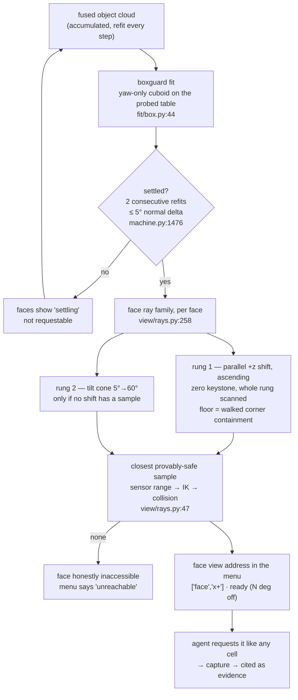

# Sections 6 & 7 — verified context

Collected 2026-09-22 for the Albert progress talk. Every claim below is anchored to
`path:line` or a run artifact under `inspection/data/runs/`. Paths are relative to
`/home/anton/projects/robotics/` unless absolute. Read-only: nothing under
`data/runs/` was modified.

Albert's ask (raised twice): *evidence images must be the most orthogonal view of
the inspected surface, derived from the object's geometry, not from a
geometry-agnostic sphere.* Sections 6 and 7 are the delivery.

---

# Section 6 — Evidence views

Spine: "box primitive fitted; orthogonal face views computed once the fit settles.
The top agent decides which primitive the object is, the runtime applies it. Box
only today."

## Facts

### The fit — boxguard

- `inspection/fit/box.py:44` `boxguard_core(P)` fits a **yaw-only cuboid** to the
  accumulated object-only cloud. Scene-conditioned, not bare point fitting: the
  bottom face sits on the recorder's probed **table plane**, gravity fixes the
  axis (1-DOF yaw search, no twin ambiguity), extents are the **outer fuzz
  envelope** (q99.5-style, never a density mode) — `fit/box.py:2-9`.
- Yaw: min-area AABB seed, then a ±10° wall-sharpness re-search adopted only on a
  ≥15 % sharpness win (`fit/box.py:83-93`).
- `fit/box.py:154` `boxguard_fit(P) -> Decomposition` is the slim contract: one
  `Primitive(kind="box")`, pose = X/Y columns at the refined yaw + Z up, centre at
  mid-height on the table; `params.extents` = [l, w, h] and
  `params.side_conf` = per-face wall-band evidence (`fit/box.py:175-182`).
- Input, live: `run/machine.py:1448` fits `self.acc.points` — the **accumulated
  fused cloud**, refit on every fused step (`run/machine.py:1415-1468`).
  Offline backfill uses the same registry/record/writer over
  `steps/NNN/fused/cloud.npy` (`fit/apply.py:36-40`, `fit/apply.py:65`), so a live
  run and a backfilled one are byte-compatible by construction.
- Closed kind vocabulary: `box · cylinder · plane_patch · superquadric · mesh`
  (`fit/contract.py:32`). Only `box` has a fitter today.

### The settle rule

- Gate: **2 consecutive refits** whose max face-normal delta stays within
  `stable_tol_deg` — `run/machine.py:1476-1494` (`_update_face_gate`), counter
  clamped at 2, gate read at `run/machine.py:1535` (`self._face_stable >= 2`).
- Tolerance: `FACE_STABLE_TOL_DEG_DEFAULT = 5.0` — `view/faceview.py:30`.
- Metric: `view/faceview.py:94` `normals_delta_deg(a, b)` = max angular change of
  any face normal between two fits.
- Any jump **closes** the gate and voids every cached face resolution — the box
  moved, so every achieved off-angle is stale (`run/machine.py:1490-1493`).
- Recorded in the run: `run/app.py:170-176` `face_method()` stamps
  `{"id":"face","kind":"boxguard-face","version":"1","params":
  {"stable_tol_deg":5.0,"cone_max_deg":60.0}}` into `run.json:view_methods`.
  Verified present in every demo run's `run.json` (e.g.
  `data/runs/2209-box-ray-demo4/run.json` lines 30-38).

### Addressable faces

- `view/faceview.py:26` `FACES = ("x+", "x-", "y+", "y-", "top")` — bottom excluded,
  it faces the table. Handles are box-frame and stable under yaw.
- Menu status per face: `run/machine.py:1531-1548` `_face_states()` returns
  `{face: {status, off_angle_deg}}` with status in
  `settling | ready | unreachable | visited`.
- Address form in the loop and on disk: `["face", "x+"]` — parsed at
  `run/machine.py:1803-1812`, recorded at `run/machine.py:1205-1214`, schema at
  `record/schema.py:511-515` (`views_inspected: list[list[int | str]]` — the one
  address site the face build originally missed).

### How a face view is defined

Geometry (`view/faceview.py`), resolution (`view/rays.py`). The split is explicit:
`faceview.py` "resolves nothing" (`view/faceview.py:8-11`, `view/AGENTS.md:31-35`).

- `view/faceview.py:38` `face_frame(prim, face)` → face centre, **outward unit
  normal**, wall extents. *A face normal IS the orthogonal view direction*
  (`view/faceview.py:3-5`).
- `view/faceview.py:47` `face_cam_pose(center, normal, r, roll)` — camera on the
  normal ray, +X boresight at the face.
- `view/faceview.py:65` `face_corners(prim, face)` — the four corners of that wall,
  base frame: the geometry the containment check projects.
- `view/faceview.py:76` `top_align_roll(prim)` — roll that lays the footprint's
  **wider side along the image width**, i.e. the camera rotates *with the box*,
  not with the world axes (Anton 2026-09-21, demo7: the yawed box came back
  diagonal). Alignment holds mod π, so the 180° collision flip keeps it.
- `view/rays.py:258` `face_family(prim, face, fy, height_px)` — the ordered
  candidate rays for one face:
  1. **Parallel shift rung, ascending** (side faces): anchor lifted +z from the
     face centre in `RAY_STEP_M` steps, direction locked to the outward normal.
     A plane parallel to the sensor projects as a pure similarity — **zero
     keystone at any shift** (`view/rays.py:259-290`). Top face: a single exact
     member carrying the yaw-aligned roll pair (`view/rays.py:291-305`).
  2. **Tilt cone**, strictly later: 5°→`CONE_MAX_DEG` in 5° steps × 12 azimuths,
     never from under the table (`view/rays.py:107`, `view/rays.py:306-322`).
- `view/rays.py:379` `resolve_face(...)` — **the whole shift rung is scanned
  before the cone is consulted at all**; the winner is the member whose closest
  valid sample has the smallest depth, ties to the smaller shift. The cone is
  consulted only when no shift member has any sample (`view/rays.py:381-408`).
- **Containment floor, walked not bounded** — `view/rays.py:228` `_contain_depth`:
  each `RAY_STEP_M` grid depth is *checked* by projecting the face's own four
  corners through the real intrinsics at that member's roll; the first containing
  depth is the floor. The half-diagonal formula it replaced stood ~10 cm too far
  off an elongated box's top face (`view/rays.py:228-239`; commit `ae78262`:
  "~13 cm closer on an elongated box"). `_d_contain` (`view/rays.py:213`) survives
  only as the analytic reference the tests pin against.
- `FOV_MARGIN_PX = 14.0` (`view/rays.py:25`) — the D405's principal point is not
  at frame centre (ppy ≈ 356.7 vs 360, measured −2 px corner cuts), so containment
  holds against the real sensor, not the ideal one.

### Why (the design docs)

- `docs/2026-09-14-face-evidence-design.md:5-15` — the goal, verbatim: *"The
  evidence image for an inspected object is the **orthogonal view of the relevant
  face**, derived from geometry — never from a programmed pose. The boxguard
  cuboid already carries the orthogonality: each face's normal IS the orthogonal
  view direction."* Success criterion: *"repositioning the box moves its face
  views with it, and the cited evidence is the orthogonal shot of the coded side."*
  The *stability gate* (`:37-48`) and the *face addresses* (`:17-35`) survive from
  this doc.
- `docs/2026-09-17-ray-views-design.md:8-18` — the **1709 keystone lesson**:
  distance selection had grown into seven interacting mechanisms; face evidence
  views ended 0.28–0.34 m from centre while ring cells sat at 0.24 (40 % farther
  from the surface they inspect), *"and the z-lift ladder then tilted three of
  five faces 35–42° into keystone."*
- `docs/2026-09-17-ray-views-design.md:51-59` — translating the camera is what
  works: *"A vertical plane parallel to the sensor projects as a pure similarity —
  zero keystone at any shift."* Whole-rung scan, shallowest wins, tie-break
  smaller shift (bench amendment 2026-09-17), because *"a shift is optically
  free."*
- `docs/2026-09-17-ray-views-design.md:110-112` — *"Flat-object side faces stay
  servable via the shift rung (~7 cm lift on the 1709 box → fronto-parallel
  instead of 35–42° keystone)."*
- `docs/2026-09-17-ray-views-design.md:121-125` — the **Dies** list: `CLOSENESS`,
  `FILL_TARGET` + extent rules, static `R_MIN`, `derive_r_floor`,
  `max(want, floor)`, frozen shell radius, the face floor, the z-lift rung.

### "Distance emerges"

- No fill target, no extent rule, no closeness slider, no radius floor. The
  sampler's stop conditions replace them all and **the closest provably-safe
  sample wins** — `view/AGENTS.md:43-47`, `view/rays.py:1-6`,
  `docs/2026-09-17-ray-views-design.md:27-35`.
- `view/rays.py:47` `sample_ray(...)` walks depths ascending from the sensor floor
  to `R_MAX`, cheapest check first: sensor min range → IK branches → collision;
  it returns the whole run of the roll whose closest valid sample is closest
  (`view/rays.py:63-72`). Element 0 is always the closest valid sample.
- **A face can be honestly inaccessible.** `resolve_face` returns `None` when no
  family member has a sample (`view/rays.py:409`, `view/rays.py:436`); the
  Supervisor records it as `face_unreachable` and the plan fails with
  `"face inaccessible: no safe sample in its ray family"`
  (`run/machine.py:964-967`). No fallback substitution, no silent degradation
  (`docs/2026-09-17-ray-views-design.md:106-110`).
- **`off_angle_deg` is reported to the model** so it knows how oblique a face view
  is: `run/machine.py:1546-1547` puts `off_angle_deg` (the resolved
  `res.theta_deg`, set at `run/machine.py:973-977`) in every face's menu entry;
  `brain/live.py:108-129` `nav()` returns `"faces": self.sup._face_states()` as
  the fourth set next to reachable/visited/blocked. The prompt renders it as
  `ready (N deg off)` (`brain/loop.py:135-137`).
- Also persisted per step: `steps/NNN/view_state.json` →
  `candidates[].scores.off_angle_deg` (`run/machine.py:1605-1620`).

### "The top agent decides the primitive" — what actually exists

**Verify before saying this on stage: it is design intent, not implemented.**

- `fit/apply.py:36-38` — the registry has exactly one entry:
  `METHODS = {"boxguard": boxguard_fit}`.
- `run/app.py:220` and `run/app.py:395` — `fit: str = "boxguard"` is a **CLI
  default**. It is stamped into the run as `config.json:models.fit`
  (`run/app.py:303`, `run/app.py:469`); verified
  `data/runs/2209-box-ray-demo4/config.json` → `"models": {"vlm":"real",
  "segmenter":"sam3", "fit":"boxguard"}`.
- The Supervisor holds the fitter name as a plain string and dispatches on it
  (`run/machine.py:139`, `run/machine.py:1444-1450`). **No code path lets the agent
  set or change it.**
- The survey agent *does* declare the primitive — in text, for the planner's own
  reasoning: `eyes/agents/survey_agent.py:37-38` ("Its gross shape as a geometric
  PRIMITIVE: a box (say which faces show), a cylinder (wall / top / bottom), a
  sphere, or a composite"), consumed as prose by `brain/loop.py:69-75`. Nothing
  reads that declaration to select a fitter.
- `fit/__init__.py:13` lists `cyl.py — cylguard — the cylinder guard (next)`.
  **The file does not exist.** No cylinder support today.
- Safe phrasing: *"The architecture is ready for it — the fitter is a named
  registry entry and the whole downstream switches on `kind` alone
  (`fit/contract.py:1-9`). Today the runtime is configured to `boxguard` and the
  registry has one entry. Box only."*

### `viewplan/` — status

`inspection/viewplan/` exists and is substantial (~185 KB, 9 modules): the
mesh-based alternative — cloud → mesh → surface samples → normal-offset candidate
cameras → measurability matrix → orthogonality-weighted greedy set cover
(`viewplan/__init__.py:1-8`). It is **offline only**: nothing in `run/`, `brain/`
or `view/` imports its planner; the single live import is
`fit/box.py:48` pulling `viewplan.mesh.table_plane`. One line for the slide:
*"the mesh route is built and parked; the primitive route is what runs live."*

### Refusal → reposition

- The refusal message carries the one fact the model cannot know on its own —
  **plans are stance-dependent**: `brain/live.py:196-209`, verbatim tail:
  *"Plans are stance-dependent: the same view often plans after standing
  somewhere else first. For a face view, move to a numbered cell on that face's
  side of the sphere, then request the face again."*
- Prompt rule: `brain/loop.py:126-132` — *"A refused face is not a dead face …
  make at least one such deliberate reposition before settling for less. If the
  face still never resolves, take the numbered cell most nearly head-on to that
  wall as the closest-to-orthogonal substitute, and say in the answer how far off
  it was."*
- Commit `9418bed` "brain: a refused view teaches the retry that works —
  stance-dependence": *"Demo10 (2026-09-21): face y+ refused twice, and the
  orchestrator retried from wherever it happened to stand, then gave up on the
  face entirely and answered from a suboptimal view."*
- **It works in the runs** (from `ai/000/trace.jsonl`, `tool_result` seqs):
  - `2109-box-ray-demo19`: `["face","y+"]` REFUSED (seq 142) → cell `[3,1]`
    (seq 158) → `["face","y+"]` OK (seq 173), captured at **0° off** (step 007).
  - `2209-smallcam-ray-demo5`: `["face","y-"]` REFUSED (seq 122) → cell `[9,1]`
    (seq 142) → `["face","y-"]` OK (seq 158), **0° off** (step 005).
  - `2209-bigcam-ray-demo5`: `["face","x+"]` REFUSED (seq 100), `[2,1]` refused
    (106), then `[3,1]` → `[9,1]` → `[10,1]`, `["face","x-"]` and `["face","x+"]`
    refused again (175, 180), `[11,1]` refused (211), **`[11,2]` OK (234) →
    `["face","x+"]` OK (249) at 0° off**, then `["face","x-"]` OK (324) at 5°.
  - `2209-box-ray-demo4`: `["face","x-"]` REFUSED (seq 90), not retried — the
    answer used `y-` at 30° off and said so.

## Evidence to show

Absolute paths, run root = `/home/anton/projects/robotics/inspection/data/runs/`.

**Face-view frames — the "orthogonal evidence" images.** Every one of these is a
real capture at a resolved face address; the off-angle is its `view_state.json`
`scores.off_angle_deg`.

`2109-box-ray-demo19/steps/NNN/rgb.png` — all 5 faces, one run:
| step | face | off-angle |
|---|---|---|
| `003/rgb.png` | top | 0° |
| `004/rgb.png` | x+ | 0° |
| `005/rgb.png` | x− | 10° |
| `007/rgb.png` | y+ | 0° (after the reposition) |
| `008/rgb.png` | y− | 25° |

`2209-box-ray-demo4/steps/NNN/rgb.png`:
`003` x+ 0° · `004` y+ 0° · `005` y− 30°.

`2209-smallcam-ray-demo5/steps/NNN/rgb.png` — all 5 faces:
`003` top 0° · `005` y− 0° · `006` x+ 0° · `007` x− 5° · `008` y+ 20°.

`2209-bigcam-ray-demo5/steps/NNN/rgb.png` (status **completed**, not running):
`003` y+ 0° · `004` y− 5° · `009` x+ 0° · `010` x− 5°.

`2109-lan-ray-demo16/steps/NNN/rgb.png` — all 5 faces, 4 of them at 0°:
`003` y+ 25° · `004` x+ 0° · `005` y− 0° · `006` x− 0° · `007` top 0°.

`2209-box-ray-demo1/steps/004/rgb.png` — x+ 0°.

**Evidence crops (what the card actually ships).** All verified present on disk:
- `2109-box-ray-demo19/ai/000/artifacts/004_01_crop.png` — the x+ side labels
  (barcode, `A00110-INTL`, `MADE IN CHINA`, CE/FC; vertical `VATI`,
  `AAB0007-0001`, QR).
- `2109-box-ray-demo19/ai/000/artifacts/003_01_crop.png` — the top `AI KIT` label.
- `2109-box-ray-demo19/ai/000/artifacts/007_01_crop.png` — a blank y+ wall (the
  "we looked and there is nothing there" citation).
- `2109-lan-ray-demo16/ai/000/artifacts/006_01_crop.png` — NETGEAR front panel,
  `GS308EPP`, 8 ports, yellow PoE+ band.
- `2109-lan-ray-demo16/ai/000/artifacts/004_01_crop.png` — rear ID sticker, MAC +
  serial + 54 V ⎓ 2.4 A jack + Kensington slot.
- `2109-lan-ray-demo16/ai/000/artifacts/007_01_crop.png` — white NETGEAR wordmark
  on the black top cover.
- `2209-box-ray-demo1/ai/000/artifacts/004_01_crop.png` — the VBTI serial label.
- `2209-box-ray-demo4/ai/000/artifacts/005_01_crop.png` — the VBTI serial label,
  read from a 30°-off face view.
- `2209-smallcam-ray-demo5/ai/000/artifacts/007_01_crop.png` — the D3 spec label
  (P/N, REV, S/N, config line, DataMatrix).
- `2209-smallcam-ray-demo5/ai/000/artifacts/003_01_crop.png` — the DESIGNCORE
  brand sticker.
- `2209-bigcam-ray-demo5/ai/000/artifacts/009_03_crop.png` — the Intel L515 code
  label, read head-on after the `[11,2]` reposition.

**Bench renders** — `inspection/investigation/ray_views/evidence/`:
- `1709-demo1_frames_faces.png` (1430×2035) — **the single best "before/after"
  picture for this section.** Five rows, one per face (y−, x+, x−, y+, top). Left
  = the run's real `rgb.png` with the boxguard wireframe projected through the
  *recorded* camera pose (yellow ring = the face of interest); right = the same
  wireframe through the **ray endpoint** camera with the old footprint ghosted
  grey. Titles carry the resolved `θ / shift / depth` and the **face-area gain**:
  y− ×3.2 (θ=10°, d=0.14), x+ ×2.4 (θ=0°, shift=0.04, d=0.16), x− ×3.6 (θ=10°,
  d=0.16), y+ ×0.9 (θ=30°, d=0.26), top ×1.4 (θ=0°, d=0.20). Panel layout
  documented at `investigation/ray_views/frame_render.py:1-9`, `:85-131`.
- `1709-demo1_comparison.png` (2100×1008) — two 3D panels (oblique + top-down) of
  the same scene: grey dots = the old executed cameras, green = ray endpoints on
  the θ=0 shift/exact rung, orange = cone-rung endpoints, dashed lines join each
  pair, faint circle = the old 0.24 m shell. Title: *"1709-cam-ai-demo1 — old
  endpoint vs ray endpoint (10/11 closer to the surface; obstacle = boxguard box
  +0 cm, faint ring = old 0.24 m shell)"*. **This is the picture that kills the
  fixed-radius sphere** — the green dots sit inside the ring, per-address.
  `investigation/ray_views/ray_replay.py:595-636`.
- `1709-demo1_comparison_guard.png` — same plot under the *live planner's actual
  collision world* (`geometry.object_box` on the fused cloud) rather than the
  boxguard belief box; that is the run reported in `bench_summary.txt` (9/11
  closer). Use whichever matches the caption you write; do not mix the two counts.
- `1509-cam-bench5_frames_faces.png`, `1509-lan-bench5_frames_faces.png` — the
  same five-row face render for two more benched runs (both 1430×1628).
- `bench_summary.txt` — the numbers table behind all of the above.

## Numbers

**Constants (all verified in code):**
| what | value | where |
|---|---|---|
| ray depth & shift step `RAY_STEP_M` | 0.02 m | `view/rays.py:18` |
| sensor floor `MIN_RANGE_M` (D405 @ 720p) | 0.105 m | `view/rays.py:20` |
| outer bound `R_MAX` | 0.40 m | `view/grid.py:27` |
| FOV containment margin | 14 px | `view/rays.py:25` |
| tilt cone | 5° steps, max 60°, 12 azimuths | `view/rays.py:107` |
| face stability tolerance | 5.0°, 2 consecutive refits | `view/faceview.py:30`, `run/machine.py:1489` |
| camera roll set | {0, π} | `view/AGENTS.md:52-61` |
| cell grid | 12 azimuths × elevations 10/40/70° | `view/grid.py:16-17` |
| addressable faces | 5 (bottom excluded) | `view/faceview.py:26` |

**Face views actually captured across the six demo runs: 23.**
- **15 of 23 at exactly 0° off** — resolved on the fronto-parallel shift rung.
- **19 of 23 at ≤ 10° off.**
- The remaining 4 sit at 20–30° (demo19 y− 25°, box-demo4 y− 30°, smallcam y+ 20°,
  lan16 y+ 25°) — all well under the 60° cone cap, and each one is *declared* in
  the answer text.
- Worst off-angle over all 23: **30°**.

**Bench, ray endpoint vs the old fixed-position path** (`bench_summary.txt`,
`--world guard` = the live planner's real collision world):
| run | views closer | mean surface distance |
|---|---|---|
| 1709-cam-ai-demo1 | 9/11 | 0.194 → 0.158 m |
| 1509-cam-ai_bench5 | 7/9 | 0.190 → 0.158 m |
| 1509-lan-ai_bench5 | 9/10 | 0.249 → 0.184 m |
| 1509-cam-ai_bench4 | 1/1 | 0.150 → 0.133 m |
- 0 inaccessible addresses, 0 endpoints inside the box, sensor floor respected on
  every executed row, in all four runs.
- The keystone fix, 1709 demo: **old face tilts y−=40°, x+=9°, x−=34°, y+=40°,
  top=0°** → the ray family resolves 2 of 5 fronto-parallel and the rest on the
  shallow cone.
- Whole-rung scan vs first-hit (`view/rays.py:393-404`): on the 1709 box `x+`
  resolved at shift 0 / depth 0.30 while shift 0.04 held a sample at 0.14 —
  **16 cm of standoff**, and the same pattern (12–20 cm) in all four benched runs.
  Cost of scanning the whole rung: 10–27 ms.

**Compute budget** (measured, `bench_summary.txt`):
- 36-cell accessibility refresh: **168–186 ms** (design estimate 230 ms).
- Face shift rung: 48–66 ms. Full side cone (67 members): 640–847 ms. Top cone
  (145 members): ~1.0–1.1 s.
- One ray validity check: ~5 ms (10–13 depths, mean ~12).

**A real fit** (`2209-box-ray-demo4/steps/005/decomposition.json`): method
`boxguard` v3, 9 300 points, extents **112.4 × 221.7 × 93.0 mm**,
`side_conf {x+: false, x-: true, y+: true, y-: true}`.

## Diagram

**Text version.** Fused object cloud → boxguard fits a yaw-only cuboid, bottom on
the probed table, gravity fixing the axis → the fit must *settle*: two consecutive
refits whose face normals move less than 5°; until then the five faces show as
`settling` and cannot be requested → once settled, each face gets a **ray family**:
first the parallel-shift rung (camera translated up the face's own normal ray in
2 cm steps — zero keystone at any shift), whole rung scanned, each member floored
at the depth from which that face's own four corners are provably in frame; only
if no shift member has a safe sample does the 5°→60° tilt cone get consulted →
along whichever ray wins, the **closest provably-safe sample** is taken (sensor
min range, then IK branches, then collision — no fill formula anywhere) → that
becomes the face view's address in the agent's menu, carrying its off-angle; if
nothing is safe, the face is honestly inaccessible and says so.

## Claims to avoid

- **Do not mention the fixed-radius viewsphere, `R_MIN`, `derive_r_floor`,
  `FILL_TARGET`, `CLOSENESS`, or the z-lift rung as live mechanisms.** All deleted
  in Stage D — commit `48fd128` ("view: the fixed-position viewsphere dies"),
  which removed `derive_r_floor`, `cell_reachable`, `plan_to_cell`, `FILL_TARGET`,
  `EXTENT_RULE`, `CLOSENESS`, `R_MIN`, `radius_for_extent`, `face_radius` and the
  exact/z-lift/cone ladder. Grep confirms zero occurrences in `view/`, `run/`,
  `brain/`, `motion/`, `cell/`. `DEFAULT_R` survives only as the radius the cell
  markers are *drawn* at before any ray depth resolves (`view/grid.py:23`).
- **Do not say the agent picks the primitive.** Not implemented (see above). Say
  "the runtime is configured to boxguard; the registry is the seam where a second
  primitive plugs in."
- **Do not claim cylinder support.** `fit/cyl.py` does not exist.
- **Do not present `docs/2026-09-14-face-evidence-design.md`'s resolution ladder
  as current.** Its §"Request-time resolution ladder" (`:65-`) and its
  `radius_for_extent` / `R_MIN` face radius (`:23-26`) were superseded by
  `2026-09-17-ray-views-design.md`. Cite the 09-14 doc for the *goal* and the
  *gate*, not the mechanism.
- **Do not mix the two bench worlds.** `1709-demo1_comparison.png` says 10/11
  closer (boxguard belief box as obstacle); `bench_summary.txt` and
  `..._comparison_guard.png` say 9/11 (the live planner's real collision world).
- **Transparent / reflective objects are out of scope** — nothing in the fit or
  the segmenter addresses them; every demo object is an opaque cardboard or
  plastic box.
- Do not say a face view is "always orthogonal". It is the *most orthogonal
  reachable* view, and the system reports how far off it is.

---

# Section 7 — The answer

Spine: "verdict + structured fields + cited evidence images. A citation = a hunt;
a miss bounces the answer."

## Facts

### The `answer()` tool

- Declared at `brain/loop.py:669-681`. Argument shape:
  `{"reasoning": str, "verdict": str, "evidence": str, "evidence_cells": list,
  "fields": dict}`.
- `evidence_cells` — up to three citations, each **exactly**
  `{"cell": [h, v] or ["face", name], "find": "what the picture must show"}`,
  *"never a plain string"* (`brain/loop.py:670-673`). The canonical shape string
  lives once, at `brain/loop.py:370-371`, and is quoted verbatim in every bounce
  "so a retry cannot guess wrong twice".
- `fields` — *"the STRUCTURED readout for the answer card: every code, serial,
  model number, count or state you actually established, as flat JSON
  key→value … Only values read from pixels — omit anything you did not establish"*
  (`brain/loop.py:674-679`).
- Prompt-side contract, `brain/loop.py:89-98`: *"evidence_cells names where the
  PROOF is … For a YES cite the feature itself; for a NO cite the surfaces that
  would have shown it, so the record proves you looked."*
- Shape mismatch handled at one boundary: the model writes `evidence` as one prose
  blob, `AnswerRecord.evidence` is `list[str]`, converted at
  `brain/loop.py:513-520` (`_answer_record`).

### What a citation does

- **One evidence hunt per citation**, on the cited captured view —
  `brain/loop.py:395` `_collect_evidence`, hunts dispatched at
  `brain/loop.py:447` (`hunt_evidence`). The hunts run *inside* the answer call
  (`brain/loop.py:684-690`).
- **The hunter is deliberately not told the verdict** —
  `eyes/agents/evidence_agent.py:9-11`, verbatim: *"It is deliberately given no
  `hypothesis` and never the verdict: a hunter told the expected answer is under
  confirmation pressure, and the honest miss is the whole point."*
- The hunt is locate → **verify** → frame, in one frame only
  (`eyes/agents/evidence_agent.py:29-39`); *"Answering 'not found' honestly is a
  fully successful hunt — never stretch"* (`:51-53`). Tools: detect, segment,
  read_text, crop (`:86-87`); budget 16 turns (`:22`).
- **Crop chosen by number, never by path**: the loop numbers every image it hands
  over, the model echoes `evidence_image: N`, and the harness resolves N back to
  the saved path — *"The model echoes a digit it just read; no model ever authors
  a file path"* (`eyes/agents/evidence_agent.py:13-16`,
  `evidence_agent.py:114-131`).
- Record shape: `{cell, find, found, report, crop, frame, transcript,
  transcript_id}` (`eyes/agents/evidence_agent.py:134-142`). `frame` is the "we
  looked here" receipt, **present even on a miss**.
- **A FRESH miss bounces the whole answer** — `brain/loop.py:466-472`: the bounce
  names each gap and says *"The run is not over: move to a view that shows it,
  cite a different view, or answer again citing the same hunt to ship with the gap
  on record."* Cached hunts are reused (`brain/loop.py:434-437`), so **re-citing a
  missed hunt is the explicit "ship with the gap on record"**, and a re-answer
  pays only for what it newly cites (`brain/loop.py:400-404`).
- **Malformed citations bounce, never get dropped** — `brain/loop.py:414-432`,
  rationale at `:406-409`: *"demo11 (2026-09-21) shipped an answer with ZERO
  evidence images because every string-form entry was dropped on the floor and
  nothing was left to miss — and the card's images are the point of the
  citation."* The string form a retry actually produced ("face x+ : the white
  product label …") is coerced back into a citation at `brain/loop.py:373-393`.
- Face citations pass through as `("face", name)` rather than the int-pair
  coercion, *"which raised on the name and silently dropped every face citation an
  answer tried to make"* (`brain/loop.py:419-425`).
- **A crashed hunt bounces with the casualty named** — `brain/loop.py:446-462`:
  `"the evidence hunt at {cell} failed ({exc}). Cite it again, or cite another
  view."` Rationale: *"the SDK handed the model a raw error, and the model's retry
  degraded to string citations. The honest surface is a bounce that names the
  casualty and keeps the run alive — never an unexplained tool error."*
- **Fixed today (commit `884d895`, 2026-09-22 12:56):** *"eyes: a garbled evidence
  list never crashes a finished hunt — demo4's bounce."* In
  `2209-box-ray-demo4` the hunt at `["face","y+"]` had *succeeded* — three turns, a
  crop, an OCR read, `done` at trace seq 150 answering *"found — blank cardboard
  face of the box in the center of the table with no labels or text"*, citing
  image 1 — and then the next line raised
  `TypeError('sequence item 0: expected str instance, list found')` because the
  model returned a nested list as evidence item 0. The answer bounced (seq 151-152)
  and no transcript was written (`transcripts/` stops at `t008`). Fix: normalise
  `evidence` to strings once, at the parse boundary —
  `eyes/agents/vlm_agent.py` `_evidence_text` / `_normalise_evidence`, same
  standing decision as `normalise_evidence_image` (2026-08-26). Tests:
  `tests/test_vlm_agent.py::test_a_garbled_evidence_item_never_breaks_the_summary`
  and `::test_a_nested_evidence_list_does_not_bounce_a_finished_hunt`.
  **You can show this bounce live in the demo4 trace** (see below).
- Write order: `answer.json` is written **first**; only a stored answer ends the
  run (`brain/loop.py:492-511`). `record/ai_writer.py:109-112` is the pen;
  `AnswerRecord` is `record/schema.py:497-516`
  (`verdict, reasoning, evidence, fields, evidence_images, step_ids,
  transcript_ids, views_inspected, coverage`).
- A hunt that produced no image at all is dropped from `evidence_images` only
  there, at `_answer_record` — the full record stays in the trace and in the
  transcript, *"the answer simply does not claim a picture it does not have"*
  (`brain/loop.py:527-531`).

### The card

- `ui/src/panels/TracePanel.tsx:853-859` — `answer()` is not instant; until the
  tool result lands the block reads as **stages**, with *no verdict text and no
  images*: *"the text appearing before the evidence made the answer look done
  while it was still being verified"* (Anton 2026-09-21).
- `TracePanel.tsx:765-808` `AnswerStages` — one row per cited hunt, checked off as
  its `evidence` event lands, the active row carrying the hunter's live step
  counter (`n/of`), then a closing **"compose card"** stage.
- `TracePanel.tsx:811-851` `AnswerCard` — renders **once, whole**: the
  `answer` label, the verdict line, the field rows (`trace-card-fields`, one
  `key / value` row per `fields` entry), then the evidence image strip. Falls back
  to the call args and the result strip for runs recorded before `fields` existed.
- `TracePanel.tsx:891-895` — a **bounced** answer renders as `answer · bounced`
  plus the reason. An attempt on record, never a verdict.
- Commit `19e60e1` "answer: the verdict is a card — stages while it runs, the whole
  thing once" — three parts: the prompt rulings, `fields` on the `answer()` tool,
  and the staged/whole-card UI.
- Commit `5013157` "answer: the card gets its images, and its block appears on
  invocation" — demo11's card came out imageless and the block sat invisible while
  the model generated its verdict. Three causes/fixes: crashed hunt now bounces
  with the casualty named; malformed citations coerce or bounce (never dropped);
  a `tool_start` event fires off the stream's `content_block_start` so the block's
  shell ("writing the answer…") renders the instant the model begins the call.

### Prompt rules that shape evidence quality

`brain/loop.py:112-138`, the FACE VIEWS block:
- *"FIND THE BEST VIEW BEFORE MINING A MEDIOCRE ONE: the face views are the best
  looks this workspace can give — head-on, as close as the arm can safely stand —
  and they are where evidence comes from."* (`:114-117`)
- *"Numbered cells buy coverage and settle the box early; their oblique looks
  MISREAD (a run read 'Made in Italy' off an oblique cell where the face view read
  'MADE IN CHINA')."* (`:117-119`)
- *"A detail — text, label, barcode, small feature — is read from the face that
  owns it. **A read off an oblique view is a lead, not evidence**: it tells you
  WHERE to look, never yet WHAT is written."* (`:120-122`)
- *"Labels, codes and serials are read at orthogonal or near-orthogonal, or they
  are misread. **Never cite text from a view you know is oblique.**"* (`:133-134`)
- Pinned by test — commit `a2db938`, `tests/test_live_faces.py`
  `test_prompt_mentions_face_priority` now asserts the normative wording, not the
  old advisory "mainly".
- The face view even announces itself to the hunter: `eyes/tools.py:259-261`
  renders a face capture's provenance as
  `"face view · x+ · orthogonal evidence pose · dir NNN"`.

## Evidence to show

### Real answers (read-only). Path: `data/runs/<run>/ai/000/answer.json`

**`2109-box-ray-demo19`** — question *"inspect this box"*, 5 face views.
- verdict: *"A sealed brown corrugated cardboard shipping box for a 'VATI AI KIT'.
  Top face: white square label with a three-open-ring logo and 'AI KIT'. One long
  side: upper label with barcode, 'A00110-INTL', 'MADE IN CHINA' and CE/FC/
  recycling/WEEE marks; lower label with vertical 'VATI', unit code
  'AAB0007-0001' and a QR code. The other three walls are blank cardboard; flaps
  taped shut; one corner dented."*
  *(Note: it read the wordmark as "VATI", not "VBTI" — worth owning on stage if
  you show this one; demo1 and demo4 read the same label correctly as "vbti".)*
- evidence text: *"Face views held: top (0° off) shows the AI KIT label; x+ (0°
  off) shows both printed labels with all codes; y+ (0° off) and x− (10° off) show
  blank cardboard walls, establishing that the printing is confined to the x+
  side."*
- `fields` (14): object, top_label_text `AI KIT`, top_label_logo, brand `VATI`,
  product_code `A00110-INTL`, unit_code `AAB0007-0001`, origin `MADE IN CHINA`,
  regulatory_marks, barcode, qr_code, labeled_faces `top and one long side (x+)`,
  blank_faces `3 (x-, y+, y-)`, seal_state `taped shut`, condition.
- `evidence_images`: `artifacts/004_01_crop.png` (t014, step 4),
  `artifacts/003_01_crop.png` (t015, step 3), `artifacts/007_01_crop.png` (t016,
  step 7) — all three from face views, all `found`.
- coverage: `3/36 cells seen … 5 face views captured`.

**`2109-lan-ray-demo16`** — the NETGEAR switch. **The conflict-declaration story.**
- verdict: *"The object is a NETGEAR GS308EPP — an 8-port Gigabit Ethernet Plus
  PoE+ desktop switch … Rear: 54V ⎓ 2.4A DC input, Kensington lock slot, and a
  white label (MAC 04:07:7D:2C:03:5E, serial 6JF04B5PA019B; **its model line was
  read as 'GS305EPP V1', which conflicts with the front panel and the eight
  physical ports**)."*
- reasoning, verbatim: *"**The rear sticker's model digit conflicts with the front
  panel; the physical evidence decides it** — there are eight jacks, labelled 1
  through 8, and the 54V/2.4A (~130 W) adapter rating matches the 8-port PoE+
  model, not the 5-port one, so the small-print '5' is a misread of the tiny
  sticker and the device is the GS308EPP."*
- `fields` keeps **both readings side by side**: `model_front_panel: GS308EPP`
  and `model_rear_sticker_as_read: GS305EPP V1` — it did not quietly pick one.
  Plus port_count `8`, port_labels `1-8`, poe_marking `PoE+ 30 watts/port max`,
  led_labels, power_led `green / on`, other_front_markings `Reset`, dc_input
  `54V 2.4A`, mac `04:07:7D:2C:03:5E`, serial `6JF04B5PA019B`, rear_features
  `Kensington lock slot`, cables_connected `0`.
- evidence text: *"Front face head-on (0° off) shows model text and 8 numbered
  PoE+ ports; rear face head-on shows the power rating and ID sticker; top face
  head-on shows the NETGEAR wordmark."*
- `evidence_images`: `artifacts/006_01_crop.png` (t015, step 6 = face x−),
  `artifacts/004_01_crop.png` (t016, step 4 = face x+),
  `artifacts/007_01_crop.png` (t017, step 7 = face top).
- 5 face views captured, **4 of them at 0° off**.

**`2209-box-ray-demo1`** — *"inspect this box, what is the VBTI serial number?"*
- verdict: *"The VBTI serial number is AAB0007-0001, printed on the small white
  VBTI label (with QR code) at the lower-left of the box's x+ side face."*
- reasoning carries a **self-correction**: *"My earlier third citation to [7,1] for
  a blank opposite side was mis-stated — that view showed the top, one long side
  and one short side — so I drop it."*
- `fields`: vbti_serial `AAB0007-0001`, label_location, top_sticker_text `AI KIT`.
- `evidence_images`: `artifacts/004_01_crop.png` (t009, step 4 = face x+, 0° off),
  `artifacts/001_03_crop.png` (t007, step 1 = cell [1,2]).
- Only **1 face view** in the whole run — the serial was settled from it alone.

**`2209-box-ray-demo4`** — same question, and the run where the answer **bounced**.
- verdict: *"The VBTI serial number is AAB0007-0001."*
- evidence text: *"From the [\"face\",\"y-\"] orthogonal face view (closest
  reachable, **30° off head-on**), the white sticker reads 'vbti' sideways at left
  with the serial 'AAB0007-0001' beside it and a QR code alongside; the sticker is
  fully in frame and sharp."* — the obliquity is *declared*, exactly as
  `brain/loop.py:130-132` requires.
- `fields`: vbti_serial `AAB0007-0001`, label_wordmark `vbti`, top_label `AI KIT`.
- `evidence_images`: one — `artifacts/005_01_crop.png` (t008, step 5).
- **The bounce, in the trace** (`ai/000/trace.jsonl`): seq 145-150 the `y+` hunt
  crops, OCRs, and finishes *"found — blank cardboard face of the box in the
  center of the table with no labels or text"*; seq 151
  `"evidence hunt at ['face','y+'] crashed: TypeError('sequence item 0: expected
  str instance, list found')"`; seq 152 tool_result `failed: true`,
  `"the evidence hunt at ['face','y+'] failed (…). Cite it again, or cite another
  view."`; seq 154 `tool_start answer`; seq 158 `"run complete"` with one image.
  **Fixed this morning by `884d895`** — that hunt would now ship its crop.

**`2209-smallcam-ray-demo5`** — *"inspect and give the complete spec of this
camera"*. The densest card.
- verdict: *"Complete spec, as printed on the box: D3 Embedded DESIGNCORE®
  CAMERA — P/N D3CMC74N-089-084-S, REV \"-\", S/N 52515. Configuration line:
  \"D3CM, 234, BGGR, 9295, 101HFOV, 64D\" = D3 Camera Module, AR0234 image sensor,
  BGGR Bayer color filter array, MAX9295 GMSL2 serializer, 101° HFOV / 64° second
  FOV figure. …"*
- **An honest abstention inside the answer**: *"only a sub-pixel label-stock number
  runs along its left edge, and repeated reads disagreed (1001222 / 1000229 /
  3002329), so I do not report it as established."*
- `fields` (15): brand, product_line, part_number `D3CMC74N-089-084-S`, revision
  `-`, serial_number `52515`, config_line, module_type, image_sensor
  `AR0234 (234)`, color_filter_array `BGGR`, serializer `MAX9295 (GMSL2)`, hfov
  `101 deg`, fov_second `64D`, machine_readable_code, origin, other_faces.
- evidence text: *"The x− face view (orthogonal, 5° off) shows the white spec label
  with the full part number, revision, serial and configuration string plus a
  DataMatrix. The top face view shows the black DESIGNCORE CAMERA brand sticker …
  The y− face view shows a blank wall, establishing that no second spec label
  exists there."*
- `evidence_images`: `artifacts/007_01_crop.png` (t016, step 7 = face x−, 5°),
  `artifacts/003_01_crop.png` (t018, step 3 = face top, 0°),
  `artifacts/005_01_crop.png` (t019, step 5 = face y−, 0°).
- 5 face views captured, 3 of them at 0°.

**`2209-bigcam-ray-demo5`** — *"inspct this vam, what are the serial numbers?"*
(typo in the question, answered anyway). Status: **completed**.
- verdict: *"One code label only, on the box's end panel (face x+). Numbers: B/N
  (batch/serial) F0244802, Product Code 82638L515G1PRQ, MM# 999NGP, plus UPC and
  EAN barcodes; \"Made in Thailand\". No separate S/N sticker appears on any other
  face."*
- reasoning is **the reposition story, told by the model itself**: *"The single
  white code label sits on one end panel, first seen obliquely from [9,1]/[10,1] —
  where reads were inconsistent (\"P024A003\"/\"P02AA003\") — so I repositioned via
  [11,2] and captured the orthogonal [\"face\",\"x+\"] view. **At 0° off head-on
  the label reads, twice consistently**: … / Product Code: 82638L515G1PRQ / B/N:
  F0244802 / MM# 999NGP / Made in Thailand."* It also corrects the *kind* of
  number: *"The unit number is printed as B/N (batch number), not S/N."*
  **This is the single strongest slide for Albert's ask**: two oblique reads
  disagreed, the orthogonal face view settled it.
- `fields` (6): product, batch_serial_B/N `F0244802`, product_code
  `82638L515G1PRQ`, MM# `999NGP`, origin `Made in Thailand`, labels_found
  `1 (end panel, face x+)`.
- `evidence_images`: `artifacts/009_03_crop.png` (t015, step 9 = face x+, 0°),
  `artifacts/003_01_crop.png` (t018, step 3 = face y+, 0°),
  `artifacts/005_01_crop.png` (t019, step 5 = cell [3,1]).
- coverage: `6/36 cells seen … 4 face views captured`.

### The card screenshots Anton already took

`inspection/docs/demo/pictures/` — viewed, captions verified against the pixels:

- **`card_aikit.png`** (825×322) — the `2209-box-ray-demo4` card: verdict line
  *"The VBTI serial number is AAB0007-0001."*, three field rows
  (VBTI_SERIAL / LABEL_WORDMARK / TOP_LABEL) in mono, and one evidence crop
  underneath — the white sticker, sideways "vbti" wordmark, the serial in large
  print and the QR code. Caption: *"one citation, one hunt, one crop — the serial,
  read off a face view."*
- **`small_cam.png`** (791×836) — the `2209-smallcam-ray-demo5` card: a long
  verdict paragraph (the full D3 spec), **fifteen** field rows from BRAND down to
  OTHER_FACES, and a three-image evidence strip: the white spec label crop, the
  blue/black DESIGNCORE CAMERA sticker with the US flag, and a blank cardboard
  wall. Caption: *"a complete spec read off three orthogonal face views — including
  the blank wall that proves there is no second label."*
- **`bigcam_card.png`** (763×467) — the `2209-bigcam-ray-demo5` card: verdict
  naming the single end-panel label, six field rows (PRODUCT / BATCH_SERIAL_B/N /
  PRODUCT_CODE / MM# / ORIGIN / LABELS_FOUND), and a three-image strip: the
  barcode label read head-on, the L515 wordmark face, and the box from an oblique
  cell. Caption: *"the head-on face view settled a code that two oblique reads
  disagreed about."*

(Also in that folder, not requested for these sections: `compute_card.png`,
`badtcp.png`.)

## Numbers

- **6 answers examined, 15 evidence citations total, 15/15 `found`.**
- **13 of the 15 citations are face views**; 2 are numbered cells
  (`2209-box-ray-demo1` step 1 = `[1,2]`, `2209-bigcam-ray-demo5` step 5 = `[3,1]`)
  — both cited for *absence* ("no serial here"), never for reading text.
- `fields` per card: 3 (box-demo1, box-demo4) · 6 (bigcam) · 14 (demo19) ·
  14 (lan16) · 15 (smallcam).
- Evidence-hunt budget: 16 turns (`eyes/agents/evidence_agent.py:22`); citations
  capped at 3 per answer (`brain/loop.py:90`, `brain/loop.py:670-671`).
- Bounces on record in these runs: **1** — `2209-box-ray-demo4` seq 151-152, the
  crashed hunt, fixed by `884d895` today.
- Refusals on record: 9 across the six runs, of which 3 led to a successful
  reposition-then-face (see Section 6).

## Claims to avoid

- Do not say a missed hunt is "dropped" or "ignored" — it **bounces**, and a
  re-citation ships the gap *on record* (`brain/loop.py:400-404`).
- Do not say the hunter checks the verdict. It is never told it
  (`eyes/agents/evidence_agent.py:9-11`).
- Do not say the model picks the crop file. It echoes an image *number*; the
  harness resolves the path (`eyes/agents/evidence_agent.py:13-16`).
- Do not claim `2209-box-ray-demo4` shipped three evidence images — it shipped
  **one**, because of the crash that `884d895` fixed. If you show that card, the
  honest line is "this is the run that found today's bug."
- Do not present `2109-box-ray-demo19`'s `brand: VATI` as a correct read; it is an
  OCR slip on the same label demo1/demo4 read as "vbti".
- The GS305EPP/GS308EPP case is a **declared conflict resolved by physical
  evidence**, not a "the model was right about the sticker" — the sticker really
  does read GS305EPP in the crop; the model argued from the eight ports and the
  54 V/2.4 A rating.

## Open questions for Anton

1. `2109-box-ray-demo19` reads the brand as **VATI**, while `2209-box-ray-demo1`
   and `demo4` read the same label as **vbti**. Which do you want on the slide —
   or do you want to show the disagreement as an honest-failure example?
2. `bench_summary.txt` was produced by
   `p inspection/investigation/ray_views/ray_replay.py --run all --world guard`
   on the 1509/1709 bench runs, i.e. **before** the 2109/2209 demo runs. If you
   want bench numbers for a demo-era box, that re-run has not been done (and I did
   not run it — it is a compute job).
3. `2209-bigcam-ray-demo5`'s question is typed `"inspct this vam, what are the
   serial numbers?"`. Show verbatim (it is a nice robustness point) or paraphrase?
4. Which of the two 1709 comparison renders do you want on the slide —
   `1709-demo1_comparison.png` (boxguard belief box as obstacle, **10/11 closer**)
   or `1709-demo1_comparison_guard.png` (the live planner's real collision world,
   **9/11 closer**)? They are different worlds and the counts differ.
