# AI-driven inspection on a UR5e: project report

## 1. Introduction

Hand a human inspector any object and they know what to do with it: where to look,
what to check, how to adapt when the object is not what they expected. But humans are
slow, and expensive. Robot inspection is the
opposite: fast and scalable, but tied to one object and one program,
and not robust to anything outside that program. The idea behind this project is to
bring the two together, the efficiency of the robot with the robustness of human-like
cognition, into autonomous AI inspection.

This work is a research branch running parallel to ADAM, VBTI's inspection robot. Its
aim is an even higher level of autonomy in inspection.

The problem we set ourselves: **given any object and any question about it, the robot
should understand the question, plan and execute the movements that gather the
information, answer the question, and provide the evidence that proves the answer is
correct.** No path is programmed per object, and no code names the object or the
question.

This report describes the proof of concept built for that problem between 12 August
and 22 September 2026. It covers what we took on and what we left out, how the system
works, what was achieved, its limitations, the insights we take from it, and the
directions for the next phase.


## 2. Scope of the proof of concept

**Problem formulation.** We did not treat this as a robot-motion problem. The
inspection is a sequence of steps over view positions around the object: at each step
the system decides where to look next, moves there, and reads what it sees. It is not
a continuously moving robot that decides in real time. The robot motion itself was
taken as given, solvable with existing motion planning methods; the task was to build the views and the machinery to
select among them. In short, a view-selection decision problem.

**Success criterion.** For this first phase the criterion was qualitative: the system
should work end to end on real objects, and the people watching the demo should come
away with the feeling that this is reasonable and might actually work. Measuring the
system quantitatively was not part of this phase.

**Boundaries set on day one:**

- one object on a table;
- questions that can be answered from the visible surface of the object: labels,
  codes, markings, counts, the presence of a feature;
- no training or fine-tuning of any model. Every model is used as shipped.

**Deliberately left out:**

- **Vision-language-action models.** Motion planning and execution use traditional
  methods. That machinery exists and works, so a learned policy was not needed to
  reach the demo.
- **Simulation.** Everything was developed and tested in the real world, on the real
  arm.

## 3. How the system works

### 3.1 The setup

The robot is a Universal Robots UR5e, a six-axis collaborative arm, mounted on a table.
On its wrist sits an OnRobot RG2 gripper. The gripper never grasps anything; it carries
the camera. The camera is an Intel RealSense D405, a short-range stereo camera that
delivers a colour image and a depth image of the same view. Everything the system sees
comes from this one camera on the wrist.

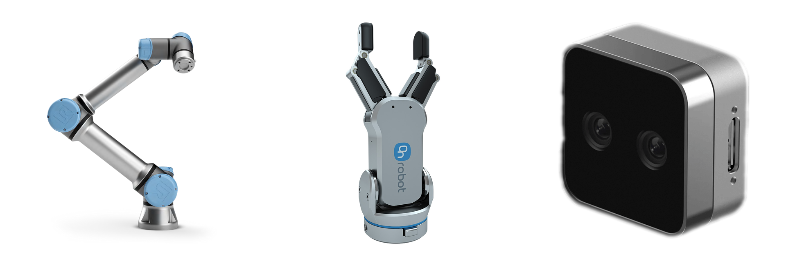

The table in front of the robot is the inspection area. We put one object on it: a
product box, a small industrial PC, a ball. Then we type a question about the object:
"what is the serial number on this box?", "how many green dots are on the side of the
object?", "inspect this device and give its complete spec".

From that moment the system is on its own. It looks at the object, decides where to
look next, moves the camera there, reads what it sees, and keeps going until it can
answer. A person sits at the operator screen and approves each movement before the arm
executes it, as a safety measure; the person does not help with the inspection itself.
The arm never touches the object.

Behind the scene a workstation runs the perception, the geometry, the motion planning
and the robot control, together with the local models for detection, segmentation and
text reading. The two reasoning models, the main agent and the vision agent, run as
cloud services.

### 3.2 Motivation

In AI for robotics we often do not distinguish the intelligence from the motion. Robots
were trained to execute motions, and the motion itself came to be perceived as the
intelligence. That is not the framing I want to see. There is a distinction between
*what* to do and *how* to do it: the higher-level reasoning and the lower-level
execution. I want to decouple the two, so that it becomes possible to judge separately
how reasonable an action is and how well the robot executes it. An intelligent robot,
to me, is one that plans the sequence of actions properly, perceives the state of the
world correctly and adapts to changes. A precise robot is one that executes the actions
it was told. These are two different qualities, and they deserve two layers.

So I see a two-layer structure: a reasoning layer that decides what to do, and an
execution layer that does it. Between them sits a protocol: general reasoning on top,
clear commands to the robot to move in the physical world below. In terms of the AI
systems of 2026 this is a harness. A model reasons and calls tools, and the tools are
the commands that let the robot act in the physical world. The decision to move the arm
or to go to a different location is one such tool call.

This is the direction I expect robotics development to take in the near future, and
the main reason I want to develop this system in the form of a robot AI harness. The
reasoning loop can be taken off the shelf. The engineering work is the harness: the
tools, the robot integration, the perception logic, the monitoring, the safety. The
sections that follow describe that harness.

### 3.3 The inspection loop

On the process level: the system reconstructs the 3D object being inspected and generates the best set of
viewpoints for inspecting it. An AI agent picks the viewpoint for the next capture. The
captured image is analysed by a vision agent, which collects all the details it can see
and answers the question given to that pass. The inspection state is updated with the
findings. With one loop finished the system knows more, and the loop repeats until the
agent decides it has enough to answer the original question.

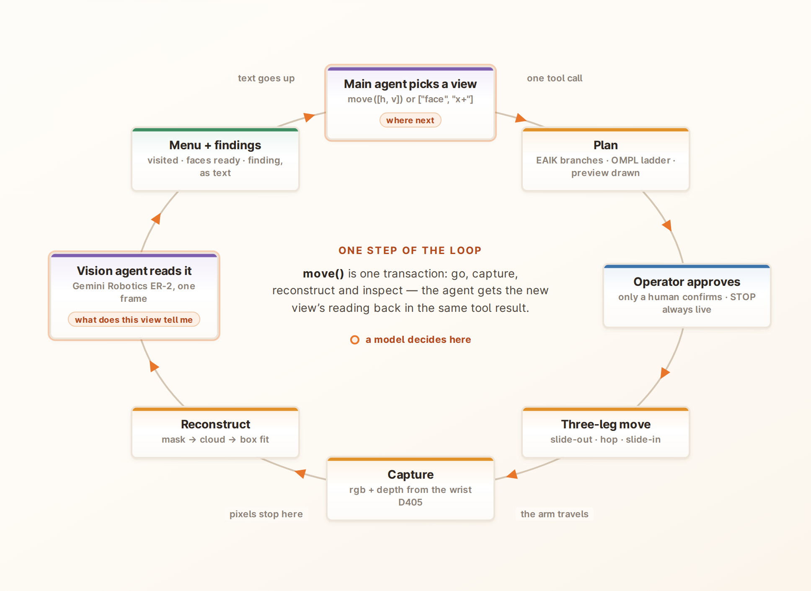

The decision-maker is a general language model, used as shipped, with four tools:
`plan` (break the question into checkable criteria, once, at the start), `move` (go to
a viewpoint, capture it, and have the new view read against the question), `inspect`
(ask a new question about a view already captured, without moving), and `answer` (end
the run with a verdict, the fields that were read, and citations to the views that
prove them). The loop itself
(turn taking, retries, context handling) is the Claude Agent SDK. What we built is the
harness and set of tools.

The main agent is a top-tier manager. It never outputs a pose or a joint angle, and it never sees an raw image data: it issues commands and reads structured reports written over the raw data. That is what makes
this neither a vision-language-action model nor a vision model with a robot attached.

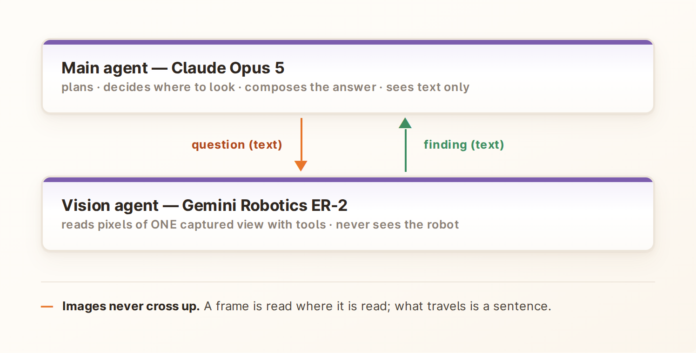

A second agent, the vision agent, does the seeing. It receives one captured frame and a
question, works on it with its own tools, and returns a finding as text: the evidence
it saw, its reasoning, and its answer. It cannot move the robot and cannot look at
another view. A question goes down as text; a finding comes back as text to the main agent session context;

A `move` is one transaction. The code plans the path, waits for the operator to
approve it, moves the arm, captures colour and depth, updates the 3D model of the
object, and has the vision agent read the new view. The result returns to the main
agent as text, together with a refreshed menu of where it can look next. The model
makes two decisions per step: where to look next, and what the new view tells it.

The sections that follow walk through the parts of this loop: how the robot moves
safely, where the camera may stand, what happens to a captured image, how the vision
agent reads it, how evidence views are derived from the object's shape, how an answer
is formed, and how every run is recorded.

### 3.4 Motion and safety

Every move is planned against a model of the cell that was measured with the robot
itself: the table position (touched at five points), the walls and corners around the
robot (taught by guiding the arm by hand and tapping the surfaces), the shape of the
gripper and camera on the wrist, and the exact position of the camera relative to the
arm (a hand-eye calibration). These measurements live in one file and are loaded into
a collision checker, together with the robot's own geometry. The inspected object is
added as an obstacle as soon as its shape is known, and updated after every capture.

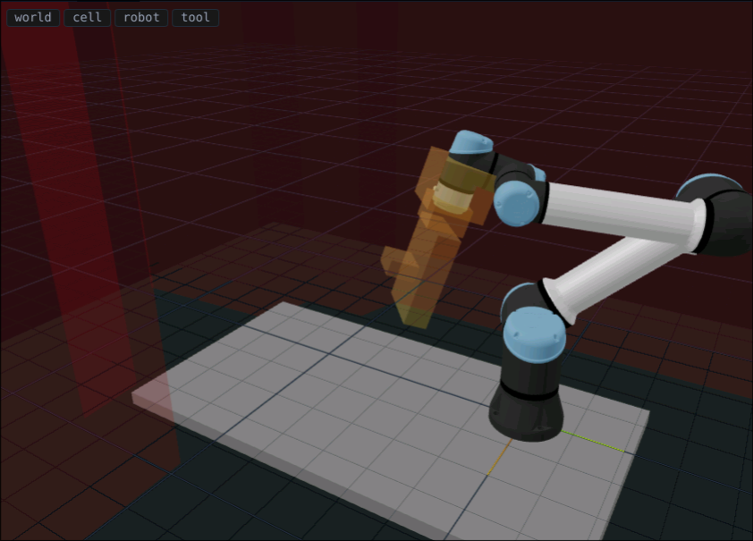


Motion planning itself is classic. For a target camera pose the system computes every
arm configuration that reaches it, tries a straight joint-space move first, checked for
collisions along its whole length, and falls back to a sampling planner with path
smoothing when the straight move is blocked. If neither finds a safe path the move is
refused, and the agent is told why so it can choose another view.

A move between two views in current setup is done as 3 steps action. The arm first slides straight back from
the object along its current line of sight, travels through open space, and then
slides straight in along the new line of sight. The long leg stays where planning is
easy, and the close approach cannot sweep sideways into the object.

During the proof of concept a person sits in front of this. The agent can only request
a move; the operator sees the planned path drawn in the 3D view and confirms it with a
second press, and a STOP button is always active and interrupts motion in any phase.
This gate is a choice, not a limitation of the design: nothing stops us from giving
the system permission to execute its moves autonomously.

### 3.5 Where the camera may stand

The agent chooses *where to look* from a menu, and the menu is built from directions
around the object. There are 36 of them: 12 steps of 30° around the object, at three
elevations above the table (10°, 40° and 70°). Each direction is addressed as a cell
`[h, v]`.

A cell is not a point in space. It is a ray, aimed at the object's centre from that
direction. Along the ray the system tests points every 2 cm, starting at the camera's
minimum working distance of 10.5 cm and going out to 40 cm. A point passes if the arm
can reach it, if nothing collides along the way (the table, the taught keep-out
regions, the tool itself, the object), and if the whole object fits in the frame. The
closest point that passes is the view. If no point on the ray passes, the cell is
inaccessible and is never offered to the agent.

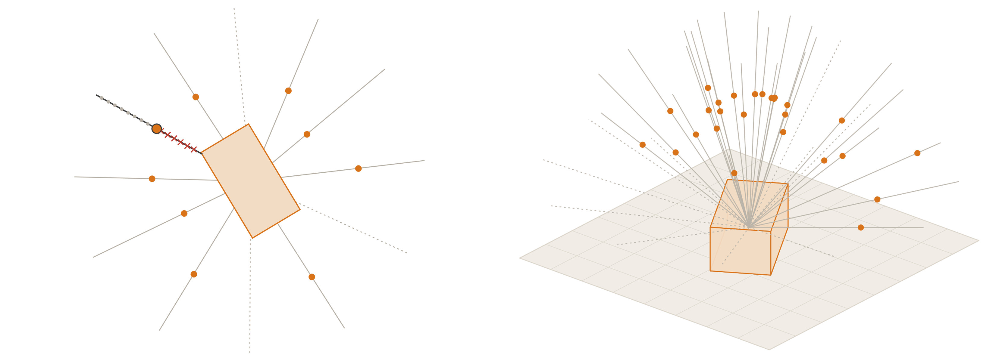

Distance is therefore not a setting and not a formula. It follows from the size of the
object and the reach of the arm, and it is recomputed after every capture because the
3D model of the object changes as views are added. The camera reads small text only
from close by, so the closest safe point is the one we want.

What the agent reads is a list of addresses with a bearing relative to where it stands
("30° right", "60° left", "opposite") and whether the cell was visited. It never sees
a pose, a distance or a joint angle.

Once the shape of the object is known, the same ray idea is applied to each face of
the object to produce head-on evidence views. Those are described in 3.7.

### 3.6 From image to 3D object

Every captured view goes through the same chain, and the result is a growing 3D model
of the object that both the view planner and the collision checker use.

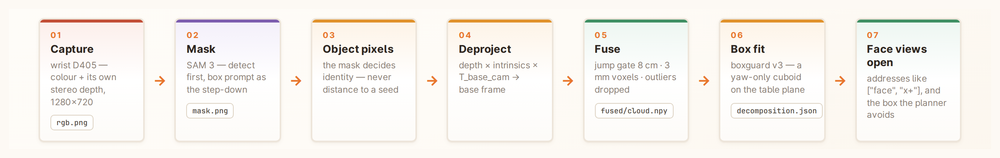

1. **Capture.** The wrist camera delivers a colour image and a depth image, taken
   while the arm is stationary. Each frame is stamped with the camera pose.
2. **Mask.** A segmentation model picks out the object. Its prompt is not a word but
   geometry: the point cloud built so far is projected into the new image, and the
   detected instance that contains it is kept. A mask is accepted only if it is
   confident and large enough; otherwise the view falls back to depth alone, and the
   record says so.
3. **Object pixels.** The mask decides which depth pixels belong to the object.
   Distance rules alone could not separate a cable lying against the object; the mask
   can.
4. **To 3D.** The object pixels become points in the robot's frame. The table is found
   by plane fitting and removed.
5. **Check.** If the fitted table plane disagrees with the measured table by more than
   3 cm or 5°, the camera pose cannot be right and the view is rejected.
6. **Fuse.** New points join the accumulated cloud: points far from everything seen so
   far are dropped, the cloud is reduced to a 3 mm grid, and statistical outliers are
   removed.
7. **Fit.** A box is fitted to the cloud. It stands on the measured table, may rotate
   only about the vertical axis, and its size is the outer envelope of the points.

The fit produces two boxes with different jobs: a tight one that says where the object
is, used to frame it in the camera and to build the face views, and a padded one that
the motion planner avoids.

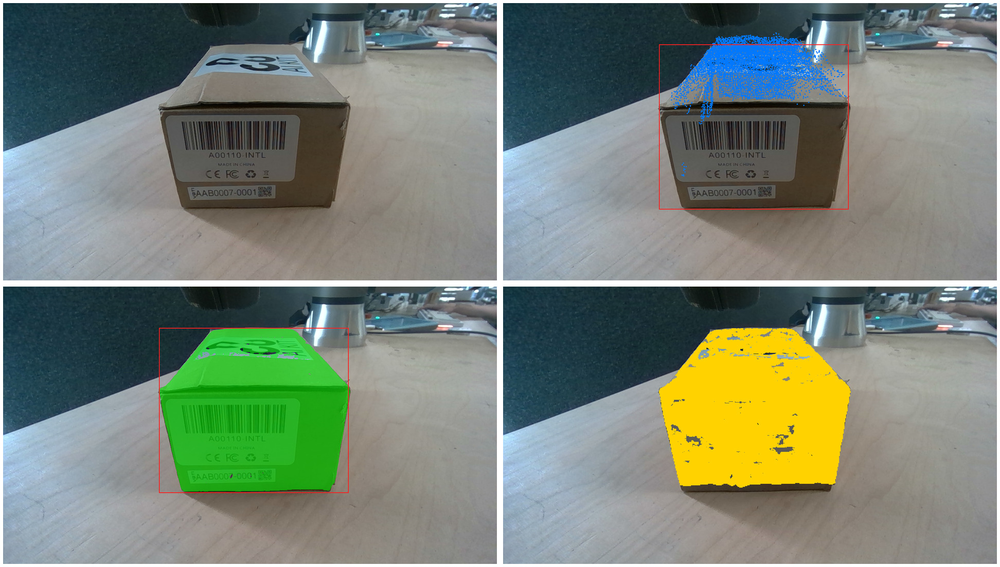


### 3.7 The vision agent

The vision agent is the only part of the system that looks at pixels. It receives one
captured frame and a task, and works in a short loop of its own: it may call a tool on
the frame, read the result, and call another, until it has what it needs. Its tools
run locally on the workstation.

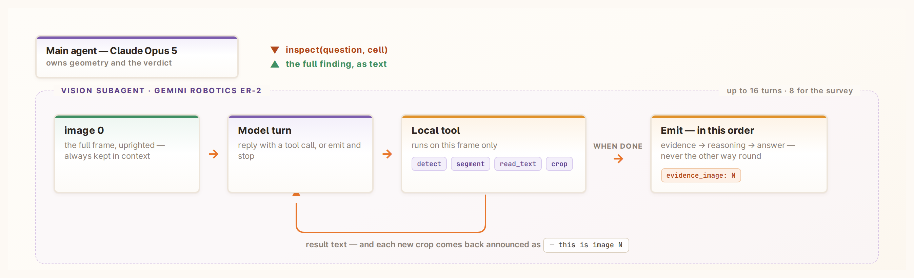

| Tool | What it does |
|---|---|
| `detect(phrase)` | Finds things by name and returns their boxes |
| `segment(box)` | Masks the region inside a box |
| `read_text(box)` | Reads the text inside a box with an OCR model |
| `crop(box)` | Zooms into a region; the zoomed image is added to its context |
| `note(text)` | Records a remark for the main agent |

A few rules are fixed in the loop itself and cannot be switched off by any prompt. The
reply always states the evidence first, then the reasoning, then the answer; the
opposite order measurably degrades the answers. There is no confidence score, because
self-reported confidence from these models is not reliable enough to act on. The full
frame stays in context next to every crop. Descriptions are camera-relative ("at the
right edge of the frame"); the main agent, which knows where the camera was, turns
that into a direction. A repeated identical tool call is refused with the earlier
result.

Besides its answer, the vision agent reports what it saw in the frame and a
recommendation on where a better view might be ("half right", "further up"). These
are hints in words, not coordinates; the main agent decides what to do with them.

The same loop is used in three roles: describing the object once at the start of a
run, inspecting a view against a task, and hunting for evidence when an answer is
checked (3.8). Everything it does is stored: the prompt, each turn, the frame as it
saw it, and every crop it chose.

### 3.8 Evidence views

One requirement set at the start of the project was that the system should offer the
best views of the inspected object. In this phase that ability was built for two primitives, the box
and the cylinder. The agent decides at the survey step which primitive it is looking
at, and the runtime applies the matching geometry.

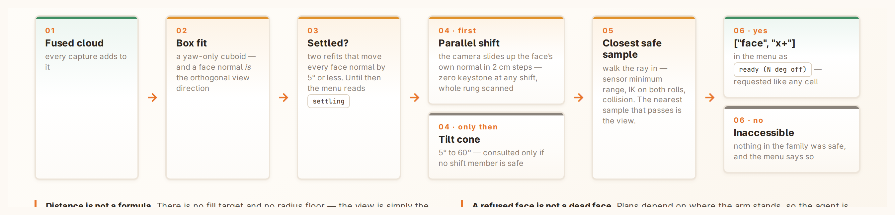

Once the fitted primitive has been stable for two consecutive refits, each of its
visible surfaces gets a view of its own. The outward direction of a surface is the
direction of its head-on view, and the view is found with the same ray idea as the
cells. Two families are tried in order. First a parallel shift: the camera stays
parallel to the surface and is moved sideways in 2 cm steps, which images the surface
without perspective distortion at any shift. Only if no shifted position is safe is
the camera tilted, from 5° up to 60°. Along the chosen line of sight the closest safe
point is taken, exactly as for a cell. The menu then lists the face as ready, together
with how many degrees off head-on the view is; a face with no safe view is listed as
unreachable.

### 3.9 The answer

The run ends when the main agent calls `answer`. An answer has three parts: a verdict
in plain language; a set of structured fields (codes, serial numbers, model numbers,
counts, states) holding only values that were actually read from pixels; and up to
three citations. A citation names a view and what the picture must show.

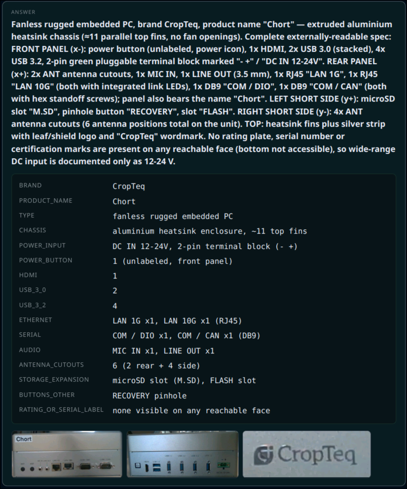

Each citation is checked before the answer is accepted. A separate vision agent run,
the evidence hunt, looks at the cited view for the named thing and either returns a
crop of it or reports that it is not there. The hunt is not told the verdict, so it is
not pushed toward confirming it.

If a hunt finds nothing, the whole answer is returned to the main agent as a failed
call. The agent can move to a better view, cite a different view, or submit the same
citation again, in which case the answer ships with the gap on record. The rule
enforced here is "answer from your best view, not your first". For a negative answer
the agent cites the surfaces that would have shown the feature, so the record shows
where it looked.

### 3.10 Data handling

Every run is a folder of plain files, written as the run happens.

```
runs/<run>/
├─ run.json · session.json · config.json · events.jsonl · manifest.json
├─ steps/NNN/   rgb.png · depth · mask.png · chain_*.png · fused/
│               step.json · view_state.json · decomposition.json
└─ ai/NNN/      trace.jsonl · transcripts/ · artifacts/ · answer.json · menu/
```

The steps hold what the camera captured at each position, the mask, the object cloud
as of that step, and the fitted primitive. `config.json` holds the conditions of the
run: the code revision, the full cell model, the calibration, every tuning constant
and the models used. `events.jsonl` is the approval trail. `ai/` holds the agent's
side: every tool call and result, every vision agent transcript, every crop, and the
final answer.

The operator UI is built on this record. It shows the 3D scene, the camera image, the
agent's trace and the answer card, and it renders the trace file in both cases:
watching a live run and re-opening a finished one are the same code path.

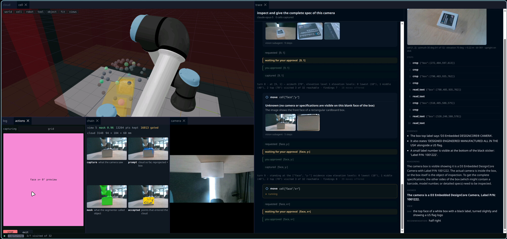

Recording everything from the first day was deliberate. The next stages, whether
evaluation, benchmarking or training, will need this data, and it was collected so
that it is ready for them.

## 4. What was achieved

**As a system.** The system works with any object placed on the table, without tuning
for the object and without training any model. It returns a structured result: a
verdict, the fields it read, and the evidence views that back the answer. For
box-shaped objects it selects the best views from the object's geometry. It moves
safely, without hitting the barriers of the cell or the object.

**As an architecture.** We built a harness for a robotic system in which custom tools
are defined and a reasoning language model thinks and acts through those tools in the
real world. We tested how to represent the world around the robot so that the language
model understands it, and gathered the insights on what works in that representation.
We tried the composition of a vision agent under a higher-level orchestrator, and it
carried the whole inspection.

## 5. Limitations

**Of this build:**

- **Small text is misread.** The vision model reconstructs characters it cannot
  resolve and shows no sign of doubt when it does.
- **The camera.** Far views are unreadable, images are sometimes blurry, and the depth
  is poor on untextured surfaces, which limits the 3D reconstruction. The camera is the
  weakest part of the system.
- **Opaque, textured surfaces only.** Passive stereo gives no usable depth on plain,
  glossy or transparent surfaces.
- **Geometry-aware views for box-shaped objects only.** Everything else is inspected
  from the directions around the object alone.
- **One object on the table.** Several objects at once are not handled.
- **Unreachable cells and refused moves cost turns.** The agent learns that a view
  cannot be taken only by asking for it.

**Of the approach:**

- **The cells around the object are an approximation of generality.** The fixed set
  of directions lets the robot see everything, whatever the object is, and that is
  what makes the system work on any object. But those are not the best views. The best
  views are determined by the object itself: squarely on a face, close to a feature,
  along an edge. Object geometry and view planning have many degrees of freedom; the
  most restricted end is a fixed set of invariant views, the least restricted is views
  completely determined by the object being inspected. We want the latter. In this
  phase it was reached only for the box and the cylinder (section 3.8); for every
  other object the system sees it without looking at it the way the object would
  require.
- **The point cloud is barely used.** We talked a lot about 3D space and voxels. It
  should be understood that the system works at the level of the fitted primitive and
  a few key measures such as the centroid. Starting to work with voxels and the real
  point cloud means going from structured 3D to unstructured 3D. It makes sense and it
  is the right decision, but spatial reasoning is still an unsolved problem: we do not
  yet know how to navigate and make decisions with 3D objects as the input.
- **Text is the only channel to the orchestrator.** This was not tested on anomaly or
  defect tasks, where the evidence may not survive being described in words.

## 6. Insights

What we know about the problem now that we did not know when we started.

**Agentic systems are the next step in robotics.** The reasoning loop can be taken off
the shelf. The work is writing the tools, the robot integration, the monitoring and
the perception logic, and building the agent from them, whether the model runs in the
cloud or locally. The agentic harness is what a robotic system of this kind needs, and
that is what we built.

**The protocol between the layers is speculative and lossy.** The system runs a
three-layer protocol: raw to structured to raw. A raw image is read by the vision
agent and handed to the orchestrator as structure; the orchestrator picks from a menu
and sends a command that becomes raw robot motion. It works. But it was designed by
hand, and every crossing loses something. The options run from improving the protocol
under strict A/B testing to changing the architecture so that all of it happens in
latent space, which needs an end-to-end scenario: a vision-language-action model
trained on the collected data, or simulation. A decision is needed here.

**Spatial reasoning is unsolved.** No model today really understands 3D and knows how
to plan from it; some robotics models try, without much progress yet. The physical
world is under-represented in every domain the large models are trained on. In this
system the model only ever worked with structured geometry, a few key measures and a
menu of directions, and we are only starting to get a feeling for what it can do with
that. This will be crucial knowledge in the next few years.

**The intelligence sits in the orchestrator session.** The main agent keeps track of
what was seen from where, merges findings across views and decides where to look next,
all over text reports. To some extent it captures the spatial picture, but it feels
like a blind man painting: it kind of knows what is there from the description, but
does not really understand it at the level we might at some point. What is needed is a
better state representation, and research into whether it is even feasible, and
through which protocols, to present a complex world (relations, what is seen from
which position) to a sequential textual model so that it can reason over spatial
features: where a feature lies on the object, what is close to it, where to look.

**From the build itself, three things stand out.**

**Motion planning needs to be assisted.** A planner given one target pose fails more
often than a planner given the sequence of what to do. Splitting a move into slide
out, hop and slide in turned one hard problem into three simple ones, and the share of
runs that completed went up. In practice the robot often needs a more detailed
sequence to plan, not a single goal.

**Text read from a blurry image cannot be trusted, and the system has no way to know
it.** The vision model reads text with the same confidence whether the image is sharp
or not, and there is no mechanism that tells the orchestrator when to trust it. Better
tooling for text is needed: OCR and vision-model text detection that report what they
could and could not resolve.

**The menu shapes the logic.** How the actions and the spatial features are presented
to the model, what the menu lists, how a direction is named, what a move returns,
influences the model's reasoning a lot. Much of the behaviour we saw was a product of
the representation rather than of the model, and changing the representation was the
most effective way to change the behaviour.

## 7. Next steps

The next phase is to be defined together with Albert; there is a lot of room. What
follows is our position going into that discussion.

**Not a quantitative evaluation of this system.** This is a raw prototype. It is too
restricted for an evaluation to tell us much, and there is not much that polishing it
would improve. The current system does not have the innovation capacity to scale:
improvement and polishing will not make it good enough. Other innovations must happen
for this product to become really valuable. The next phase is therefore structural.

**The structural directions.** All three are about spatial intelligence in the wide
sense.

1. **Navigation and decision-making in voxel space.** Move from the fitted primitive to
   the real point cloud and let the system decide where to look from the occupied
   volume of the object. This is the direction Albert put forward.
2. **Vision-language-action models**, with end-to-end training enabled by simulation.
   The decision between the hand-made protocol and a latent, end-to-end path (section
   6) is taken here.
3. **Keeping the same system and developing the data structure.** A representation
   that captures the details of the object, their relations, its spatial structure and
   maps of what was seen from where, interpretable to the language model so that it
   can reason over it.

**The data.** Everything recorded is available to work with, and it may be transformed
once it is clear exactly what is needed. The data was collected from the beginning so
that it is ready for the next stage, whether that is evaluation, benchmarking or
training.
