# e01: all masks from one image, and a tree from them — turn 1

**Status:** turn 1 closed 2026-10-08, experiment open (Anton to judge, next turn to follow).
**Answer so far:** UnSAMv2 run at six granularities and stacked by containment gives, on
every one of the eight frames, a tree a person would read as object → faces → stickers,
ports, barcodes, labels → letters, pins, digit groups (depth 4–7, 22–54 nodes, ≤ 12
conflicts). SAM 3 is the better *detail finder when named* (text prompts find every port
and label) but its point mode cannot produce the levels: one point gives a junk whole, a
good part, and a sub-part, and a grid of them collapses into blobs. So: UnSAMv2 for the
structure, SAM 3 text for naming and for the printed text it reaches better.

## What was run

- Frames: the eight in `evidence/frames_selected.json` (chosen from `evidence/frames_all.jpg`).
- SAM 3 (`facebook/sam3`, bf16, `robo` env), `sam3_masks.py`:
  `grid32` (point grid, transformers mask-generation pipeline, default thresholds),
  `grid64`, `grid64_loose` (c5.6 only), `crop32/64` (c5.6 only), `obj3_32` (points inside
  the object, all three masks per point kept, IoU ≥ 0.5, dedupe 0.85), `text` (the
  planner's nouns: sticker, label, logo, text, barcode, port, connector, LED, button,
  hole, screw; score ≥ 0.3).
- UnSAMv2 (`plus` checkpoint, SAM 2.1 hiera-small, `unsam` env, GPU), `unsamv2_masks.py`:
  granularity 0.1, 0.2, 0.3, 0.5, 0.7, 0.9 with the notebook thresholds (iou 0.77,
  stability 0.9); g = 0.1 also with the authors' eval thresholds (0.65 / 0.7).
- Trees, `tree.py`: root = recorded object mask (c5.7 and b1.4 have none: largest UnSAMv2
  g = 0.9 mask); masks < 50 % inside the object dropped; dedupe IoU ≥ 0.8; A contains B
  if |A∩B| / |B| ≥ 0.9 and area(A) ≥ 1.25 area(B); parent = smallest container;
  conflict = overlap ≥ 30 % of the smaller without containment. Three trees per frame:
  `unsam_stack` (six granularities), `sam3_text`, `unsam_stack+sam3_text`.
- Figures: `figures.py` (ladder, strategies), `tree.py` (levels, nested, gallery),
  `points3.py` (one prompt → three masks), `pairs.py`; numbers: `summary.py` →
  `evidence/tree_stats.json`, `evidence/mask_counts.json`.
- Commit at run time: `884d895` (the e01 scripts themselves were not yet committed; every
  run wrote `run.json`). Heavy outputs: `inspection/data/iwm/e01_all_masks/` (masks per
  frame and strategy, node masks per tree).

## What we saw

### The frames

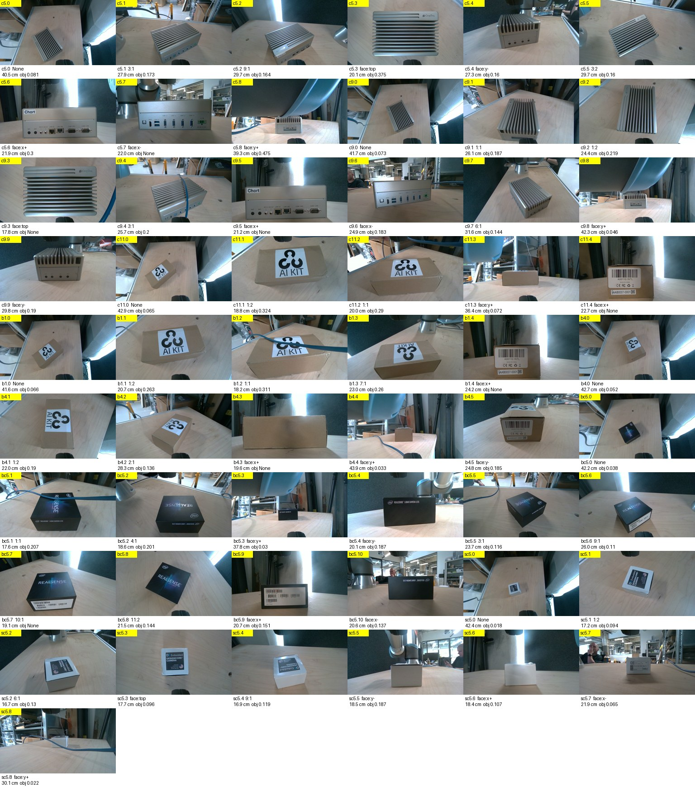

Chosen: c5.6, c5.2, c5.7, c9.6 (compute box), bc5.9 (REALSENSE box), b1.1, b1.4, b4.5
(cardboard box). Main example below is c5.6, the compute box's port panel at 22 cm.

### Part 1 — masks: one frame, five ways

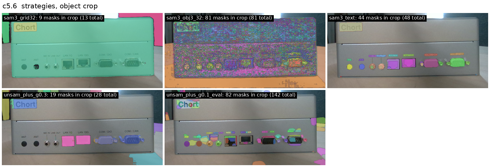

SAM 3 point grid (top left): body + sticker, no port. SAM 3 obj3 (81 nested masks from
points inside the object): unreadable blobs. SAM 3 text prompts: every port, jack, hole,
label and the sticker — but no body, no face. UnSAMv2 g = 0.3: sticker and every port,
no body. UnSAMv2 g = 0.1 with the authors' eval thresholds: 82 surface fragments.

### Why SAM 3's point mode cannot give levels

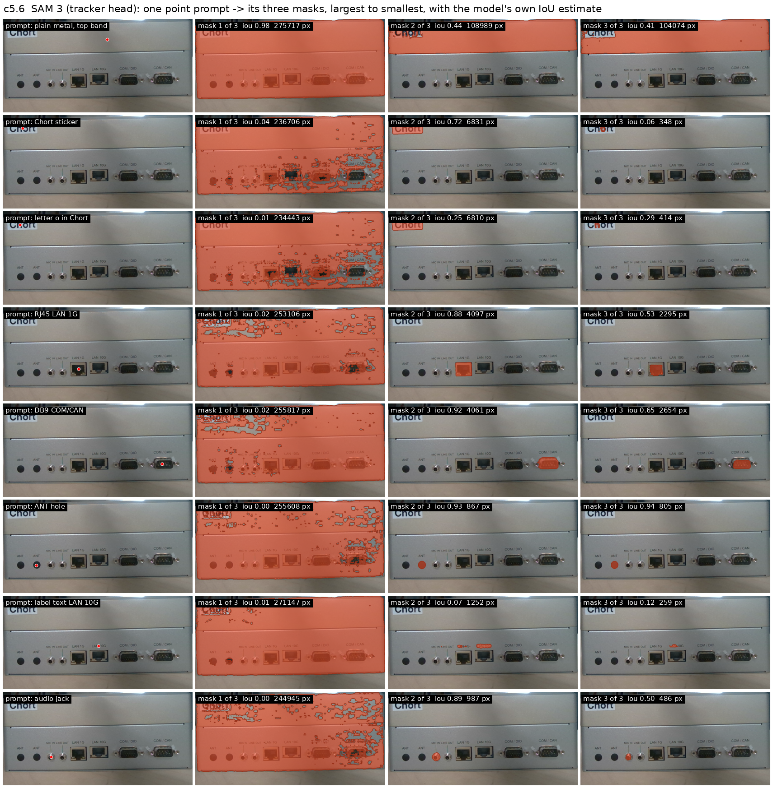

Row by row: the largest of the three masks is a speckled whole-object guess that the
model itself scores at IoU 0.00–0.04; the middle one is the clean part (RJ45 0.88, DB9
0.92, ANT hole 0.93, sticker 0.72); the third is a sub-part. Printed text scores
0.07–0.12. A plain-metal point (first row) returns face-sized blobs at 0.4. The grid
strategies filter this raw material: with the default thresholds only the body and the
sticker survive; with all three kept, the blobs chain into a 16-deep ladder.

### The granularity dial is the level dial

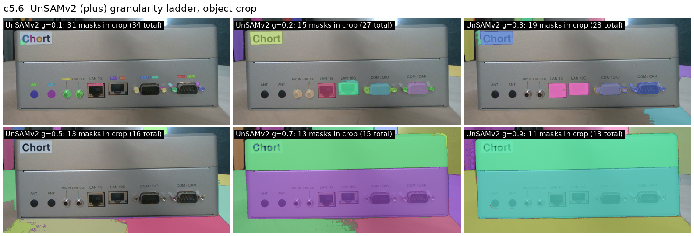

g = 0.9 the whole object; 0.7 its two faces; 0.5 almost nothing on the object; 0.2–0.3
the sticker and every port; 0.1 holes, labels, letters.

### Part 2 — the tree, level by level

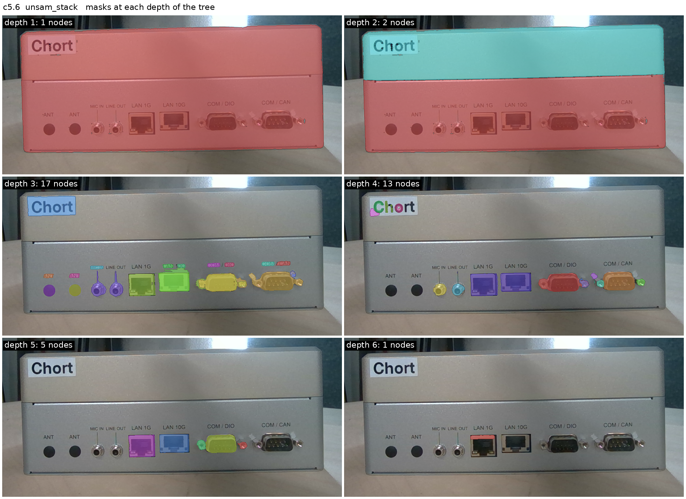

Depth 1 the object, 2 the two faces, 3 the sticker + every port + every label, 4 the
letters of "Chort" and the port innards, 5–6 pins and a plug cavity. 39 nodes, 10
conflicts. Every node at depths 1–4 is something a person would name.

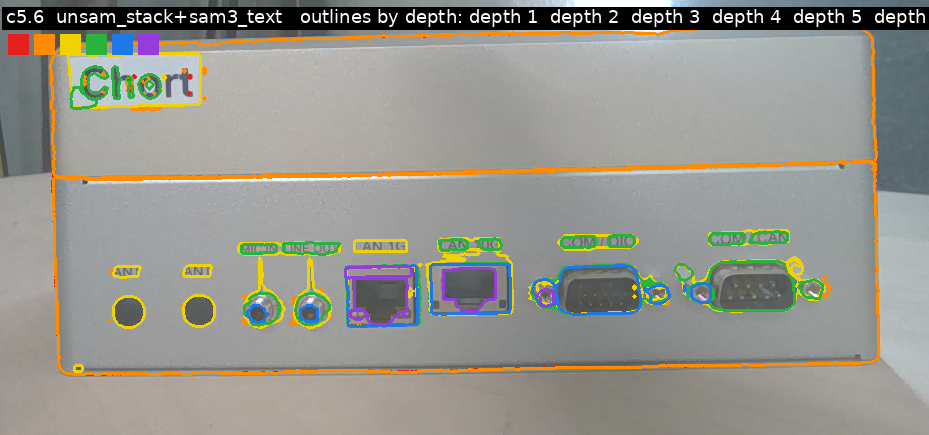

Adding SAM 3 text brings the printed labels ("MIC IN", "LAN 10G", "COM / CAN") that
UnSAMv2 gets only partly, and duplicates of ports hung at another depth (conflicts
10 → 12). The duplicates should be merged, not added.

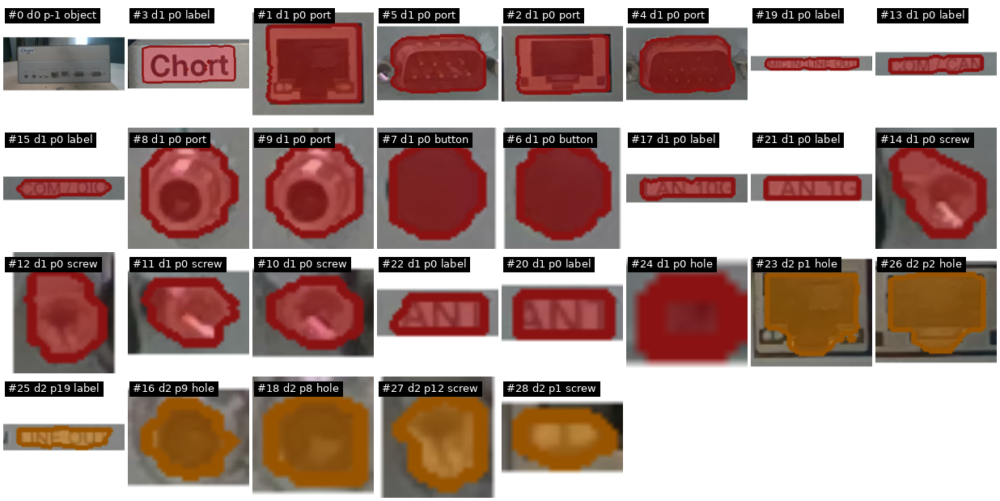

What a node looks like one by one: ports, labels, the sticker at depth 1 (red); port
cavities and the "LINE OUT" label inside its port at depth 2 (orange).

### The same on the other objects

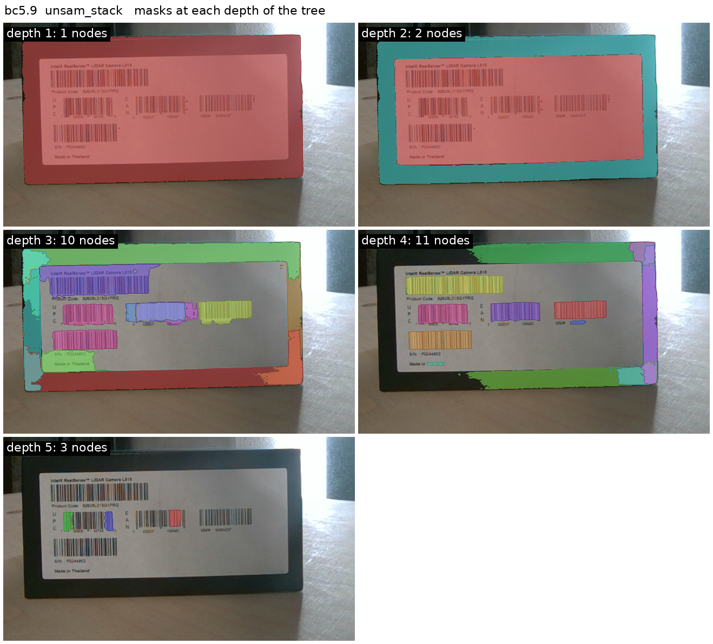

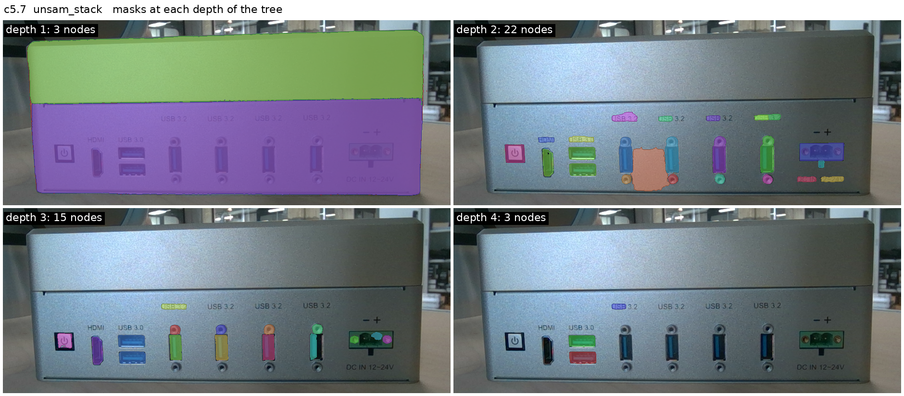

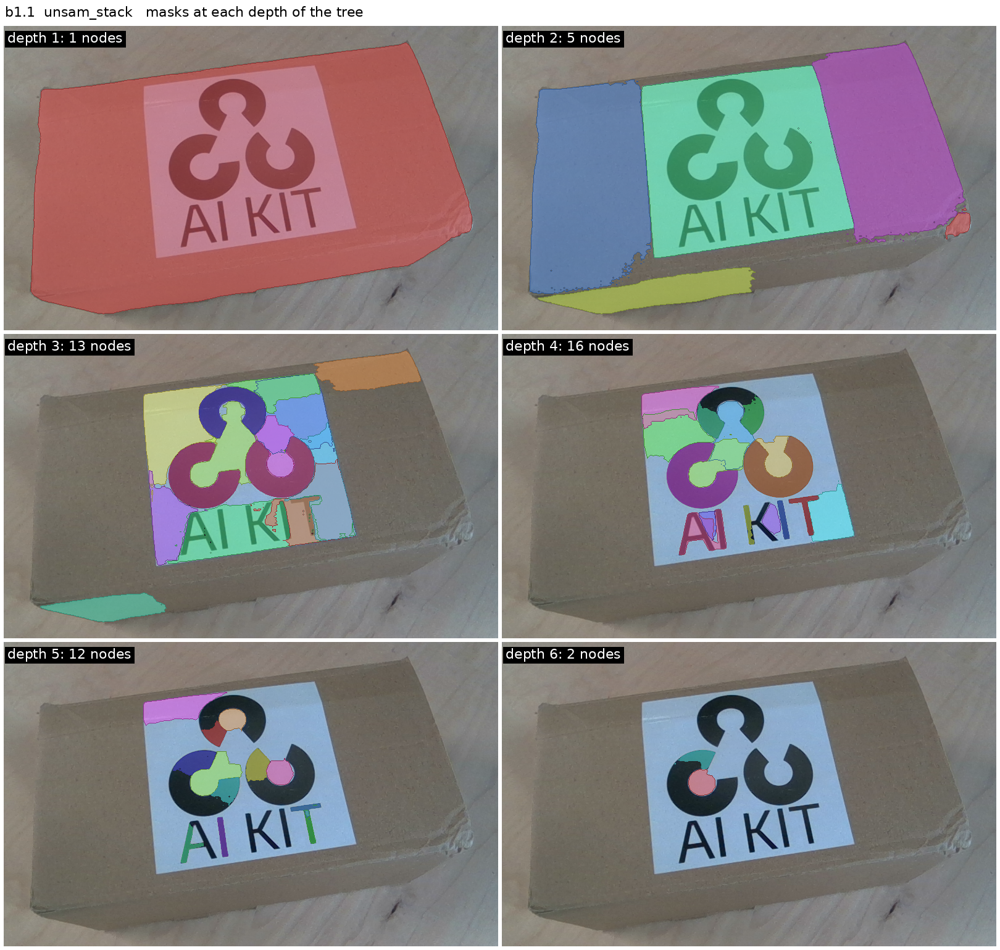

The AI KIT box shows the failure mode: at depth 3 the white sticker background is split
into fragment nodes nobody would name. The ladder makes levels out of uniform surface
too; a node needs a reason to exist beyond "a mask was there".

### Far / close and two runs of one face

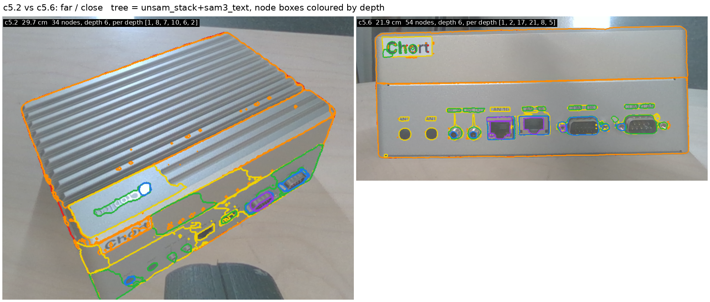

The far view already holds the top face (fins), both side faces, the Chort sticker and
the DB9s (34 nodes, depth 6); the close view adds the letters under the sticker and the
innards under each port (54 nodes). The closer view deepens the tree where it looked.

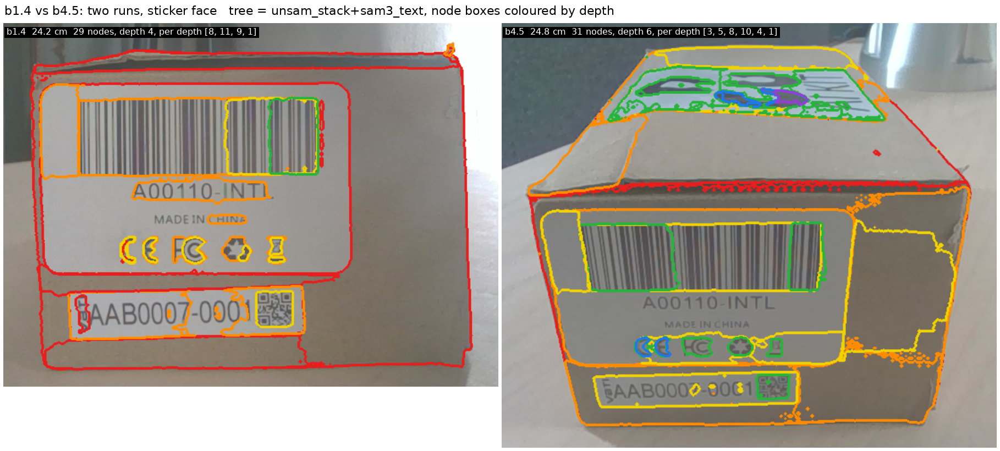

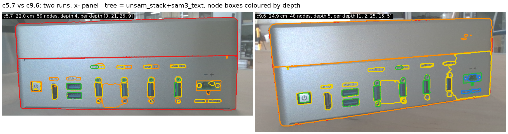

Both trees carry the label, the barcode, the two text lines, the CE/FC/recycle marks and
the small VBTI serial label with its QR code, in the same nesting; both panels carry the
same ports in the same order. The structure to match across views at rung 4 is there.

**Planner's details, found as a tree node (by eye, from the level figures):**
compute x+ — Chort wordmark ✓, 2 RJ45 ✓, 2 DB9 ✓, 2 audio jacks ✓, 2 ANT holes ✓, port
labels ✓ (text prompts; UnSAMv2 partial); compute x− — power button ✓, HDMI ✓, USB ✓,
terminal block ✓, labels ✓; box sticker face — VBTI serial label ✓, QR ✓, barcode ✓,
"A00110-INTL" ✓, CE/FC marks ✓; REALSENSE — label ✓, each barcode ✓, text blocks ✓
(lines not separated); AI KIT — sticker ✓, logo ✓, letters ✓. Missed: nothing the
planner asked about on these faces; the misses are text *lines* inside dense labels.

## Numbers (from `evidence/tree_stats.json`)

| frame | unsam_stack nodes / depth / conflicts | sam3_text | unsam_stack+sam3_text |
|---|---|---|---|
| c5.6 compute x+ | 39 / 6 / 10 | 28 / 2 / 0 | 54 / 6 / 12 |
| c5.2 compute oblique far | 24 / 5 / 3 | 16 / 2 / 0 | 34 / 6 / 9 |
| c5.7 compute x− | 43 / 4 / 1 | 34 / 2 / 0 | 59 / 4 / 1 |
| c9.6 compute x− other run | 33 / 5 / 3 | 30 / 2 / 0 | 48 / 5 / 5 |
| bc5.9 REALSENSE label | 27 / 5 / 9 | 6 / 2 / 0 | 28 / 5 / 10 |
| b1.1 AI KIT top | 49 / 6 / 10 | 5 / 2 / 0 | 50 / 7 / 8 |
| b1.4 box sticker face | 22 / 4 / 2 | 11 / 3 / 1 | 29 / 4 / 4 |
| b4.5 box sticker face other run | 28 / 5 / 1 | 10 / 2 / 0 | 31 / 6 / 2 |

SAM 3 obj3 tree on c5.6: 49 nodes, depth 7, **136 conflicts**. Masks per frame and
strategy: `evidence/mask_counts.json`. Speed on the 5090: SAM 3 text 2–6 s, grid 0.5–9 s;
UnSAMv2 5–13 s per granularity (6 min per granularity on CPU).

## Limits

- Judged by eye on eight frames of four objects; no ground truth, no IoU numbers.
- The containment rule and its four thresholds are turn-1 choices by the agent; the
  three tree methods compared are really one rule over three mask sets. OmniSeg3D's patch
  voting was not run.
- "Faces" are only what UnSAMv2 at g = 0.7 happens to split; on the AI KIT box the
  sticker *is* the face node, and plain cardboard / sticker background becomes fragment
  nodes nobody would name (b1.1 depth 3).
- Printed text: UnSAMv2 gives words or whole blocks, SAM 3 text gives labels but not
  lines inside dense labels; neither separates the lines on the REALSENSE label.
- UnSAMv2 counts depend on its score thresholds more than on g (0.77/0.9 vs 0.65/0.7:
  31 → 142 masks); only the notebook thresholds were used for the trees.
- The two frames without a recorded mask took their root from UnSAMv2 g = 0.9; it
  happened to be the whole object on both.
- The frames' 180° flip: `step.json` boxes are in raw coordinates; crops now use `mask.png`.

## What changes

- Q1: SAM 3 stays the tool model for *naming* (text prompts) and OCR; UnSAMv2 is the
  structure model. Both are needed; neither alone gives the tree.
- Q2: point grids through SAM 3 are out. Strategy = UnSAMv2 ladder (6 granularities,
  ~1 min per frame on the GPU) + SAM 3 text prompts for the planner's nouns.
- Q3: plain containment with a parent-ratio rule is enough on these frames; the stack
  of granularities does the levelling, the rule only wires it. Open: merging the SAM 3
  text duplicates into the UnSAMv2 nodes instead of hanging them beside.
- Q4: 64×64 points (UnSAMv2 default) reach everything the planner asked about at 17–30
  cm; the g = 0.5 gap and the surface-fragment nodes are the things to tune next.
- Next turn (Anton decides): (a) drop or merge non-nameable fragment nodes (a node must
  differ in appearance from its parent, or be named by SAM 3 / a VLM), (b) the OmniSeg3D
  patch-vote tree on the same mask sets for a real method comparison, (c) rung 3: the
  nodes in 3D with depth, then rung 4 on the two pairs that already look matchable.
