# e02: the vision agent builds the tree — turn 1

**Status:** turn 1 closed 2026-10-08, experiment open (Anton judges the granularity; we
converge from here).
**Answer so far:** the in-loop vision agent (the unchanged `VlmAgent` loop, Gemini ER-2)
given six verbs over e01's draft tree — `tree`, `show`, `find`, `name`, `group`, `drop` —
turns 28–59 draft nodes into a named tree of 6–19 nodes on every one of the eight frames,
in 8–12 turns and 35–63 s, never running out of budget. The trees read as side → things
on the side → their parts, with repeated things grouped ("array of USB 3.2 ports", "COM
ports", "LAN ports"). "Name it or drop it" removed every surface fragment. `show` is the
verb that carries it: without it the agent names 2 nodes.

## What was run

- Agent: `agent_tree.py` — a spec over `inspection/eyes/agents/vlm_agent.py` (not
  modified; the verb table and dispatcher are extended at import for this process),
  `kind="inspect"` for the record schema, 24-turn budget, model
  `gemini-robotics-er-2-preview`, verbs `LocalVerbs(SamOcrBackend())` (SAM 3 text for
  `find`, PP-OCR for `read_text`). Rules prompt: in `agent_tree.py:RULES`.
- Draft tree: `iwm_tools.py:IwmTree.from_e01` — e01's containment rule over UnSAMv2
  g 0.1–0.9 + SAM 3 text (dedupe IoU 0.8, parent ≥ 1.25× child), then: a node covering
  ≥ 90 % of its parent is removed (its children move up). Root = recorded object mask
  (c5.7, b1.4: largest UnSAMv2 g 0.9 mask).
- Noise rule, in code after the run: every node the agent did not name is dropped,
  children move up.
- Runs: the eight frames with the full verb set; c5.6 also without `find` and without
  `show`. Every run: `inspection/data/iwm/e02_agent_tree/<frame>/<variant>/` with
  `tree_{before,after,final}.json/.txt`, the node masks, the store, the verbatim
  transcript (`store/transcripts/`), the images the model saw (`store/artifacts/`),
  `events.json`, `summary.json`, `run.json`. Numbers: `traces.py` → `evidence/summary.json`,
  `evidence/traces.md` (every tool call with its result, every final tree).

## What we saw

### c5.6 — the main example, before and after

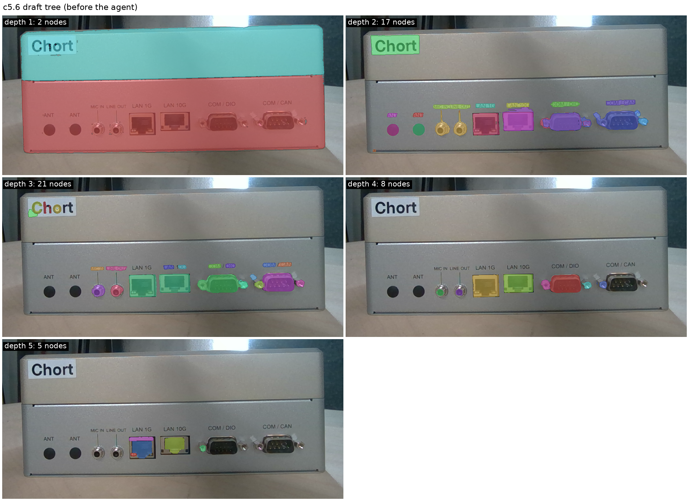

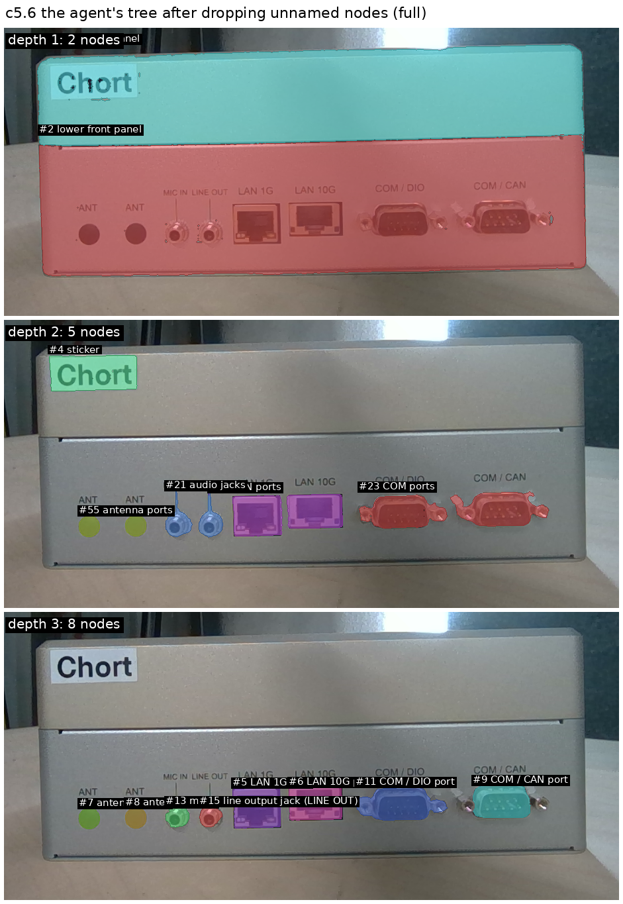

```
#0 front view
  #2 lower front panel
    #23 COM ports        → #11 COM / DIO port, #9 COM / CAN port
    #12 LAN ports        → #5 LAN 1G port, #6 LAN 10G port
    #21 audio jacks      → #13 microphone jack (MIC IN), #15 line output jack (LINE OUT)
    #55 antenna ports    → #7 antenna port 1, #8 antenna port 2
  #3 upper front panel
    #4 sticker text="Chort"
```

The trace (11 turns, 9 tool calls, 53 s; full text in `evidence/traces.md`):

```
t01 tree                      -> the 54-node draft as text
t02 show {node: 0}            -> image: #2 (59 %) and #3 (41 %) outlined
t03 show {node: 2}            -> image: 16 children outlined and numbered
t04 show {node: 3}            -> image: 1 child (#4)
t05 read_text {box: ...}      -> 'Chort' 1.00
t06 drop {ids: [18 ids]}      -> fragments on the lower panel removed
t08 name {4, "sticker", text "Chort"}
t09 group {[7, 8], "antenna ports"}   -> #55
t10 drop {ids: [8 ids]}       -> more fragments removed
t11 final reply: tree = {2: lower front panel, 3: upper front panel, 23: COM ports, ...}
```

### The other objects

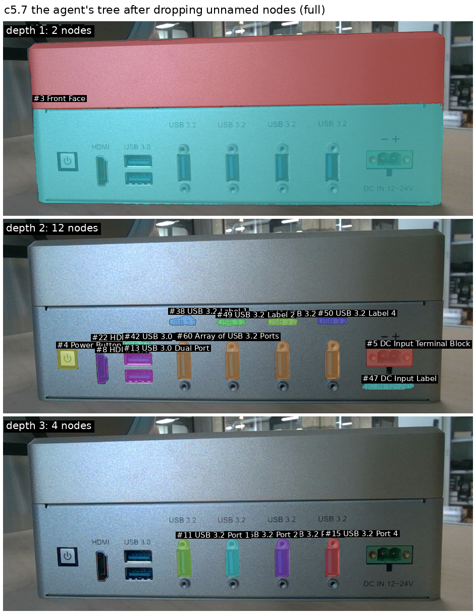

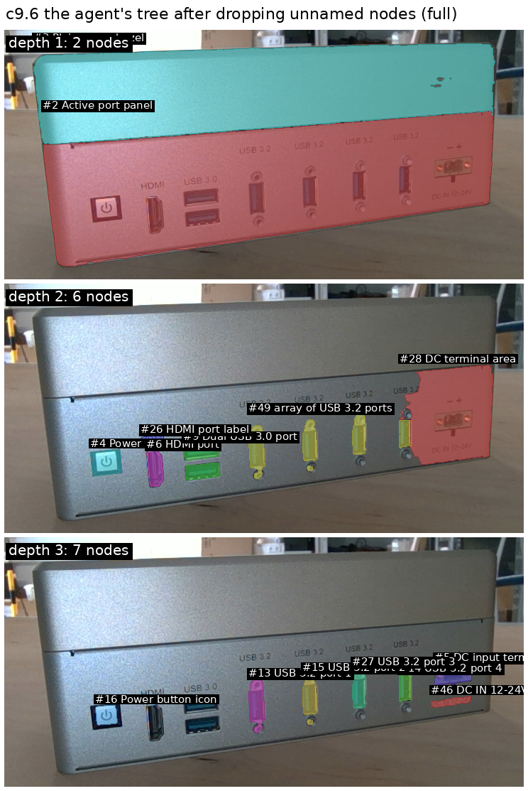

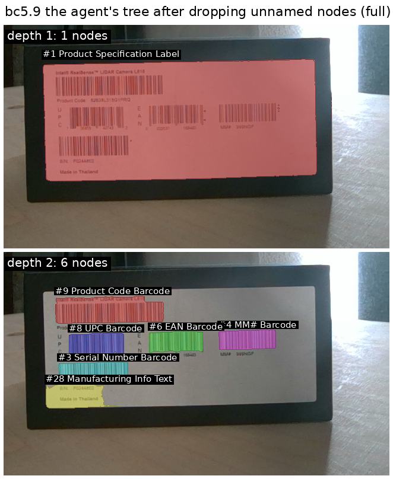

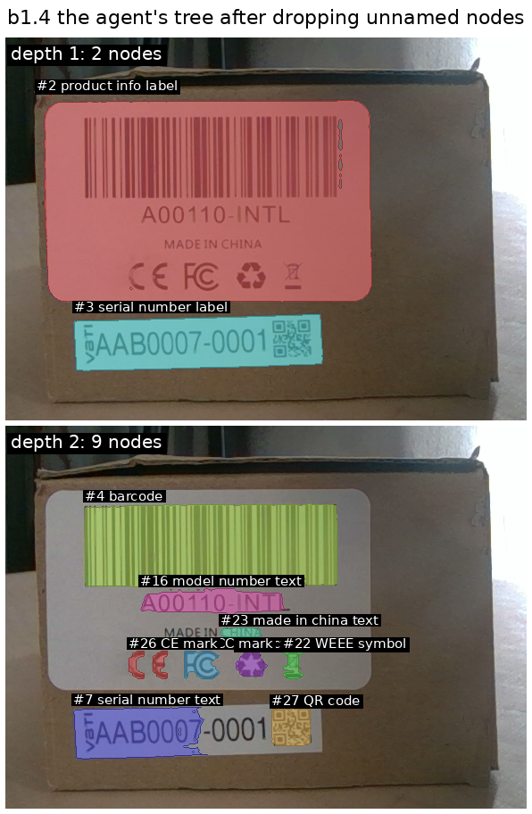

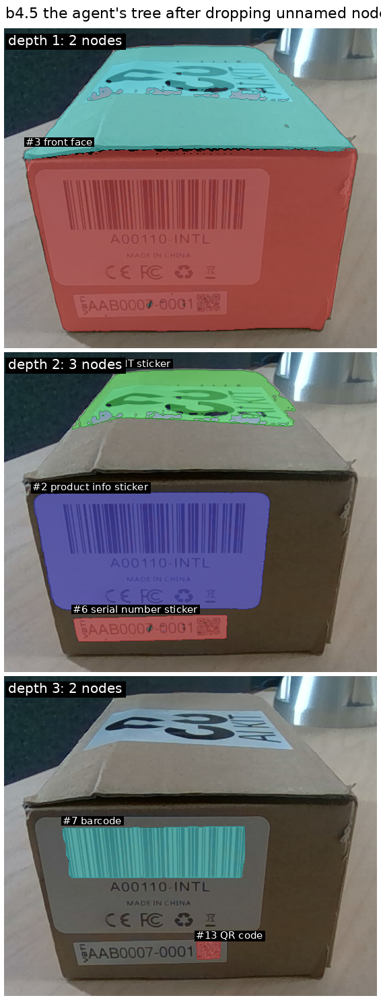

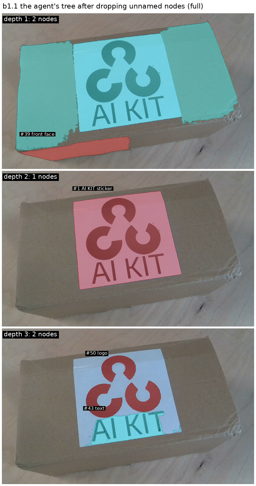

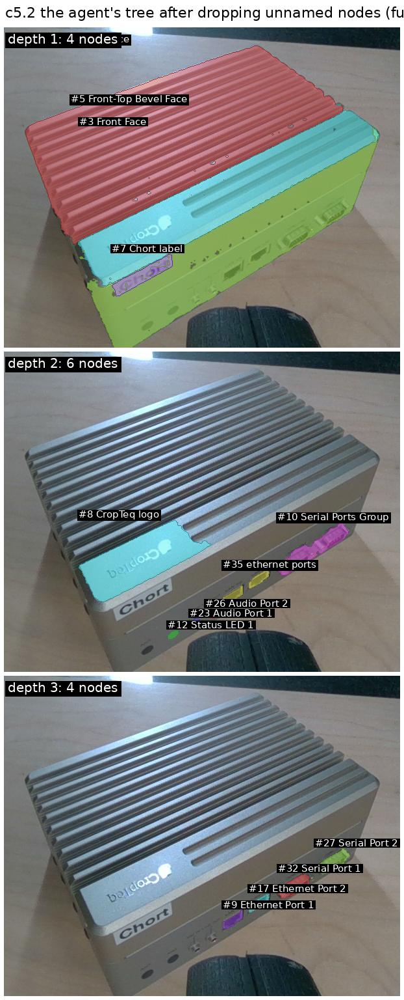

### What `show` and `find` are worth (c5.6)

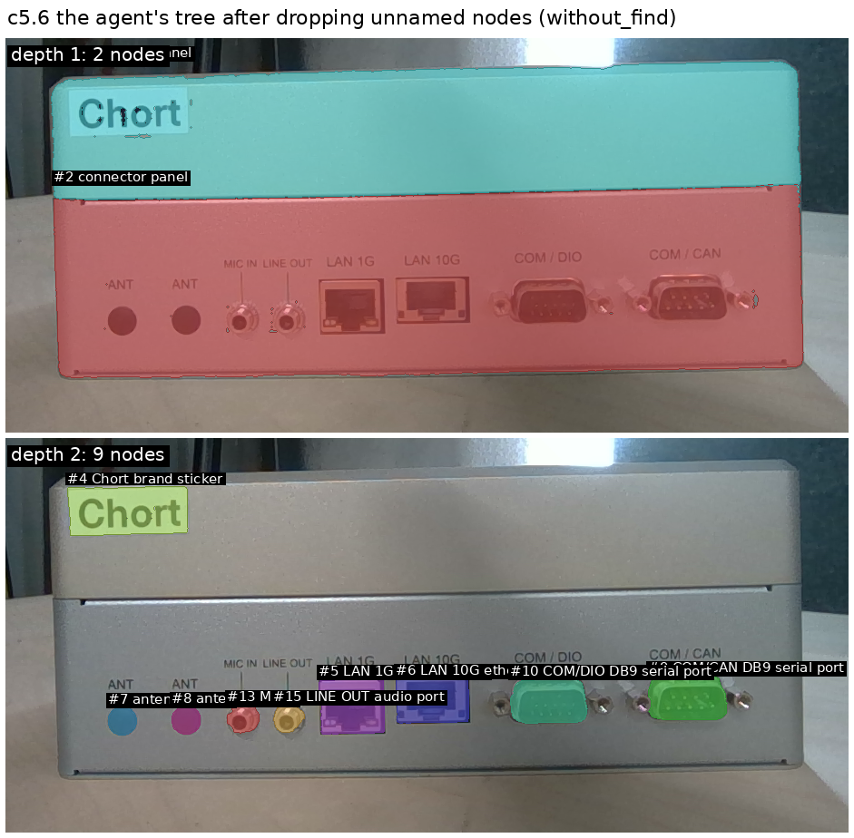

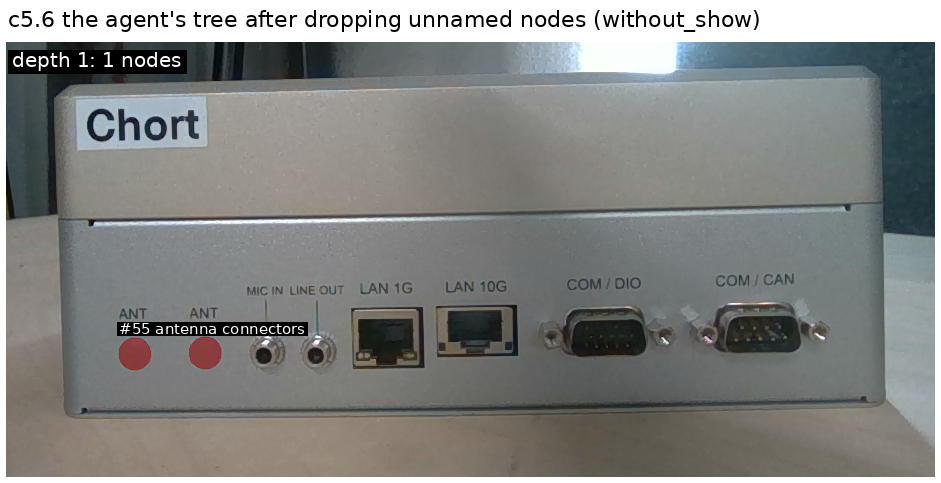

### Things for Anton to judge (the granularity)

1. **Labels become names.** The agent reads "LAN 1G" and calls the port "LAN 1G port"
   rather than keeping *label* and *port* as two children (the e01 draft had both).
   On c5.7 it kept the labels but as siblings of the ports, because a label does not
   lie inside its port — containment cannot pair them; the agent can (`group`), and
   did once (c9.6 "DC terminal area" = block + label).
2. **It stops at a person's level.** Letters, port pins, logo rings are dropped (b1.1:
   6 nodes). The rules say "do not name every letter"; if the IWM should keep the
   finer level for later zoom-ins, that line changes.
3. **Grouping is by kind, not by row.** "COM ports", "LAN ports", "audio jacks",
   "antenna ports" on c5.6; "array of USB 3.2 ports" on c5.7. Is one "row of ports"
   with kinds under it the better shape?
4. **Run-to-run variance.** Same panel, two runs (c5.7 / c9.6): the same things, the
   same groups, different names ("Front Face" / "Active port panel") and one different
   grouping decision. The structure is stable; the words are not.
5. **A dropped face orphans its children.** c5.2: the Chort label hangs under the
   object because its face node went unnamed. Rule to add: a named child keeps its
   parent, or is re-parented to the nearest named ancestor (it is — that is what
   happened — but the face is lost).

## Numbers (from `evidence/summary.json`)

| frame | variant | turns | tool calls | s | nodes draft → agent → named |
|---|---|---|---|---|---|
| c5.6 | full | 11 | 9 | 53 | 54 → 28 → 16 |
| c5.2 | full | 12 | 10 | 63 | 34 → 28 → 15 |
| c5.7 | full | 8 | 5 | 40 | 59 → 58 → 19 |
| c9.6 | full | 8 | 6 | 41 | 48 → 34 → 16 |
| bc5.9 | full | 10 | 7 | 44 | 28 → 14 → 8 |
| b1.1 | full | 9 | 6 | 39 | 50 → 51 → 6 |
| b1.4 | full | 9 | 6 | 35 | 29 → 24 → 12 |
| b4.5 | full | 11 | 5 | 40 | 31 → 29 → 8 |
| c5.6 | without find | 8 | 6 | 43 | 54 → 49 → 12 |
| c5.6 | without show | 8 | 4 | 35 | 54 → 23 → 2 |

No run was exhausted (budget 24). Per view: 8–12 model calls, 35–63 s, of which the
draft (UnSAMv2 ladder, from e01) is not counted — ~1 min per frame on the GPU.

## Limits

- One run per frame, one model; the names vary between runs (c5.7 vs c9.6).
- The draft is e01's: what UnSAMv2 + SAM 3 text did not cut cannot be kept, and `find`
  only adds what SAM 3 finds for a short noun.
- The rules prompt was written once and not tuned; the agent followed it closely, so
  its choices (labels as names, stop at a person's level, group by kind) are the
  prompt's choices as much as the model's.
- Judged by eye; no second rater, no ground truth.
- 2D only, one view; no 3D, no matching to an existing IWM (by design).

## What changes

- The verb set stands: `tree`, `show`, `find`, `name`, `group`, `drop` (+ crop,
  read_text, note). `show` is not optional.
- The noise rule stands: name it or drop it, with the two judgement-free pre-filters.
- Next turn, after Anton's judgement on points 1–5: adjust the rules (label-under-port
  pairing via `group`, the stopping level, group by row vs by kind), run twice per
  frame to see the variance, then rung 3 (nodes in 3D) on these trees.
