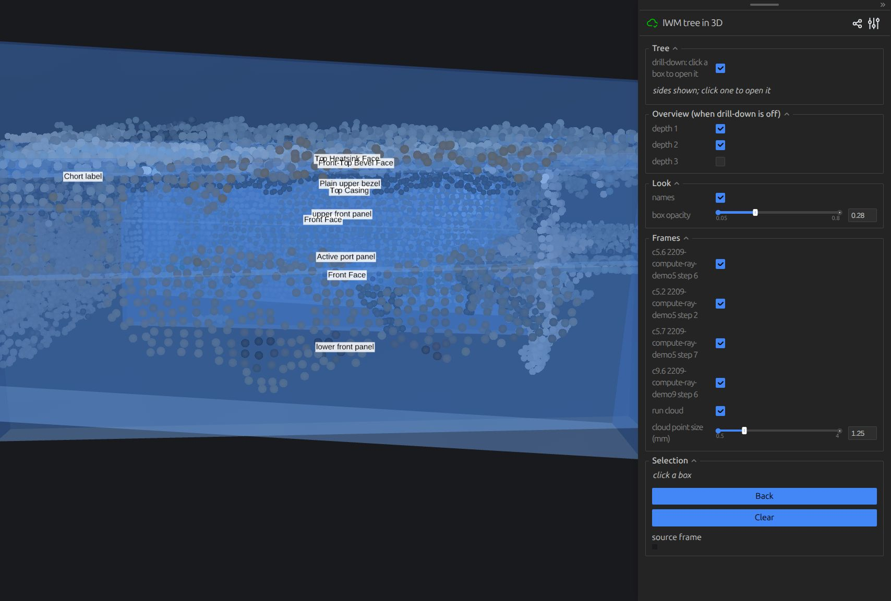
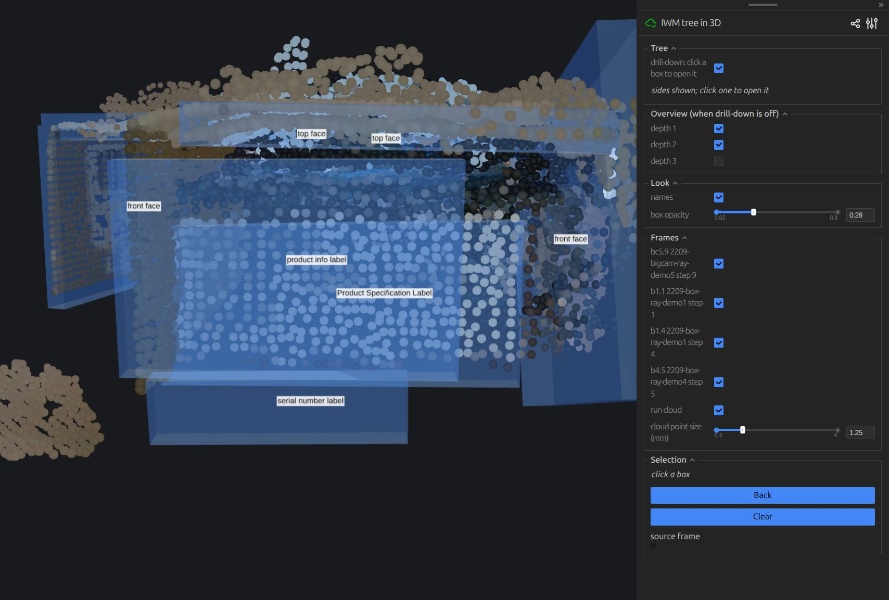
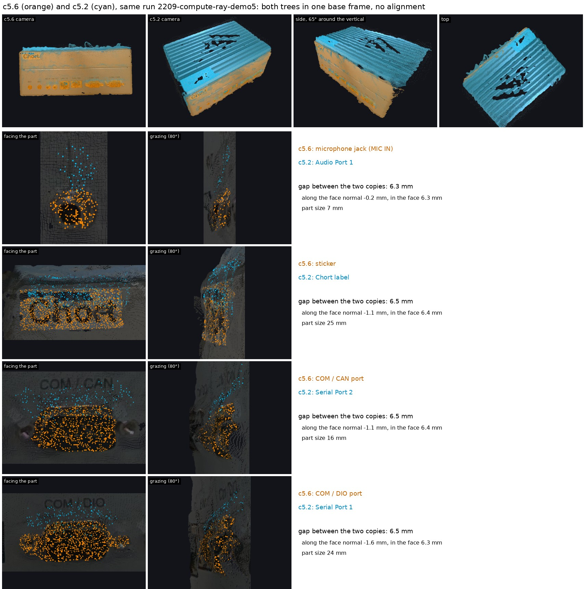
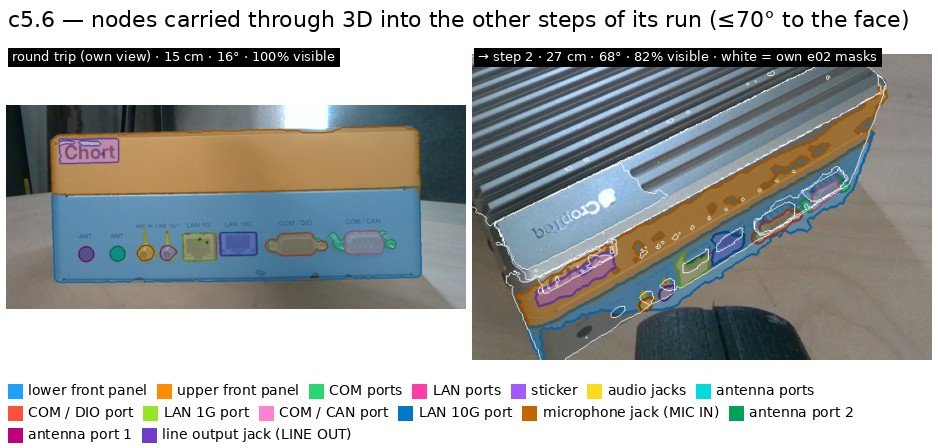
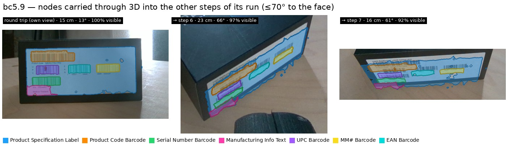
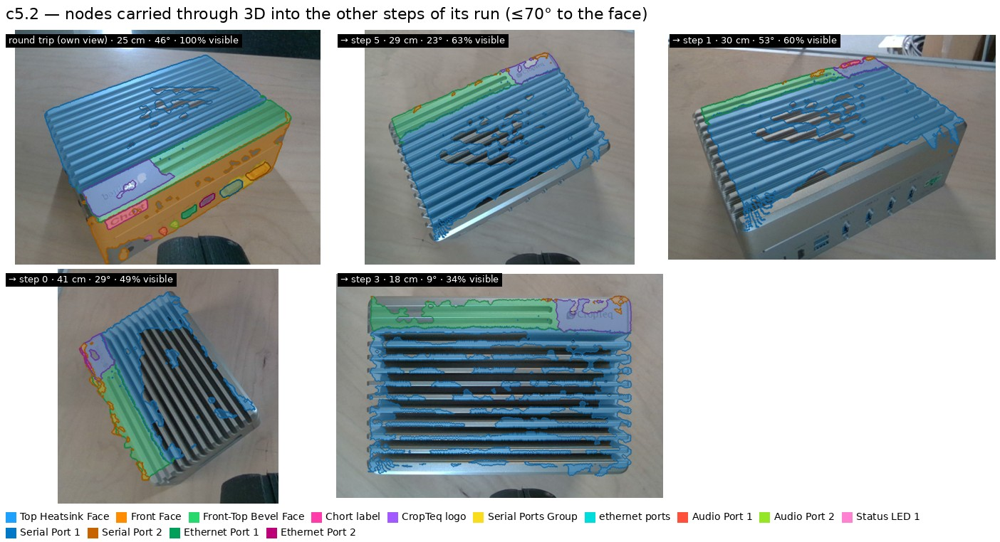
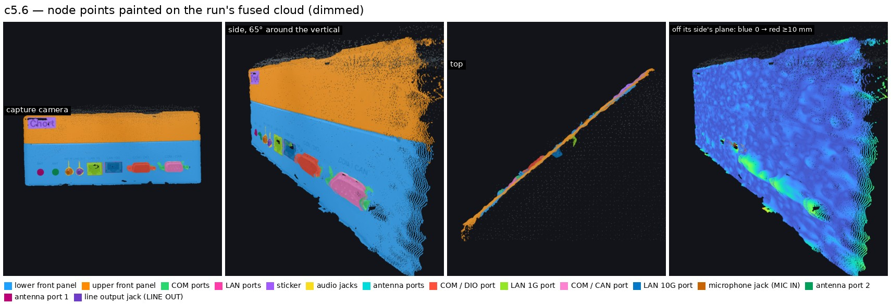
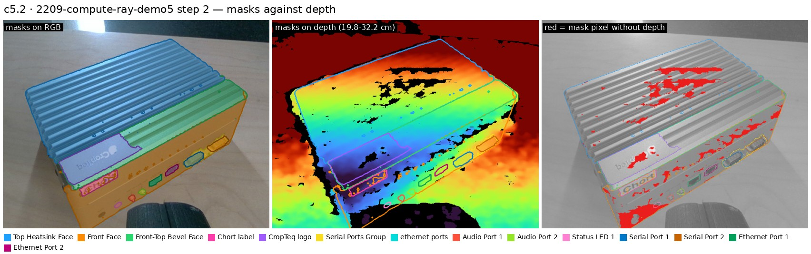
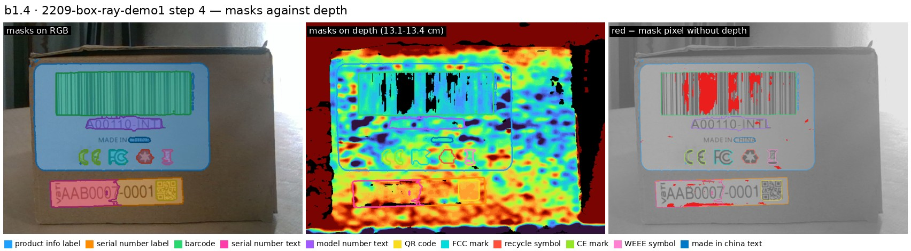
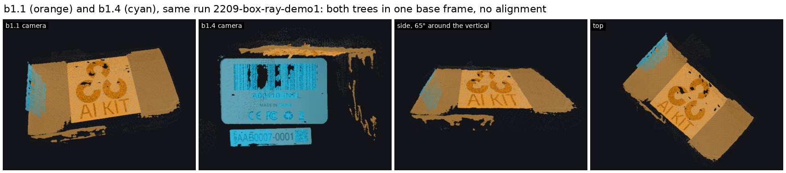

# e03: the tree in 3D — turn 1

**Status:** turn 1, 2026-10-08; the viewer is built and running, the merge experiment
has not started.
**Answer so far:** every e02 node projects into the run's base frame — 85–100 % of a
node's pixels carry depth, and the points land 1–8 mm from the run's fused cloud
(median nearest neighbour), except recessed dark holes (antenna holes 14–25 mm) and the
one frame whose face was never fused (b1.4). Nodes are 3–170 mm across. The viewer
(Viser, browser) shows the cloud with the sides as transparent boxes; a click opens a
node's children, the right panel shows its source frame crop and parents; Back closes.

## What was run

- `project.py` — per node: mask pixels → `cell/geometry.py:deproject` on
  `depth_aligned` with the colour intrinsics (`session.json`) and depth scale → base
  frame via `T_base_cam`; on 180° views the pixels are turned back to raw before
  deprojection. Colours from rgb. Per node: points, centroid, 2–98 % extent, median
  distance to the run's fused cloud. Output `inspection/data/iwm/e03_tree_3d/<frame>/full/
  {nodes.npz, nodes.json, run.json}`, all eight frames.
- `viewer.py` — Viser 1.1.1: one run cloud per run (true colours), one transparent
  PCA-oriented box per node (own mesh, opacity 0.28, level colour), a name label; click
  = open (children appear), click again = close, Back = up one level; the open path as
  breadcrumbs; right panel: name, size, parents, children, the source frame crop with
  the node tinted and its parents outlined. Overview mode: depth checkboxes.
  Launch: `p inspection/investigation/iwm/e03_tree_3d/viewer.py --frames c5.6 c5.2 c5.7 c9.6`
  (compute, port 8080) and `--frames b1.4 b4.5 b1.1 bc5.9 --port 8081` (boxes).

## What we saw

(First screenshots, before the one-frame-at-start default; with all frames on, the
labels of four frames pile up — hence the default.)

## Numbers (from `nodes.json`)

| frame | nodes | pixels with depth | nn to fused cloud (mm) | largest / smallest node (mm) |
|---|---|---|---|---|
| c5.6 | 15 | 85–100 % | 1.8–8.8 (antenna holes 14–25) | panel 116×137×43 / antenna hole 5×5×7 |
| c5.2 | 14 | 52–100 % | 1.5–6.4 | heatsink face 162×172×6 / status LED 3×4×4 |
| c5.7 | 18 | 88–100 % | 1.6–7.6 | front face 116×138×44 / HDMI label 5×6×3 |
| c9.6 | 15 | 99–100 % | 1.3–1.5 | port panel 92×156×44 / HDMI label 4×7×3 |
| bc5.9 | 7 | 89–100 % | 1.5–2.8 | label 65×70×41 / EAN barcode 13×14×7 |
| b1.1 | 5 | 53–99 % | 1.3 | top face 160×173×5 / front face 56×62×70 |
| b1.4 | 11 | 78–100 % | 21–56 (face not in the fused cloud) | label 52×49×44 / WEEE 3×3×6 |
| b4.5 | 7 | 89–100 % | 1.0–1.1 | top face 142×169×6 / serial sticker 47×29×13 |

## Limits

- Extents are axis-aligned in the base frame (percentiles), so a face seen at 45° reads
  wide in both x and y; the viewer's boxes are PCA-oriented and tighter.
- b1.4's step was never fused into its run's cloud (no recorded mask), so its nodes
  float beside the cloud; a limit of the recording, not of the projection.
- Depth on recessed dark features (antenna holes) is passive-stereo noise.
- The pairs c5.7 / c9.6 and b1.4 / b4.5 are different runs; their base frames do not
  share the object pose, so the offset between "the same part" is the align question,
  not yet measured.

## Turn 2: how well the masks land on the geometry

**Answer so far.** Inside one view the 2D-to-3D lift is clean: almost no node point
leaves its side's plane (0–3 % beyond 8 mm), and the only losses are depth holes on
dark print (barcode bars, heatsink fins, a status LED). Two views of one run put the
same part **6.4 mm apart, straight up in z** (one rigid shift, 1.6 mm left after
removing it, over 10 parts of c5.6 / c5.2). Carried into other steps, parts land on
the right part when the view is within ~70° of the face.

Commands: `p inspection/investigation/iwm/e03_tree_3d/quality.py` (per frame) and
`pair3d.py` (both trees of one run in 3D). Numbers are in
`evidence/projection_quality.json` and `evidence/pairs_3d.json`.

**Both trees in one base frame (c5.6 orange, c5.2 cyan, no alignment).** In every
zoom the cyan copy sits about 6 mm above the orange one: same direction, same size.

**Carried into other steps.** The nodes go through 3D into the step's image and are
occlusion-tested against that step's depth. White outlines are the target's own e02
masks.

**One view in 3D.** Painted points from the camera, the side and the top, and the
distance from each point to its side's plane. Only port recesses light up.

**Masks against depth.** Red marks mask pixels with no depth: barcode bars and the
heatsink.

**Adjacent faces of one run (b1.1 top, b1.4 front).** No part is shared. The cyan
face should meet the orange top along the box edge. b1.4 was never fused (no
recorded mask), so here it is checked only against b1.1.

| pair | parts matched | mean gap | gap vector (base, mm) | left after removing the shift |
|---|---|---|---|---|
| c5.6 → c5.2 | 10 | 6.4 mm | (−0.2, −0.4, +6.4) | median 1.6, max 4.8 mm |

**What it means for the merge.**
- The gap is one shift per view, so aligning a new view to the IWM before matching
  (one translation fitted on the matched parts) would bring matching to ~2 mm.
- Nearest-centroid matching makes confident wrong merges where the other view has no
  counterpart. c5.2's tree has no antenna ports, so c5.6's antenna ports matched
  "Status LED 1" at 8.6 mm and "Audio Port 1" at 25 mm. A match needs a name or
  appearance check, and an explicit "not seen in this view".
- Views beyond ~70° to the face, and the survey view (step 0, ~40 cm), carry
  badly: a thin streak, and for bc5.9 onto the table beside the box.

## What changes

- Next: the align and merge step on the pairs (Anton's experiment); first the
  granularity changes from e02's judgement (port + label at level 2) so the merge
  works on the trees he wants.
