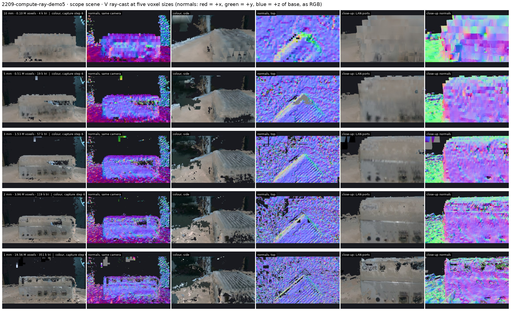
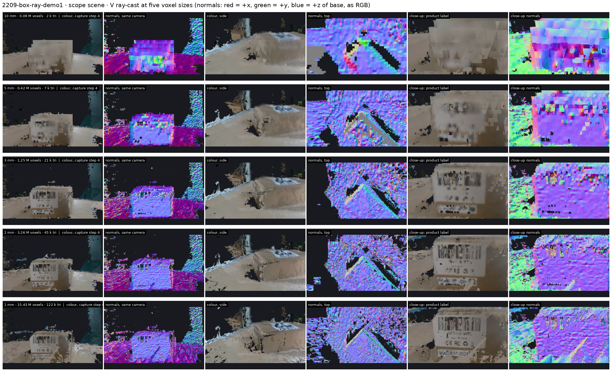
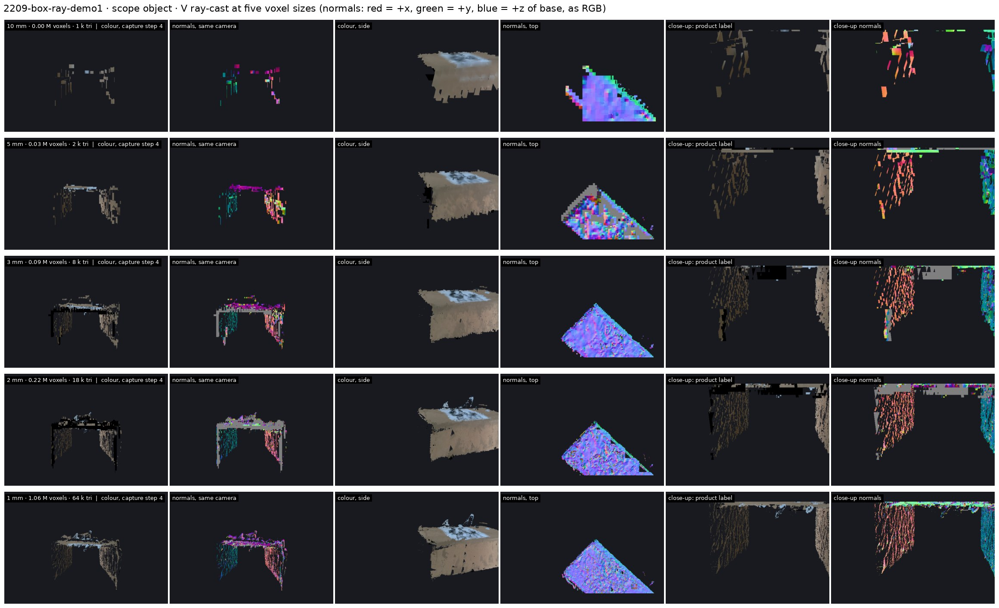
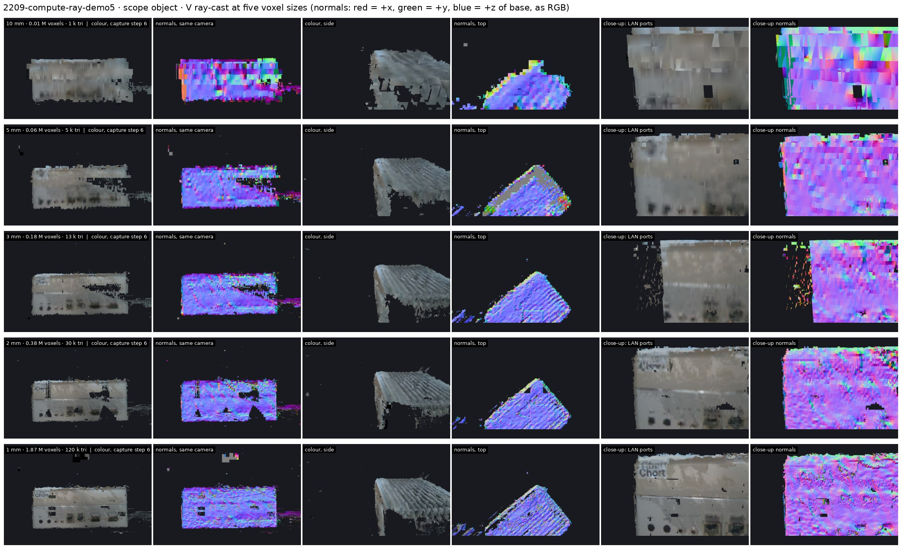
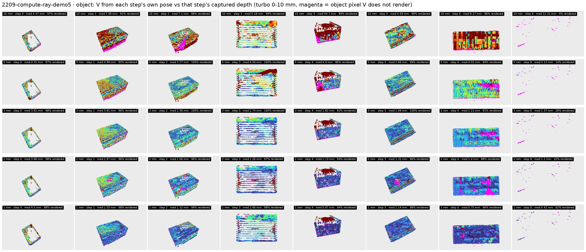
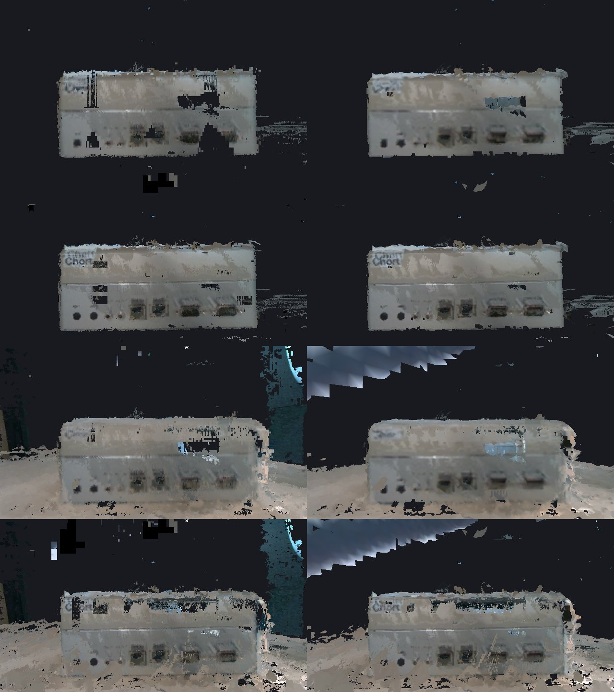

# e04: the voxel geometry V of a run: build, navigate, resolution (turn 1)

**Status:** turn 1, 2026-10-12. V is built and rendered, and the viewer runs. Closing
needs Anton's walk through the viewer and his choice of the size e05 builds on.

**Answer so far:**
- A TSDF voxel grid (Open3D `VoxelBlockGrid`) fuses a whole run in well under a second
  at any size from 10 mm to 1 mm.
- At **1–2 mm** the details we care about are present as shapes:
  - compute: the port row as recesses, the "Chort" wordmark;
  - box: the barcode, the CE/FCC marks and the serial line on the product label.
- At **5–10 mm** they are blobs.
- Rendered from a step's own pose, V matches that step's depth to a median of **~1 mm
  at 1 mm** and **~2 mm at 2–3 mm**.
- The **object scope loses whole faces** wherever a step has no recorded mask. The
  **scene scope** keeps them.

## What was run

- `build.py`:
  - Per step: aligned depth (13–60 cm) plus RGB, integrated with the recorded
    `T_base_cam` as-is. 180° steps are turned back to raw first.
  - Truncation is max(4 voxels, 4 mm). Block resolution is 16.
  - Runs: `2209-compute-ray-demo5` (9 steps) and `2209-box-ray-demo1` (5 steps).
  - Scopes: object (depth outside `mask.png` zeroed) and scene (full depth; the mesh is
    cropped to the object's extent plus 12 cm. The first version cropped to the cell's
    `WORKSPACE` box, which cut the compute unit at x = 0.05 m. That affected only the
    viewer's mesh: the ray-cast figures read V directly).
  - Sizes: 10, 5, 3, 2, 1 mm.
  - Output: `inspection/data/iwm/e04_voxel_scene/<run>/<scope>/<mm>mm/{vbg.npz, mesh.ply, stats.json}`.
- `render.py`:
  - Ray-casts V for depth, normal and colour (the same call view selection will use).
  - Cameras: the reference capture, the side, the top, and a close-up on the LAN ports
    (compute) or the product label (box).
  - Self-check: V from every step's own pose against that step's captured depth, on
    the object pixels.
- `viewer.py`:
  - Viser on port 8082; the surface is V's mesh, and a dropdown switches the voxel
    size.
  - A click casts the ray into the mesh and shows the point, its voxel index and the
    normal (drawn as a line).
  - It lists every step that saw that point (projected, depth within 8 mm), with its
    angle to the normal and its distance.
  - It shows the crop from the most face-on step. Step cameras can be shown as
    frustums.
  - Launch: `p inspection/investigation/iwm/e04_voxel_scene/viewer.py [--run …] [--scope scene|object]`.

## What we saw

**Compute, scene scope.** Down the rows the voxel size shrinks. The close-up (column 5)
goes from blobs at 10 mm, through dark port recesses at 3 mm, to the wordmark at 1 mm.

**Box, scene scope.** The product label on the x+ face: the barcode appears at 3 mm, and
the marks and serial line at 1 mm.

**Box, object scope.** The x+ face is missing because step 4 has no recorded mask, so the
object scope never integrated it. This is the same gap as b1.4 in e03.

**Compute, object scope.**

**Self-check.** V from each step's own pose minus that step's depth (0–10 mm; magenta =
an object pixel V does not render).
- Step 0 (the survey view) stays at ~4.5 mm at every size. This is the known survey
  offset.
- Step 8's recorded mask is nearly empty.
- Step 4's top reads > 10 mm: the grazing view of the top disagrees with the face-on
  views.

**The viewer's mesh vs V.** At first the viewer looked far holier than these figures, for
two reasons, both now fixed:
- Mesh extraction at `weight_threshold=1.0` dropped every voxel seen by only one view
  (the test is "greater than").
- The browser culled the ~30 % of marching-cubes triangles whose winding points away
  from the camera.

After both fixes, the mesh from step 6 (right) matches V ray-cast from the same pose
(left). Rows: object 2 mm, object 1 mm, scene 2 mm, scene 1 mm. The scene scope also
picks up a few junk sheets seen by one view only (top right).

## Numbers

From `evidence/build_stats.json` and `evidence/render_stats.json`. Self-check values
are the median over steps.

| run | scope | voxel | observed voxels | memory | V vs own depth, median | p90 | share > 5 mm |
|---|---|---|---|---|---|---|---|
| compute5 | object | 10 mm | 7.9 k | 3 MB | 7.5 mm | 16.8 mm | 68 % |
| compute5 | object | 5 mm | 55 k | 9 MB | 4.0 mm | 10.4 mm | 38 % |
| compute5 | object | 3 mm | 185 k | 19 MB | 2.0 mm | 6.9 mm | 20 % |
| compute5 | object | 2 mm | 384 k | 31 MB | 1.4 mm | 6.4 mm | 17 % |
| compute5 | object | 1 mm | 1.87 M | 96 MB | 1.2 mm | 4.3 mm | 12 % |
| compute5 | scene | 2 mm | 3.96 M | 206 MB | 2.0 mm | 7.9 mm | 27 % |
| compute5 | scene | 1 mm | 19.6 M | 787 MB | 1.9 mm | 8.7 mm | 23 % |
| box1 | object | 2 mm | 222 k | 11 MB | 2.7 mm | 6.5 mm | 25 % |
| box1 | object | 1 mm | 1.06 M | 40 MB | 1.0 mm | 5.1 mm | 23 % |
| box1 | scene | 2 mm | 3.26 M | 161 MB | 2.4 mm | 6.0 mm | 26 % |
| box1 | scene | 1 mm | 15.4 M | 634 MB | 1.0 mm | 5.4 mm | 25 % |

Build time is ≤ 0.02 s per run at every size on the RTX 5090 (Open3D CUDA). Mesh
extraction is not included in that figure.

## Limits

- Poses are as recorded. Where views disagree (survey step 0, grazing step 4), V
  averages them inside the truncation band. Nothing here corrects that; it is left for
  the offset investigation.
- The self-check compares V against depth that helped build V. It shows consistency, not
  accuracy.
- Port recesses have no depth on the dark inner walls, so a port is a hole with an
  edge, not a modelled socket.
- The mesh is only the viewer's surface. Queries (ray cast, point, normal) run on V or
  on that mesh; nothing about nodes is stored yet.

## What changes

- For the box, the **scene scope** is the usable V, because the mask-based object scope
  drops unmasked steps. A way to cut out the object without per-step masks (for example
  a box around the object above the table) is open.
- The size for e05 is Anton's call after the viewer: 1 mm or 2 mm.
