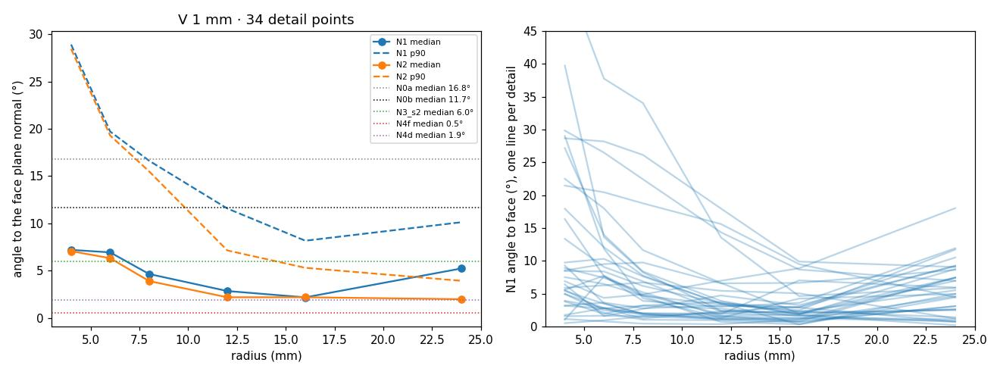
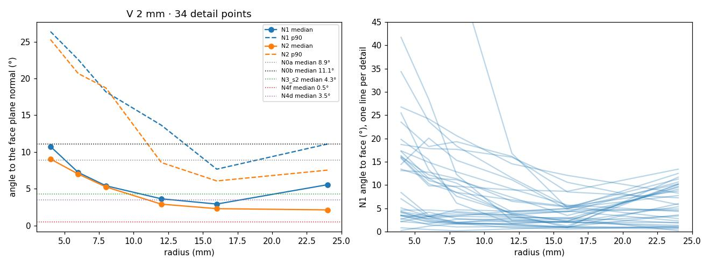
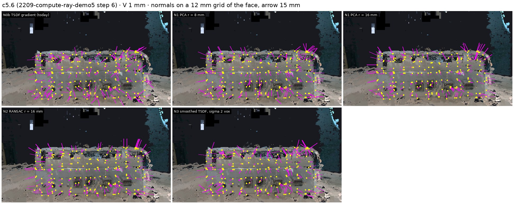
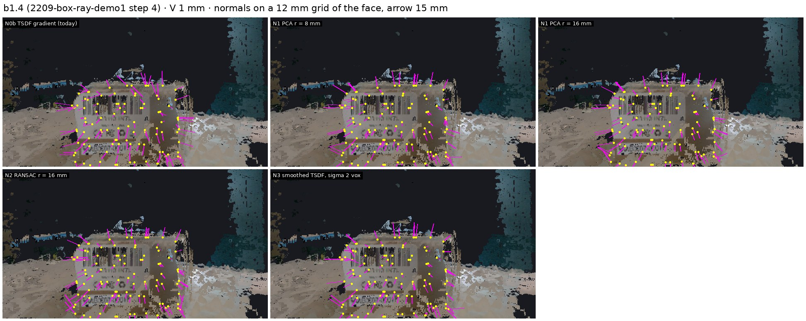
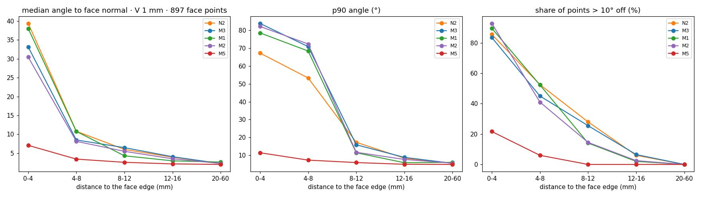

# e04 / normals: a reliable surface normal at a point of V

**Status:** run 2026-10-12. Closes once Anton has tried the viewer and chosen the method.

**Answer.** A plane fit over a **region of ~16 mm radius**, robust to outliers, makes the
normal steady on the 34 detail points of four frames:
- **N2 (RANSAC, then PCA on the inliers), at 1 mm voxels:** median **2.2°** off the face
  plane, p90 **5.3°**. Normals at nearby points agree to 0.5°.
- **Today's normals (one triangle, or the TSDF gradient over one voxel):** median
  11–17°, p90 38–54°, spread 7–12°.

The detail's own points (N4d) are worse than the region fit around it (p90 10–12°). So
for a 5–20 mm part, the right normal is the normal of the surface around it.

## What was run

`normals.py`, on e04's scene-scope V of compute demo5 and box demo1, at 2 mm and 1 mm.
- **Surface points:** `vbg.extract_point_cloud(weight_threshold=0.5)`.
- **Test points:**
  - 34 e03 detail nodes from c5.6, c5.2, b1.1 and b1.4 (ports, jacks, labels, stickers,
    the barcode);
  - each snapped to the nearest surface point;
  - each normal flipped towards the camera that captured that frame.
- **Reference:** RANSAC plane (2 mm), then PCA on the inliers, over all V points of the
  face the detail sits on.
- **Methods:**
  - N0a: the triangle normal;
  - N0b: Open3D's ±1-voxel TSDF difference;
  - N1: Gaussian-weighted PCA, r = 4–24 mm;
  - N2: RANSAC 3 mm, then PCA on the inliers, r = 4–24 mm;
  - N3: weight-aware Gaussian blur of the TSDF (σ = 1–3 voxels), then the gradient;
  - N4f: the face plane with the detail removed;
  - N4d: the detail's own points.
- **Checks:**
  - The dense-TSDF voxel order was checked: zero crossings lie 0.5–0.7 mm from V's
    surface, against 3.3–3.7 mm with the other axis order.
  - One N2 query takes ~2 ms.

## What we saw

**Angle to the face normal vs radius** (left: median and p90 over all points; right: N1,
one line per detail). Both fits improve up to 12–16 mm. Past that, plain PCA starts
taking in neighbouring faces at 24 mm, while RANSAC keeps improving.

**Normal fields on the face**, on a 12 mm grid of the face's points.
- The face is seen head-on, so a correct normal shows as a dot or a short tick toward
  the camera; a long arrow is a tilted normal.
- Today's gradient (N0b) sprays in all directions.
- At r = 16 mm, RANSAC (N2) leaves long arrows only at the face's edges, where the
  region takes in the side face.

## Numbers

From `evidence/normals/normals.json`: angle to the face normal over 34 detail points.
Spread = the mean angle of the normals at 8 points within 3 mm of the detail.

| method | 2 mm median / p90 | 1 mm median / p90 | spread 2 mm / 1 mm |
|---|---|---|---|
| N0a triangle (viewer today) | 9.2° / 38.4° | 16.8° / 46.5° | — |
| N0b TSDF gradient (renders today) | 11.1° / 28.0° | 11.7° / 54.0° | 7.4° / 11.5° |
| N1 weighted PCA r 8 mm | 5.8° / 18.2° | 4.7° / 16.6° | 1.7° / 1.6° |
| N1 weighted PCA r 16 mm | 2.8° / 8.4° | 2.2° / 8.2° | 1.1° / 0.9° |
| N1 weighted PCA r 24 mm | 5.7° / 11.5° | 5.2° / 10.1° | — |
| N2 RANSAC r 12 mm | 3.4° / 9.5° | 2.2° / 7.1° | — |
| **N2 RANSAC r 16 mm** | **2.2° / 8.3°** | **2.2° / 5.3°** | **0.7° / 0.5°** |
| N2 RANSAC r 24 mm | 2.0° / 7.3° | 2.0° / 3.9° | — |
| N3 smoothed TSDF σ 2 voxels | 4.5° / 14.2° | 6.0° / 26.2° | 2.1° / 3.1° |
| N4f face minus detail | 0.4° / 1.1° | 0.5° / 1.2° | — |
| N4d detail's own points | 3.7° / 12.3° | 1.9° / 10.0° | — |

**The worst N2 cases at r 16 mm** are the serial (DB9) ports in c5.2: 7–11° off. Their
connector shells stick out of the face, so the surface around them really is tilted,
and c5.2 sees that face from an angle. Going to r 24 mm brings them to 4–5°.

## Limits

- **N4f is almost circular.** It fits nearly the same points as the reference, so its
  0.4° shows that removing the detail changes nothing. It does not measure accuracy.
  It still needs the masks, which arrive in e05.
- **The reference is the face plane fitted in V.** If the whole face is tilted by the
  per-view offset, every method inherits that tilt. This measures noise, not absolute
  orientation.
- **N3 is limited by the truncation band** (max(4 voxels, 4 mm)). Its σ is counted in
  voxels, so at 1 mm it smooths over a smaller physical patch. That is why it is worse
  at 1 mm.
- 34 points from two runs; edges and curved surfaces are barely tested.

## What changes

- **The viewer now has a Normal panel:** method (N0a–N3), radius slider and σ slider.
  It shows the normal at the clicked point, the region as a transparent sphere, and how
  far apart the five methods are. The default is RANSAC at r 16 mm.
- **The normal belongs to the surrounding surface, not to the small part.** For S/T/V
  this suggests a part's facing direction is taken from a ~16 mm region around it (or
  from its face) rather than from its own few points. This is Anton's call.
- 1 mm and 2 mm give the same N2 result, so the normal does not drive the voxel-size
  choice.

## Turn 2: near a face edge

**Question (Anton).** Near an edge the 16 mm region takes in the orthogonal side. Do
the methods from the field fix that, without breaking the interior?

**Answer.**
- **None of the purely geometric methods fixes points within 8 mm of an edge.** At 1 mm,
  all four (largest plane, multi-plane, shifted neighbourhoods, voting) are 8–11° median
  and 50–72° p90 at 4–8 mm from the edge, and 30–40° median at 0–4 mm.
- **The one that works uses the semantics:** fit only the points of the point's **own
  face** within 16 mm (M5). It holds at **3.4° / 7.3° at 4–8 mm** and 7° / 11° at
  0–4 mm, and does not break the interior or the details.
- Shifted neighbourhoods (Anton's idea, M1) help at 8–16 mm: the share of points > 10°
  off drops from 28 % to 14 % at 8–12 mm.

**What was run.** `normals/edges.py`, on V at 1 and 2 mm, radius 16 mm.
- **Test points:** points of the faces of c5.2 (top, front, bevel), c5.6 (both panels),
  b1.1 (top, front) and b1.4 (front).
- **Binned by distance to the edge:** the nearest V point of the object that lies more
  than 6 mm off the face plane.
- **Up to 25 points per face and bin,** plus turn 1's 34 detail points as the
  non-regression set.
- **Methods:**
  - N2: turn 1's largest RANSAC plane;
  - M3: multi-plane RANSAC (up to 3 planes), keeping the plane the point lies on;
  - M1: shifted neighbourhoods (13 regions of radius r containing the point, the
    flattest wins, its plane must pass within 3 mm of the point);
  - M2: Hough-style voting (400 random triplets, only planes passing within 2 mm of the
    point; the densest cluster wins);
  - M5: RANSAC + PCA over the own face's points only.

**Numbers** (`evidence/normals/edges.json`): median / p90 / share of points > 10° off
the face normal, V at 1 mm.

| distance to edge | N2 (turn 1) | M3 multi-plane | M1 shifted | M2 voting | M5 region fit, parent-face points only |
|---|---|---|---|---|---|
| 0–4 mm (n 97) | 39.4° / 67.2° / 86 % | 33.1 / 83.9 / 84 % | 38.0 / 78.6 / 90 % | 30.4 / 82.2 / 93 % | **7.1 / 11.4 / 22 %** |
| 4–8 mm (n 200) | 10.8 / 53.3 / 52 % | 8.5 / 70.8 / 45 % | 10.8 / 68.4 / 52 % | 8.1 / 72.3 / 41 % | **3.4 / 7.3 / 6 %** |
| 8–12 mm (n 200) | 6.0 / 17.3 / 28 % | 6.5 / 15.9 / 26 % | 4.3 / 11.4 / 14 % | 5.5 / 11.7 / 14 % | **2.6 / 5.9 / 0 %** |
| 12–16 mm (n 200) | 3.9 / 8.4 / 6 % | 4.0 / 8.8 / 6 % | 3.0 / 5.8 / 2 % | 3.5 / 7.7 / 2 % | **2.1 / 5.0 / 0 %** |
| > 20 mm, interior (n 200) | 2.2 / 5.5 / 0 % | 2.2 / 5.5 / 0 % | 2.6 / 6.0 / 0 % | 2.3 / 5.6 / 0 % | 2.0 / 4.9 / 0 % |
| 34 details (turn 1 set) | 1.9 / 6.9 / 0 % | 1.8 / 5.5 / 0 % | 2.4 / 6.1 / 3 % | 1.8 / 6.7 / **9 %** | 1.9 / 3.7 / 9 % |

At 2 mm the pattern is the same. The 0–4 mm bin is nearly empty there, because the
8 mm truncation rounds the edges. M2 breaks the details there (p90 10.5°, 12 % > 10°).

**Why the geometric methods fail.** I classified the off-plane geometry within 12 mm
of the near-edge points by its normal (469 samples):
- 39 % are real orthogonal sides;
- 34 % are oblique (bevels, rounded edges, connector shells);
- 27 % are parallel layers (the heatsink fins on c5.2's top, and ghost copies from the
  per-view offset).

With three kinds of contamination mixed in one region, the "plane through the point" is
often not the face's plane. Only knowing which points belong to the face removes all
three.

**Non-regression.**
- Interior points: every method is within 0.4° median and 0.5° p90 of N2.
- The 34 details:
  - M3 is as good or better (p90 5.5° vs 6.9°);
  - M1 is slightly worse at 2 mm (p90 9.1° vs 7.2°);
  - M2 breaks them (9–15 % > 10°);
  - M5's 9 % > 10° is 3 of the 34. These are details whose face points within 16 mm
    are few (c5.2's serial ports at a grazing angle).

**Limits.**
- M5 and the reference both use the face's points, so M5 is favoured. Its real claim is
  that once the face is known, the region never crosses into the next face. Its
  accuracy depends on the face mask, which here is e03's projection from one view.
- "Edge distance" also counts protrusions (ports, fins) as edges.

**What changes.**
- **Without a face (before T):** keep N2, or M3 for a small gain with no regression.
  Expect normals within ~8 mm of an edge to be unreliable, and flag them using the
  distance to off-plane geometry.
- **With a face (T, e05 onwards):** a part's normal = RANSAC + PCA over its **own face's**
  points within 16 mm. This is the first concrete place where T informs V.
