# Partial prompt box → partial SAM mask: mitigation, benchmarked

**Question.** When the accumulated cloud covers only part of the object, the
reprojected prompt box frames only that part, SAM 3 segments only inside it,
and only those points fuse — a self-limiting loop. `floor_z` broke the
*vertical* version (top-anchored survey); the *lateral* version was open.
What fixes it, proven on the `1009-lan*` runs?

**Answer.** Anchor the prompt on the detector: `Sam3Model` text-`"object"`
detection, instance picked by projected-prior-cloud containment, its box
through the tracker; the shipped box prompt stays as the fallback rung.
On the lan benchmark the object's full footprint is believed from **view
0–1 instead of view 15–21**, final clouds are point-for-point unchanged,
and the cup runs show no regression. Every box-*growing* scheme fails —
measured, below.

---

## 1. The failure, measured

Benchmark: `1009-lan1/2/3` — black NETGEAR switch, the worst case for
passive stereo (dark gloss → sparse depth → partial reconstruction).

Run lan1, view 001: the fused cloud covers the left half of the switch,
so the box covers the left half, so the mask stops there — 15,907 px at
score 0.64 where converged views measure ~47,000 px at 0.98:

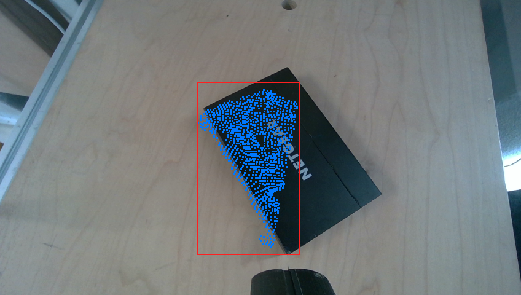
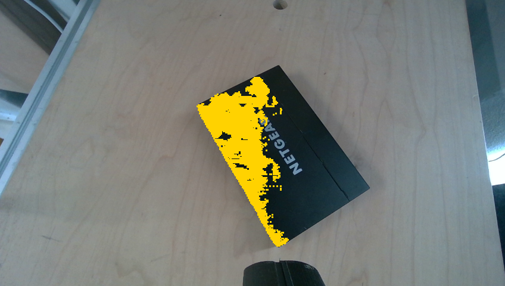

All three lan runs open with 3–7 such views (scores 0.64–0.89) and crawl:
lan1's believed extent needs ~10 views to go 93×143 → 167×172 mm. In
step.json the tell is `offered == kept, dropped = 0` — the *mask*
excluded the sides, no filter did. Until convergence the collision box is
**up to ~40 mm short toward the unseen side** — the direction the arm
sweeps across (same failure direction as the WORKSPACE amputation found
on 2408-cup4).

## 2. Single-view A/B — eight prompts, five runs, 121 views

`partial_prompt_probe.py` re-prompts every recorded view eight ways, all
derived from exactly what the run knew pre-segmentation (recorded box +
previous step's fused cloud; GT never enters a prompt). Score = recall of
the run's *final* converged cloud projected into the view.

On the 13 **true-partial** views (base recall < 0.6) across all 5 runs:

| candidate | recall on true partials | verdict |
|---|---|---|
| base (recorded box) | 0.39 | the failure |
| loose25 / loose50 (grown box) | 0.46 / 0.03 means, spill → 176k px | **catastrophic** — tracker score collapses to 0.01–0.45, grabs the table |
| iter (re-prompt growing hugged sides) | ≈ base or worse (lan1 001: 0.31→0.01) | inherits the loose-box pathology |
| pts (5 FPS cloud points, no box) | 0.81–0.90 early, **0.14–0.32 late** | segments the TABLE at score 0.70 — *above* the 0.5 gate. Silent poison, disqualified |
| boxpts (box + points) | 0.45–0.66 | still box-capped |
| mask2 (SAM mask-refine, grown box) | ≈ base | no help |
| **detect (containment-picked instance)** | **0.75–0.89** | stable early *and* late, lowest spill |

Aggregate on true partials: **base 0.394 → detect-with-base-fallback
0.749**; no view anywhere regressed by >0.1; control views unchanged.

View 001, all candidates side by side — `detect` recovers the whole
switch at s0.99 while every grown box falls apart:

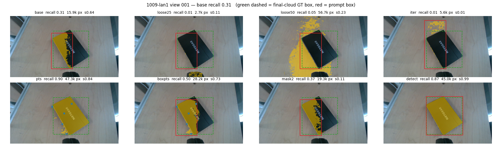

A converged view — `detect` ≡ base, and `pts`' table-grab failure mode
(bottom-left panel):

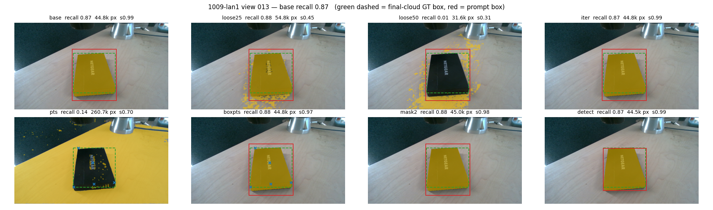
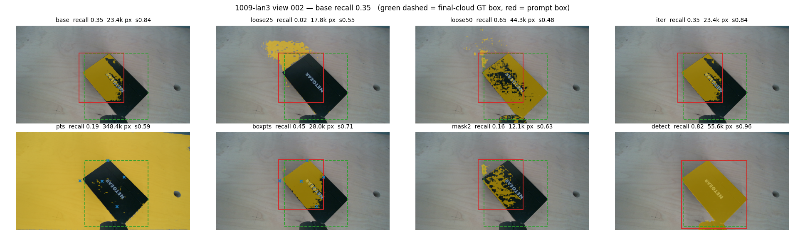

Two design lessons the table encodes:

- **A box prompt is an extent ceiling, not a hint.** Points from only the
  *seen half* let SAM return the whole switch — the model always knew the
  full object; the box was forbidding it. (Consistent with SAMRefiner /
  SAMAug: boxes constrain, points recover truncation.)
- **The shipped small `PROMPT_GROW=0.10` is validated, not a bug.** Any
  generous growth collapses the tracker on this scene. "Just widen the
  box" is not a fix; it is the worst option measured.

## 3. The policy

`DetectAnchoredSegmenter` (in `partial_prompt_replay.py`), a strictly
additive rung on the shipped ladder:

1. `Sam3Model` text `"object"` on the upright frame → ~200 instances.
2. Identity = the projected prior cloud (the same `source` the prompt box
   is built from): keep instances containing ≥ 0.5 of it, pick max
   score × containment. No pick → step down.
3. `Sam3Tracker` on that instance's box; shipped score/px gates unchanged.
4. Fallbacks: shipped box prompt → depth path, exactly as today.

The text prompt is generic ("object"), not per-object programming;
identity still comes from geometry, extent now comes from the detector's
objectness instead of from what stereo happened to return. Cost: +1
detector call ≈ +70 ms/view on the 5090, and only when a prior cloud
exists.

## 4. Closed-loop proof

`partial_prompt_replay.py` replays the whole loop — the **shipped**
`object_view`, recorded table plane forced back in (step_replay recipe),
real `floor_z`, live SAM 3 — with the recorded runs as the baseline (they
ran the identical loop, box-prompted).

| run | full footprint believed at view (mitigated vs recorded) | branches detect/box | misses |
|---|---|---|---|
| 1009-lan1 | **0** vs 19 | 24 / 1 | 1 |
| 1009-lan2 | **1** vs 15 | 19 / 5 | 0 |
| 1009-lan3 | **1** vs 18 | 19 / 2 | 0 |
| 1009-cup1 | **0** vs 21 | 21 / 7 | 0 |
| 1009-cup2 | **4** vs 20 | 23 / 5 | 0 |

(Yardstick: first view whose cloud reaches 95 % of the recorded final xy
footprint, raw AABB both sides.)

lan1 highlights: the survey view — which recorded **no mask at all** —
now masks 13,996 px; view 001 masks 44,970 px vs 15,907; the believed
extent is 177×178 mm at view 1 vs 93×143 recorded.

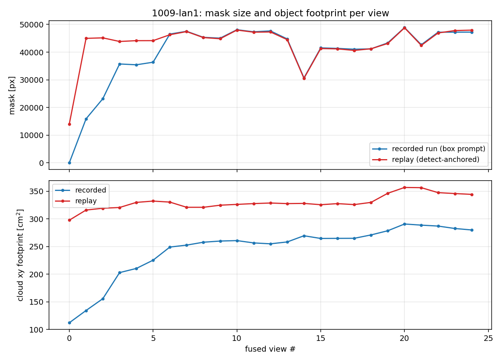
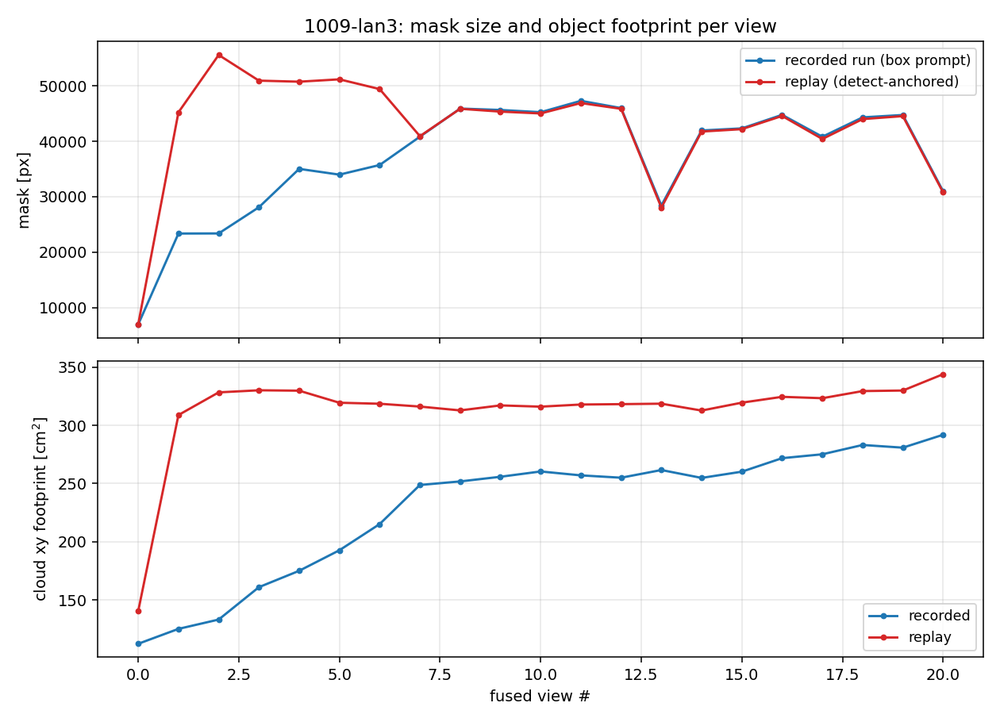

**The final geometry is unchanged** — the fix moves *when* the object is
known, not *what* is known. Replay final cloud vs recorded final cloud:
0 points farther than 10 mm on every lan run (and 0–15 of ~8,000 beyond
5 mm); cup2: 4 points beyond 10 mm. No fuzz ring, no table points.

**What does not accelerate:** point-density *coverage* of the far
surfaces (8 mm-voxel coverage of the final object: 50 % at view 1 vs 3–5,
but 80/90 % unchanged). A full mask cannot create stereo returns on black
gloss, and a replay repeats the recorded trajectory. In a live run the
early-correct extent feeds the viewsphere radius, boxguard anchor and
collision box from view 0 — planning effects a replay cannot show.

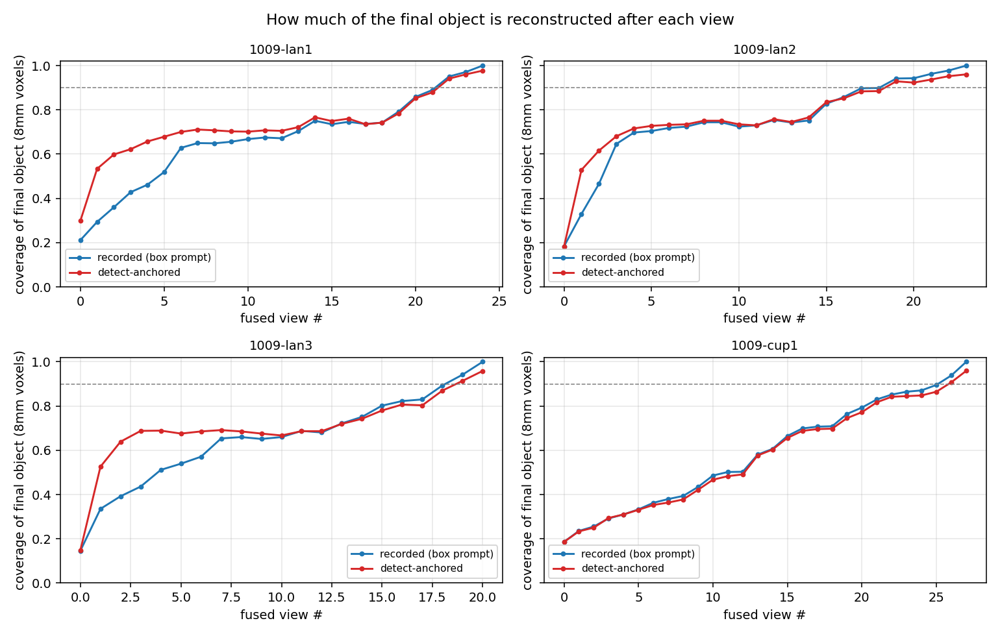

**Regression check:** cup1/cup2 (ceramic mug — depth-friendly, box prompt
mostly fine): detect agrees with base on converged views, abstains cleanly
on 5–7 views (→ recorded behaviour), zero misses, same final cloud — and
still finds the full cup+handle footprint ~16 views earlier, because the
handle is depth-sparse too.

## 5. Sharp edges, honestly

- **"object" is still a text concept.** It scored 0.98–0.99 on switch and
  cups here, but the detector abstained on 10–25 % of views (clean
  fallback each time). Untested: several similar objects adjacent —
  containment should disambiguate, not yet measured.
- Replay cannot test how the *planner* exploits early extent; that needs
  a live run.
- Not integrated into `run/segmenter.py` yet — integration point:
  `object_view` already holds `source`; `ObjectSegmenter` grows a detect
  rung with `MIN_CONTAINMENT`/`MIN_DET_SCORE` beside the existing gates.

## Reproduce

```
p inspection/investigation/partial_prompt/partial_prompt_probe.py --run 1009-lan1
p inspection/investigation/partial_prompt/partial_prompt_replay.py --run 1009-lan1
```

Artifacts: `/tmp/partial_prompt_probe/<run>/` (per-view metrics.json +
candidate overlays), `/tmp/partial_prompt_replay/<run>/` (steps.json,
per-step clouds, curves). Runs under `data/datasets/` untouched.

## 6. False-positive audit (all 5 runs, every view)

`false_positive_audit.py` runs the exact ladder on all 125 recorded views
and scores every **accepted** mask against the final-object silhouette —
plus records every detection the containment guard refused.

- **Decision level:** the detector was "tempted" 21 times across 15 views
  (confident score ≥ 0.5 on the mouse, table regions, merged blobs) —
  containment rejected **every one**. Wrong instance accepted: **0 / 125**.
  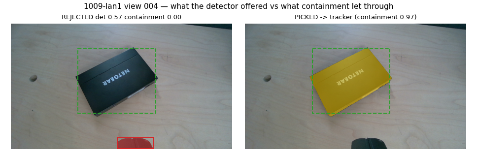
- **Mask level:** precision median **1.000**, p5 0.954, min 0.830; only
  1 of 125 views below 0.90 — and the worst offenders are visibly benign
  (low-ring perspective vs the xy GT box, several on the *box* branch,
  i.e. today's behaviour):
  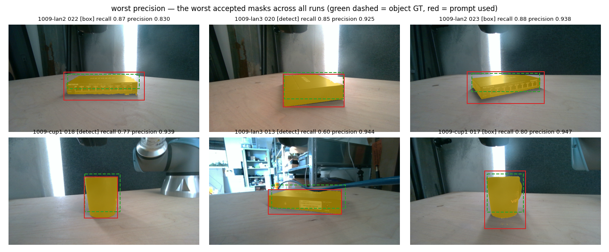
- **The low-recall tail is not the new rung:** the worst two (0.38/0.41)
  are survey views on the box fallback — the failure being fixed — and
  the rest are the blue cable *occluding* the object, where the mask
  correctly stops at the cable and never includes it (the 2408-cup2
  poison stays prevented):
  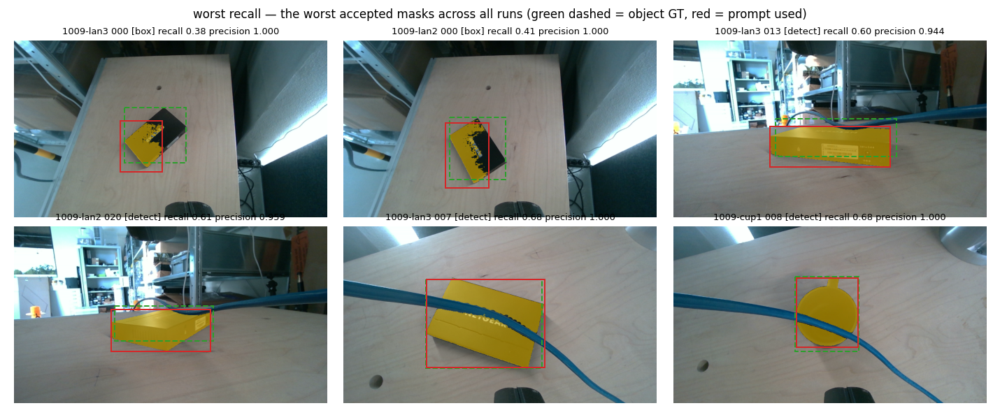
- **Geometry level:** across 105 detect-branch views fused in the
  closed-loop replays, the final clouds are point-identical to the
  recorded ones (no point beyond 10 mm) — no foreign point ever entered
  the object cloud.

Branch quality: detect n=105 recall/precision medians 0.80 / 1.000;
box-fallback n=20 medians 0.81 / 1.000; misses 0.

## 7. Shipped

The rung is integrated (2026-09-14): `eyes/verbs_local.py` grew
`instances()` (detection WITH masks, `Instance` dataclass, stub included),
`run/segmenter.py` grew `DETECT_PHRASE`/`MIN_CONTAINMENT`/`MIN_DET_SCORE`,
`ObjectSegmenter._pick_instance` and the two-rung `mask_for`;
`object_view` plumbs `src_px` (raw seen points, not the floor shadow).
7 new tests in `tests/test_segmenter.py` (TDD, red first); suite 406 pass.

Closed-loop verification with the PRODUCTION segmenter
(`partial_prompt_replay.py --shipped`): lan1 24 detect / 1 box, 0 misses,
footprint at view 0 vs 19; cup1 22/6, 0 misses, view 0 vs 21 — and the
survey view now takes the detect rung natively (object_view hands src_px
on every view), so the prototype's first-view retry is obsolete. Final
clouds vs recorded: lan1 0 pts > 5 mm; cup1 5 pts > 5 mm, 0 > 10 mm.
