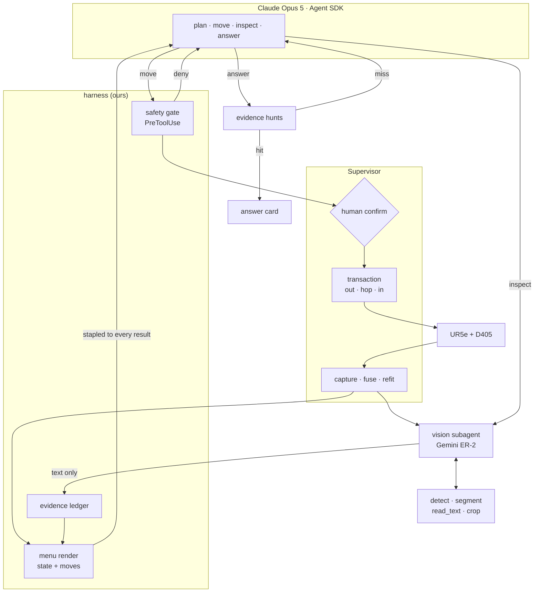

# Demo context — sections 1 and 3

Source document for slide building. Every claim below was read out of the code
at HEAD `884d895` (2026-09-22) or out of a recorded run under
`inspection/data/runs/`. Numbers were computed by reading the files, not
estimated. Nothing was run against the robot.

Paths are relative to `/home/anton/projects/robotics/`.

---

# Section 1 — How the AI drives the robot: the discrete action menu

Spine: *discrete action menu, computed by logic, resolved into motion. Not a
VLA (yet): the model picks, the harness moves.*

## Facts

### The menu is code, and it is the only thing the model sees

- The whole context the top agent gets is text. `brain/render.py` module
  docstring: "The orchestrator never receives pixels (Anton 2026-08-25).
  Everything it knows arrives as text." — `inspection/brain/render.py:1-33`.
- Two kinds of text, deliberately carried by different mechanisms: **content
  accumulates** (view descriptions, the model's own words, in the transcript);
  **state is recomputed** every turn by deterministic code and stamped
  `· turn N ·` — `inspection/brain/render.py:7-21`.
- The menu is *pushed*, not pulled: a `PostToolUse` hook staples the STATE +
  MOVES blocks onto **every** tool result, so the model cannot forget to look.
  "A pull costs a turn and can be skipped; a push cannot."
  — `inspection/brain/loop.py:740-775` (`_staple_state`), registered at
  `inspection/brain/loop.py:854`.
- The renderer *is* the menu: `MENU_ID = "brain-render"`, and the menu's
  content hash is the sha256 of `render.py` itself
  — `inspection/brain/render.py:266-303`.
  **Verified**: `sha256(inspection/brain/render.py)` today =
  `259d7fcf32b02fa8af5d54f1b4556fc6b9612df113057109e459ddf6b10c5346`, which is
  byte-identical to the `content_hash` recorded in
  `inspection/data/runs/2109-box-ray-demo19/ai/000/menu/menu_def.json`. The
  menu text quoted below is the menu the code renders today.
- Every turn's menu *inputs* are also recorded, so a recorded turn can be
  re-rendered instead of re-flown —
  `inspection/data/runs/*/ai/000/menu/inputs.jsonl`, written by
  `inspection/brain/loop.py:706-738` (`_menu_input`).

### Real menu excerpt (recorded run, unedited)

From `inspection/data/runs/2109-box-ray-demo19/ai/000/trace.jsonl`, the `state`
event for turn 2 — this is verbatim what the model read after its first move:

```
STATE · turn 2 · at [1, 2] — azimuth 30°, elevation level 2
        elevation levels: 0 lowest (10°), 1 middle (40°), 2 top (70°)
        visited 1 of 31 reachable · findings 2

MOVES · turn 2 · you are at [1, 2] — elevation level 2 of 0/1/2
  move([2, 2])    30° right     · not visited
  move([0, 2])    30° left      · not visited
  move([3, 2])    60° right     · not visited
  move([11, 2])   60° left      · not visited
  move([4, 2])    90° right     · not visited
  move([10, 2])   90° left      · not visited
  move([5, 2])   120° right     · not visited
  move([9, 2])   120° left      · not visited
  move([6, 2])   150° right     · not visited
  move([8, 2])   150° left      · not visited
  move([7, 2])   180° opposite  · not visited
FACES (orthogonal evidence):
  ["face", "x+"] — settling
  ["face", "x-"] — settling
  ["face", "y+"] — settling
  ["face", "y-"] — settling
  ["face", "top"] — settling
```

Second excerpt (same run, turn 6 — the box has settled, faces are live, and a
visited row carries what the subagent saw there):

```
STATE · turn 6 · standing at the ["face", "top"] evidence view
        visited 2 of 30 reachable · findings 6
...
  move([1, 2])   az 30° lvl 2   · visited · the top face of the box squarely with a white label and a blue cable ly…
  move([7, 2])   az 210° lvl 2  · visited · the top surface of the cardboard box with its white 'AI KIT' label squa…
FACES (orthogonal evidence):
  ["face", "x+"] — ready
  ["face", "x-"] — ready
  ["face", "y+"] — ready
  ["face", "y-"] — ready
  ["face", "top"] — visited (0 deg off)
```

Rendering rules behind those two shapes:

- Standing on a numbered cell → bearings are **relative and egocentric**
  ("30° right", "opposite"), the address absolute. "Absolute for the system,
  egocentric for the model … the model picks from a labelled list and never has
  to COMPUTE an azimuth address itself" — `inspection/brain/render.py:29-33`,
  `inspection/brain/render.py:154-250` (`moves_block`).
- Standing at a face pose (or at the off-grid survey pose) there is no ring
  position to be relative to, so rows carry absolute geometry (`az 30° lvl 2`)
  — `inspection/brain/render.py:211-226`.
- The menu is **complete at the current elevation, no cap**, plus every visited
  cell at other elevations. The old 8-row cap was measured doing harm on
  `2508-aiduck2` — `inspection/brain/render.py:23-28`.
- A visited row carries the subagent's one-clause `saw` note (clipped to 72
  chars, `NOTE_CAP` at `inspection/brain/render.py:63`) and, when there is one,
  a `recommends: <phrase>` line hanging *under* the row
  — `inspection/brain/render.py:197-206`.

### The address space

- **Cells**: `{h, v}`, 12 azimuth bins × 3 elevations = 36 addresses.
  `H_BINS = 12` (30° each, `h=0` faces the robot base) and
  `V_ELEVATIONS = (10.0, 40.0, 70.0)` degrees above the table
  — `inspection/view/grid.py:16-17`. `h` wraps, `v` clamps
  — `inspection/view/grid.py:57-67`.
- **Face addresses**: `["face", name]` with
  `FACES = ("x+", "x-", "y+", "y-", "top")` — five, no bottom
  — `inspection/view/faceview.py:26`. Each is the head-on, orthogonal look at
  one wall of the fitted box.
- **Face status vocabulary**, computed by the Supervisor, not the model:
  `settling` / `ready` / `unreachable` / `visited`, plus `off_angle_deg` when
  the closest reachable look is off head-on
  — `inspection/run/machine.py:1531-1548` (`_face_states`). A face only becomes
  requestable after the box fit has been stable twice (`gate_open =
  self._face_stable >= 2`, `machine.py:1535`).
- **Reachability comes from ray resolution, not from a sphere radius.**
  `view/rays.py:cell_map()` resolves every cell's ray and returns
  `{(h, v): RayResolution | None}` — "The WHOLE grid, always — an inaccessible
  cell is an explicit `None`, not a missing key. That dict IS the machine's
  accessibility gate" — `inspection/view/rays.py:353-376`. The machine holds it
  as `self._reach` (`inspection/run/machine.py:1287-1322`, `:950`, `:1351`) and
  refuses a request whose entry is `None` with the reason
  "inaccessible: no safe sample on its ray" — `inspection/run/machine.py:427-444`.
  Measured cost: ~140–150 ms for the 36-cell grid, paid once per plan and once
  per fuse — `inspection/view/rays.py:364-371`.
- `visited` / `reachable` / `blocked` reach the menu through
  `SupervisorMover.nav()`, which returns exactly the three sets the 3D markers
  are coloured from, plus `faces` — `inspection/brain/live.py:108-129`.
  `blocked` is deliberately soft ("no path from where the arm is standing" can
  become reachable one move later) and renders as
  `· no path from here right now` — `inspection/brain/render.py:188-192`.
- Observed reachable counts (of 36) in the three recorded runs, read from the
  `state` blocks: demo19 23→31, smallcam 32→33, bigcam 29→31. It changes
  during the run because the object box is refitted after every capture.

### The tools the top agent has — exactly four

Verified against `inspection/brain/loop.py:579-705` (`_build_tools`, returning
`[_plan, _inspect, _move, _answer]` at `:705`) and the SDK options at
`inspection/brain/loop.py:827-857`.

| verb | argument schema (literal, from the `@tool` decorator) | line |
|---|---|---|
| `plan` | `{"criteria": str}` | `loop.py:591-600` |
| `inspect` | `{"question": str, "cell": list, "answer_schema": str}` | `loop.py:602-625` |
| `move` | `{"cell": list}` | `loop.py:627-667` |
| `answer` | `{"reasoning": str, "verdict": str, "evidence": str, "evidence_cells": list, "fields": dict}` | `loop.py:669-703` |

- `allowed_tools=[f"mcp__brain__{n}" for n in ("plan","inspect","move","answer")]`
  and `tools=[]` — "no Read/Bash/Edit: this agent has exactly four things it
  can do" — `inspection/brain/loop.py:831-836`.
- `strict_mcp_config=True`, `setting_sources=[]` (this repo's `.claude` config
  is ignored), `permission_mode="dontAsk"` — `inspection/brain/loop.py:835-837`.
- Design rationale for four verbs: "Every additional verb is a distractor, and
  pruning the action set is the biggest measured lever on agent loops
  (AgentOccam `2410.13825`: WebArena 16.5 → 25.8% from pruning alone)"
  — `inspection/brain/loop.py:31-35`.
- `plan` must come first; `inspect` and `move` both refuse until it has been
  called — `loop.py:608-610`, `loop.py:631-632`.
- `MAX_TURNS = 40` is "a budget, not a plan"; running out yields
  `"cannot determine"` as a legitimate result, not a crash
  — `inspection/brain/loop.py:57-59`, `inspection/brain/loop.py:919-928`.

**Read-only helpers the top agent does *not* have.** There is no `crop`,
`recall`, `coverage` or `describe` verb on the orchestrator today. The free,
chainable, read-only tool set lives one tier down, inside the vision subagent:
`TOOLS = frozenset({"detect", "segment", "read_text", "crop", "note"})`
— `inspection/eyes/agents/vlm_agent.py:47`.

**"look/move ends the turn; read-only tools chain freely" — status today.**
The original ruling is design doc D3, `inspection/docs/report/project-definition.md:512-519`
("Agentic within a step, orchestrated across steps … `look(h, v)` moves the arm,
and calling it ends the turn"). In the code today:

- The *spirit* holds and is stronger: the only motion verb is `move`, it is
  gated in code before the actuator, and the harness owns the step counter, the
  40-turn budget and the termination gate.
- The *letter* has moved. There is no code that ends a turn on `move`
  specifically — the Claude Agent SDK ends an assistant turn at every tool call,
  and `self.turn` is incremented by the PostToolUse hook on **every** tool
  result (`loop.py:748`). The free-chaining read-only tools named in D3 are now
  the subagent's, not the orchestrator's.
- The orchestrator's motion-free verb is `inspect`: "This costs NO robot
  motion, so chase a detail through the views you already have before spending
  a move" — `inspection/brain/loop.py:88-95`. Runs do use it that way: smallcam
  demo5 chained three `inspect` calls on `["face","x-"]` in a row
  (`trace.jsonl` t≈460.9 / 486.2 / 507.9).

Do not claim on a slide that the harness mechanically ends the turn on `move`.
Claim: *motion is one verb, it is approval-gated, and looking again is free.*

### From a picked address to motion (the hand-off — section 4 owns the depth)

One paragraph, with the seams:

`move(cell)` → **gate** (`PreToolUse` hook on `mcp__brain__move`,
`inspection/brain/loop.py:777-815`): a cell must satisfy `0 ≤ h < 12`,
`0 ≤ v < 3`; a face must be `ready`; anything else is a `permissionDecision:
"deny"` the model cannot talk past. "Prompt-level safety fails in 49-73% of
vulnerable tasks, so the veto lives in code between the tool call and the
actuator" — `loop.py:781-785`. → **request** (`SupervisorMover.request`,
`inspection/brain/live.py:146-256`): it puts *exactly the message the browser's
button sends* on the Supervisor's queue — `{"cmd": "view/request", "target":
..., "decider": "ai"}`, "No private API, no second path into the robot"
(`live.py:172-175`). It first waits for any other transaction to close
(`live.py:151-168`). → **machine** (`inspection/run/machine.py`): validates the
target against `self._reach` / `_face_states` (`machine.py:401-447`), goes
`planning` and spawns the plan worker (`machine.py:472-490`). → **approval
gate**: `previewing`, un-timed, waiting for a human `view/confirm` on the
matching target (`machine.py:491-525`; the mover's side, `live.py:210-243`). An
operator clicking a *different* cell is reported back to the model as a
redirect, not an error (`live.py:222-230`). → **transaction**: a move is never
one plan; `motion/transaction.py:plan_transaction` (`:156-...`) produces three
legs — slide-out radially on the current ray, hop through open space (the only
leg where the wrist may flip roll), slide-in radially to the target ray's
closest safe sample — `inspection/motion/transaction.py:1-20`. The exec worker
runs them one `rig.move` at a time under the phase each earns
(`_LEG_PHASES = (("out","adjusting"), ("hop","executing"), ("slide_in","adjusting"))`,
`inspection/run/machine.py:97-98`; executed at `machine.py:1105-1160`). →
**capture** (`machine.py:1190+`): phase `capturing`, a step directory is
allocated only after the arm actually arrived, then `fusing`, then `_recenter`
refits the object box and recomputes `cell_map` — which is why the menu changes
shape mid-run. → the tool call returns and the vision subagent is run on the
new frame (`loop.py:645-651`).

Measured, from the three recorded runs (`approval` trace events,
`requested` → `captured`): median request-to-frame **28.4 s** (demo19),
**21.6 s** (smallcam), **23.1 s** (bigcam). Of that, the human gate is small:
median operator delay 2.7 / 4.5 / 1.8 s.

### Model identity — what the code literally says

- Top agent: `DEFAULT_MODEL = "claude-opus-5"` — `inspection/brain/loop.py:56`.
  It is the only place a model id for the orchestrator appears; `brain/live.py`
  imports that constant (`live.py:366, 373, 389`). It is stamped into every AI
  session record: `"orchestrator_model": "claude-opus-5"` in
  `inspection/data/runs/2109-box-ray-demo19/ai/000/airun.json`, and into the
  trace's `run` event.
- Runtime: the **Claude Agent SDK** (`claude_agent_sdk`), imported at
  `inspection/brain/loop.py:38-40`; the session is `query(prompt=..., options=ClaudeAgentOptions(...))`
  at `inspection/brain/loop.py:824-870`.
- Vision subagent: **not** a Claude model. `GeminiVlm` with
  `DEFAULT_MODEL = "gemini-robotics-er-2-preview"` —
  `inspection/eyes/models.py:22`, `:66`. Assembled by
  `real_cognition()` in `inspection/eyes/cognition.py:44-66`, which pairs it
  with `LocalVerbs(SamOcrBackend())` — SAM 3 for detect/segment and a local OCR
  for `read_text` (`inspection/eyes/verbs_local.py:163+`, `:271+`).
  `real_cognition()` raises at boot if `GEMINI_API_KEY` is unset — there is no
  stub fallback (`cognition.py:58-62`; the reason is on the record: run
  `2508-aiduck`).
- What a run's `config.json` `models` block actually records: `{"vlm": "real",
  "segmenter": "sam3", "fit": "boxguard"}` — a *label*, not a model id
  (`inspection/run/app.py:301-303`). The model ids live in code and in
  `ai/<seq>/airun.json`.
- Three model tiers in one run, then: Claude Opus 5 (plan/move/answer), Gemini
  Robotics-ER 2 (reads each frame, 16-turn budget —
  `inspection/eyes/agents/inspect_agent.py:26`), SAM 3 + OCR (the subagent's
  detect / segment / read_text tools).

### One real run's shape — `2109-box-ray-demo19`

Run dir: `inspection/data/runs/2109-box-ray-demo19/`. Question: **"inspect this
box"**. Status `completed`. Git sha at run time `5013157` (HEAD~5; `brain/loop.py`
and `brain/render.py` are unchanged since).

- Wall clock `created_at`→`closed_at`: **720.4 s = 12m00s**. Trace span (first
  event → last): **544.1 s = 9m04s**. 9 recorded steps.
- Turn count: **15 stapled state blocks**; **17 tool calls**: `plan` ×1,
  `move` ×9, `inspect` ×6, `answer` ×1.
- Move targets in order:
  `[1,2]` → `[7,2]` → `["face","top"]` → `["face","x+"]` → `["face","x-"]` →
  `["face","y+"]` *(refused)* → `[3,1]` → `["face","y+"]` → `["face","y-"]`.
- `inspect` calls in order (cell + what it asked):
  1. `[1,2]` — "Describe everything visible on this box: all text, labels, barcodes, tape…"
  2. `["face","top"]` — "Report any small print, serial number, part number… verbatim"
  3. `["face","x+"]` — "Describe this face: any text, labels, barcodes, printing, tape, or damage"
  4. `["face","x+"]` — "Zoom into the upper large label. Report every line of text verbatim"
  5. `["face","y+"]` — "On the vertical side wall… is there any text, label, barcode, or sticker? Answer yes|no"
  6. `["face","y-"]` — "Read the vertical text on the left edge and the central code character by character"
- **The refusal story, and it is the best single anecdote in the run.** At
  t≈330 s the agent asked for `["face","y+"]` and the tool came back failed:

  > `["face", "y+"] could not be planned — no collision-free path was found
  > from the arm's current stance. The arm has not moved. Plans are
  > stance-dependent: the same view often plans after standing somewhere else
  > first. For a face view, move to a numbered cell on that face's side of the
  > sphere, then request the face again.`

  The agent moved to `[3,1]`, then re-requested `["face","y+"]` — and got it.
  The message text is `inspection/brain/live.py:196-209`; the failed result is
  in `trace.jsonl`.
- Views inspected (from `ai/000/answer.json`): `["face","top"]`,
  `["face","x+"]`, `["face","x-"]`, `["face","y+"]`, `["face","y-"]`, `[1,2]`,
  `[3,1]`, `[7,2]` — 8 addresses, 17 subagent transcripts on disk.
- Three evidence hunts ran inside `answer()`, all found, ~8–10 s each.
- Verdict fields extracted: `object`, `top_label_text` "AI KIT", `brand`
  "VATI", `product_code` "A00110-INTL", `unit_code` "AAB0007-0001", `origin`
  "MADE IN CHINA", `regulatory_marks` "CE, FC, recycling, WEEE crossed-out bin".

### Today's two runs

Both **status `completed`** — neither is still running.

`2209-smallcam-ray-demo5` — *"inspect and give the complete spec of this camera"*, git sha `7e4531b`.
- Wall **976.3 s = 16m16s**; trace span 680.3 s = 11m20s; 9 steps.
- 18 turns; 19 tool calls: `plan` ×1, `move` ×9, `inspect` ×7, `answer` ×2.
- Moves: `[1,2]` → `[6,1]` → `face top` → `face y-` → `[9,1]` → `face y-` →
  `face x+` → `face x-` → `face y+`.
- Inspects: `[1,2]`, `face top`, then **four** on `face x-` and one back on
  `face top` — the transcribe-verbatim grind on the spec label.
- The first `answer()` **bounced**: `the evidence hunt at ['face', 'x+'] failed
  (sequence item 0: expected str instance, list found). Cite it again, or cite
  another view.` This is the garbled-evidence-list crash; the fix landed later
  the same day as HEAD `884d895`. The second `answer()` shipped.
- Fields read off pixels: brand "D3 Embedded", P/N `D3CMC74N-089-084-S`,
  REV `-`, S/N `52515`, config line `D3CM, 234, BGGR, 9295, 101HFOV, 64D`.

`2209-bigcam-ray-demo5` — *"inspct this vam, what are the serial numbers?"* (typos are the operator's), git sha `884d895` = current HEAD.
- Wall **1314.3 s = 21m54s**; trace span 811.6 s = 13m31s; 11 steps.
- 21 turns; 22 tool calls: `plan` ×1, `move` ×15, `inspect` ×4, `answer` ×2.
- Moves: `[1,1]` → `[4,1]` → `face y+` → `face y-` → `face x+` → `[2,1]` →
  `[3,1]` → `[9,1]` → `[10,1]` → `face x-` → `face x+` → `[11,1]` → `[11,2]` →
  `face x+` → `face x-`.
- 17 `view/request`s reached the Supervisor but only **11** reached the
  approval gate — 4 brain requests were refused before a human ever saw them,
  and 1 request (`[11,1]`) carries `decider=operator`, i.e. Anton clicked it.
  `events.jsonl` also records **2 automatic retreats** ("retreat start after 3
  refusals — stance_box rev 4, live box rev 5"; the mechanism is
  `RETREAT_AFTER_FAILS = 3` / `RETREAT_M = 0.05`,
  `inspection/run/machine.py:109`, `:113`).
- The first `answer()` **bounced on an honest miss**: `hunt at ['face','x-']
  found no "the opposite end panel, bearing only the 'intel REALSENSE LiDAR
  CAMERA L515' wordmark and no label" — it reported: not found…`. The second
  answer shipped a narrower claim.
- Fields: product "Intel RealSense LiDAR Camera L515", B/N `F0244802`,
  product code `82638L515G1PRQ`, MM# `999NGP`, origin "Made in Thailand",
  `labels_found: 1 (end panel, face x+)`.

### "Not a VLA": the exact division of labour

**The model does not control:**
- Joint targets. The `move` schema is `{"cell": list}` and nothing else
  (`loop.py:627-629`); the gate accepts only `[h, v]` with `0 ≤ h < 12`,
  `0 ≤ v < 3`, or `["face", name]` with status `ready` (`loop.py:777-815`).
  No joint angle, no pose, no radius, no velocity ever crosses the tool
  boundary.
- Trajectories. The three legs, their waypoints and their IK branches are
  computed by `motion/transaction.py` and `motion/plan.py`; the model never
  sees a waypoint.
- Camera pose numerics. Depth along a ray is "the closest provably-safe
  sample" chosen by `view/rays.py:resolve_cell` / `:resolve_face`; roll is
  picked from `ROLLS = deg2rad([0, 180])`
  (`inspection/view/viewsphere.py:39`); the face standoff comes from the shift
  ladder in `resolve_face` (`rays.py:379-410`).
- Whether a motion happens at all. A human presses confirm
  (`machine.py:491-525`); STOP and the pendant outrank everything
  (`live.py:84-94`).
- The words "visited", "reachable", "N deg off" — all computed, never authored
  by a model (`render.py:11-13`, the three-trust-levels rule).

**The model does control:**
- Which offered address to go to next, and in what order.
- What to ask of a view it already holds (`inspect(question, cell,
  answer_schema)`) — including asking the vision tier *"where is this seen
  better?"* (prompted at `loop.py:152-154`).
- When it has enough, and what the verdict, the structured `fields` and the
  evidence citations are (`answer(...)`, `loop.py:669-703`).
- The plan: the question broken into checkable criteria, and the visit order
  derived from the survey geometry (`plan(criteria)`, and the prompt's
  four-step instruction at `loop.py:68-79`).

One line for the slide, safe to say as written: *the action space is 36 cells +
5 faces, all computed by geometry; the model's entire output is which of those
to visit, what to ask about it, and when to stop.*

## Evidence to show

- Menu text: `inspection/data/runs/2109-box-ray-demo19/ai/000/trace.jsonl`,
  `state` events (the two excerpts above are #2 and #6). Plain text, paste
  straight onto a slide in mono.
- Menu provenance: `inspection/data/runs/2109-box-ray-demo19/ai/000/menu/menu_def.json`
  (`verbs`, `content_hash`, `code_sha`) and
  `.../ai/000/menu/inputs.jsonl` (one line per turn).
- Model identity: `inspection/data/runs/2109-box-ray-demo19/ai/000/airun.json`
  — three lines, shows `orchestrator_model: claude-opus-5` and the menu hash.
- Answer cards already captured: `inspection/docs/demo/pictures/card_aikit.png`,
  `small_cam.png`, `bigcam_card.png`, `compute_card.png`.
- Evidence crops cited by demo19's answer:
  `inspection/data/runs/2109-box-ray-demo19/ai/000/artifacts/004_01_crop.png`
  (x+ labels), `003_01_crop.png` (top "AI KIT" label), `007_01_crop.png`
  (plain y+ wall — the *negative* citation).
- Videos: `inspection/docs/demo/videos/ai_box.mp4`, `smallcam.mp4`,
  `bigcam.mp4`, `compute.mp4`.
- Code, if a slide wants one screenshot: `inspection/brain/loop.py:579-705`
  (the four verbs on one screen).

## Diagram

Address → motion, for section 1:

```mermaid
flowchart LR
  M["menu text<br/>36 cells + 5 faces"] --> A["Claude Opus 5<br/>picks one address"]
  A -->|move(cell)| G{"gate<br/>loop.py:_gate"}
  G -->|deny| A
  G -->|allow| R["view/request<br/>same msg as the UI button"]
  R --> P["plan: rays + transaction"]
  P --> H{"human confirm"}
  H -->|redirect / no| A
  H -->|yes| X["slide-out → hop → slide-in"]
  X --> C["capture + fuse + refit"]
  C --> M
```

## Claims to avoid

- **No fixed-radius viewsphere.** The shell radius, the reachability map built
  from it and the roll search "died with Stage D"
  (`inspection/view/viewsphere.py:6-16`, commit `48fd128` today). A view is a
  **ray**; its distance is the closest provably-safe sample on that ray.
  `DEFAULT_R = 0.35` is a *drawing* radius for the UI markers only
  (`inspection/view/grid.py:18-23`) and `run.json`'s `view_methods[0].params.r`
  (0.2529 in demo19) is the *measured mean resolved depth* stamped after the
  fact, not a standoff anyone planned to.
- **Not a VLA, and nothing here is fine-tuned.** No policy, no action tokens,
  no continuous pose regression. The orchestrator is a stock frontier model
  with a system prompt.
- **The SO-ARM101 is not in this project.** This is a UR5e with a wrist-mounted
  D405 and an RG2 gripper (`inspection/run/app.py:20` robot IP; tool geometry
  in `cell.yaml`'s `tool:` block).
- **The menu does not print "N moves offered".** It prints
  `visited N of M reachable` in the STATE block (`render.py:129-152`). Also
  note that `visited` counts *cells only* — face views are counted separately
  in the FACES block, which is why demo19 says "visited 2 of 30" while its
  answer lists 8 inspected addresses.
- **The top agent's tools are not `crop`/`recall`/`coverage`/`describe`.** Those
  were the Aug-12 D3 sketch; today they are the vision subagent's tools.
- **`move` does not mechanically end a turn.** See the note above.
- **The vision subagent is not Claude.** It is Gemini Robotics-ER 2 preview.
- **A face is not always available.** It is `settling` until the box fit has
  been stable twice, and a `ready` face can still refuse to plan from where the
  arm stands.

---

# Section 3 — The harness

Spine: *general Claude agent + harness around it: `move()` → motion (robot API +
path planning), `inspect()` → vision subagent, `answer()` → evidence hunts. The
loop diagram.*

## Facts

### The runtime is the Claude Agent SDK; we wrote only the harness

- Stated as the project's own framing, at the top of the loop:
  > "Runtime is the Claude Agent SDK (Anton 2026-08-25): we adopt the loop and
  > build only the harness — the tool bodies, the safety gate, the context
  > render and the evidence ledger. Nothing here re-implements turn-taking,
  > retries or context management; that is exactly the part we rent."
  — `inspection/brain/loop.py:3-7`.
- Package: `claude_agent_sdk`, importing `query`, `ClaudeAgentOptions`, `tool`,
  `create_sdk_mcp_server`, `HookMatcher`, and the message types
  — `inspection/brain/loop.py:38-40`.
- Tools are registered as an **in-process MCP server**:
  `create_sdk_mcp_server(name="brain", version="0.1.0", tools=self._build_tools())`
  — `inspection/brain/loop.py:825-826`. Each verb is a `@tool(name, description,
  {arg: type})`-decorated async function whose body *is* the harness
  (`loop.py:591-705`).
- Hooks are how the harness gets between the model and the world:
  `PreToolUse` matched to `mcp__brain__move` (the safety gate) and `PostToolUse`
  unmatched (the state staple) — `inspection/brain/loop.py:851-856`.
- A turn ends the way SDK turns end: the model emits a tool call, the harness
  runs it, the result plus the stapled state block go back.
  `include_partial_messages=True` so streaming thinking deltas are traceable,
  and `thinking={"type": "adaptive"}` — `inspection/brain/loop.py:844-851`.
- **The run ends on `answer()`**, not on a `break`: once `self.answer` is set,
  `_staple_state` returns `{}` ("the run is over; there is nothing left to
  decide", `loop.py:750-751`) and the model stops on its own.
  `max_turns=40` is the backstop. Breaking out of `query()` mid-iteration
  raises "aclose(): asynchronous generator is already running", and the comment
  says so — `inspection/brain/loop.py:915-919`.
- Whole-loop shape as the docstring states it:
  `survey -> plan() -> { inspect(question, cell) | move(cell) } * -> answer()`
  — `inspection/brain/loop.py:11-13`.

### The loop body per turn, and the orchestration rule

- The rule, from the design: **"Agentic within a step, orchestrated across
  steps."** — `inspection/docs/report/project-definition.md:512`.
  The split is by action cost: reversible reads chain freely, anything that
  moves the arm is a step the orchestrator owns
  (`…project-definition.md:514-519`).
- Loop body **read → decide → (move + capture)**, so that the bootstrap capture
  is simply iteration zero and the answer path is live from the first turn
  — `…project-definition.md:521-525`, with the ASCII loop diagram at
  `…project-definition.md:527-548`.
- Why not fully agentic: termination would become the model's decision, and
  termination is the project's dependent variable; supporting evidence — 31.3%
  of AgentBench episodes hit the step limit without finishing; failed agentic
  runs cost ~2× successful ones; out-of-policy tool calls ran 9–43% across
  models — `…project-definition.md:550-558`.
- Why not fully orchestrated: the user story (spot an edge, crop, recall a
  neighbour, judge the step too coarse, then move) would have to be
  pre-anticipated as schema fields instead of emerging
  — `…project-definition.md:560-563`.
- The image-machinery design doc is
  `inspection/docs/blueprints/image-machinery.md` (9.7 kB) — it covers
  the image/crop plumbing, not the loop; the loop rules are in the two docs
  above.

### The two-tier split: the orchestrator never sees pixels

Verified in code, three independent ways:

1. **Tool results are text-only.** Every verb exits through one helper:
   `ok(text) → {"content": [{"type": "text", "text": text}]}`
   — `inspection/brain/loop.py:580-586`. There is no image content block
   anywhere in `loop.py`. The `images=` argument on `done(...)` goes into the
   **trace** (for the UI), never into the model's context.
2. **What crosses the tier boundary is a text finding.** `move` and `inspect`
   both return `f"view {cell} —\n{self._finding_text(f)}"`, which is
   `evidence / reasoning / answer` as text — `loop.py:282-299`,
   `loop.py:623-625`, `loop.py:663-667`. (Note: the *full* finding crosses, not
   `Finding.summary`; the override is recorded at `loop.py:282-299` — Anton
   2026-08-25, citing OpenEQA: scene-graph captions 36.5 < per-frame captions
   43.6 < raw 49.6.)
   `Finding.summary` — "The distilled form the orchestrator sees — never the
   transcript" — is at `inspection/eyes/agents/vlm_agent.py:127-138` and is what
   the finding *ledger* stores.
3. **The subagent structurally cannot leave its frame.** "What every variant
   structurally CANNOT do: move the robot (no import of motion/run); look at
   another view (`view_at`/`views_near` are absent from the tier's TOOLS);
   write geometry" — `inspection/eyes/agents/inspect_agent.py:11-18`. Its rules
   text forbids reasoning about the robot or other views and requires
   camera-centric language — `inspect_agent.py:31-38`.

The subagent's budget is 16 turns (`inspect_agent.py:26`); its tools are
`detect{phrase}`, `segment{box}`, `read_text{box?}`, `crop{box}`, `note{text}`
(`vlm_agent.py:47`). It returns `{"evidence": [...], "reasoning": ..., "answer":
..., "view": {...}}` in that order — evidence before reasoning before answer
(`EMIT_CORE`, `vlm_agent.py:51`). The `view` appendix (`saw` +
`recommendation`) is the one thing consumed by name across the boundary: it
feeds the move menu's visited rows (`vlm_agent.py:120-125`,
`inspect_agent.py:52-71`).

`answer()` runs a third agent: `hunt_evidence` / `evidence_agent.py`, one hunt
per citation, deliberately given neither the hypothesis nor the verdict —
"a hunter told the expected answer is under confirmation pressure, and the
honest miss is the whole point" — `inspection/eyes/agents/evidence_agent.py:1-16`.
A fresh miss bounces the whole `answer` back as a failed tool call
(`inspection/brain/loop.py:686-694`). Both of today's runs bounced once
(see section 1) — that is the mechanism working, not a bug to hide.

### The process / thread shape

- **One process** is the composition root: `inspection/run/app.py`
  (`app.py:1-10`, and the design's "One process, `inspection/run/app.py`, the
  composition root" — `inspection/docs/blueprints/ui-driven-loop.md:64`).
- Threads, from the design table (`…ui-driven-loop-design.md:66-73`) and the
  code:
  - **main / dispatcher** — signals + command dispatch + the state machine;
    the only thread that mutates run state (`sup.run()` at `app.py:349`).
  - **action worker** — one at a time: plan → preview → execute → capture/fuse
    (`machine.py:_plan_worker`, `_exec_worker`).
  - **camera** — owns the RealSense pipe (`rig.start_camera`, `app.py:328`).
  - **pose** — `PoseStreamer`, ~30 Hz `arm.q()` → `scene/poses`, dispatcher-gated
    (`app.py:330-333`).
  - **cmd-pump** — reads bus commands; `brain/ask` is the only command not
    forwarded to the Supervisor, "it starts a thinker, not a motion"
    (`app.py:337-346`).
  - **brain thread** — the orchestrator session runs `asyncio.run(brain.loop())`
    on its own thread (`inspection/brain/live.py:402-419`), and blocks in a
    worker thread while waiting for approval
    (`await asyncio.to_thread(self.mover.request, cell)`, `loop.py:636-641`).
  - **sam3-warm** — background checkpoint load (`app.py:259-271`).
- **Machine phases** (the full vocabulary):
  `idle`, `planning`, `previewing`, `adjusting`, `executing`, `capturing`,
  `fusing`, `fault`, `done`.
  `_BUSY_PHASES = ("adjusting","executing","capturing","fusing","fault")`
  — `inspection/run/machine.py:87`;
  `_MOVING_PHASES = ("adjusting","executing")` — `machine.py:91`;
  `_LEG_PHASES` maps the three transaction legs onto
  `adjusting`/`executing`/`adjusting` — `machine.py:97-98`.
  The state-machine diagram is in the design doc
  (`…ui-driven-loop-design.md:96-110`).
- **A generation counter** makes "a stale button can never move the arm"
  mechanical: every `view/request` bumps `self.gen`, every worker event carries
  its gen, stale results are dropped — `machine.py:6-9`, `:111-118` in the
  design doc.
- **The UI is a child process over a bus.** `porthole` is the bus
  (`PortholeBus(app="inspection", port=bus_port)`, `app.py:292`), and the window
  is spawned as a separate process running `inspection/ui/app.py serve`
  (`app.py:68-95`, `UI_APP` at `app.py:33`): "The native window is a CHILD
  PROCESS, not a thread: pywebview refuses to start off the main thread… It owns
  no run state; killing it, or closing the window, cannot touch the run."
  `ui/app.py`'s own docstring confirms the split — `serve` owns no bus, "there
  can be exactly one bus on a port, and the bus belongs to whoever owns the
  robot" (`inspection/ui/app.py:9-12`).
- Bus topics declared by the publisher: scene description, poses, cloud,
  `camera/wrist` (image/jpeg), views, status, meta, log, chain, **trace**
  — `inspection/ui/publisher.py:199-213`. The AI panel renders off the trace
  topic (`inspection/ui/src/panels/TracePanel.tsx`), which is why the answer
  card appears the moment the tool is invoked rather than after its text
  (`loop.py:878-890`).
- Images do **not** go on the bus: robot meshes and captured frames are served
  as static asset mounts the browser fetches and caches
  — `inspection/ui/app.py:36-42`.

### Facts for section 2's "harness idea" framing

Four, all checkable:

1. **The agent is one file's worth of prompt; the harness is thousands of
   lines.** The system prompt is **6,651 characters / 109 lines / 1,167 words**
   (`SYSTEM_PROMPT`, `inspection/brain/loop.py:61-171`). Against it:
   `inspection/brain/` = **1,823** lines, `inspection/run/` = 3,776 (of which
   `run/machine.py` alone is **1,927**), `inspection/motion/` = 2,204,
   `inspection/eyes/` = 2,285, `inspection/view/` = 732,
   `inspection/cell/` = 1,902, `inspection/record/` = 4,083,
   `inspection/ui/` = 1,508. Whole package: **44,828** lines of Python, plus
   **11,754** lines of tests. Ratio worth saying out loud: ~110 lines of prompt,
   ~45k lines of harness.
2. **Four tools.** `plan`, `inspect`, `move`, `answer` — and `tools=[]`, so the
   agent has no Read/Bash/Edit (`loop.py:831-836`). The vision subagent has
   five (`detect`, `segment`, `read_text`, `crop`, `note`,
   `vlm_agent.py:47`). Nine tool bodies in total, all written here.
3. **No fine-tuning anywhere.** The orchestrator is stock `claude-opus-5`
   reached through `query()`; the vision model is a stock Gemini preview
   endpoint; SAM 3 and the OCR are stock checkpoints. Nothing in `inspection/`
   trains or adapts a model. The only "training" is prompt text and menu
   rendering.
4. **Prior art, one line.** The Aug-2026 field sweep, `docs/research/2026-08-24-agentic-robotics-stack.md`,
   headline: *"Nobody ships the cognition layer. Every vendor and framework
   covers a slice; the layer between 'frontier model' and 'robot that inspects
   things' is unclaimed territory"* — citing DeepMind's own study of
   hierarchical robot agents (arXiv:2606.10267), which concludes the field
   "lacks unified design principles"
   (`docs/research/2026-08-24-agentic-robotics-stack.md:7-14`).
   Robot-side prior art for *this exact task shape*: **AP-VLM (UR5)** does
   active viewpoint selection on UR hardware with classical motion, not a VLA,
   and lifts an occluded-object scene from 0.0 passive to 1.0
   — `inspection/docs/report/project-definition.md:825`,
   `:999-1000`. (The same doc *retracts* the VAP-TAMP UR5e numbers at
   `:1002-1008` — do not quote those.)

## Evidence to show

- `inspection/brain/loop.py:1-35` — the docstring that states "we adopt the
  loop and build only the harness" and the four-verb shape. One screenshot,
  very quotable.
- `inspection/brain/loop.py:827-857` — the `ClaudeAgentOptions` block: model,
  allowed tools, `tools=[]`, the two hooks. Shows the whole harness surface on
  one screen.
- `inspection/brain/loop.py:580-586` — `ok(text)`: three lines proving the top
  agent never receives an image.
- `inspection/eyes/agents/inspect_agent.py:11-18` — what the subagent
  structurally cannot do.
- `inspection/docs/blueprints/ui-driven-loop.md:57-110` — the thread
  table and the phase diagram, already in ASCII, ready to paste.
- A live trace screenshot from the UI's AI panel
  (`inspection/ui/src/panels/TracePanel.tsx`), or the existing
  `inspection/docs/demo/pictures/*.png` cards.

## Diagram

The harness loop (slide version — short labels):



Five-line plain-text version (for a text slide or the speaker notes):

```
1. The agent reads a text menu: where it stands, where it may go, what each view showed.
2. move(cell)  -> code gate -> human confirm -> slide/hop/slide -> capture -> refit -> new menu.
3. inspect(q)  -> vision subagent reads the pixels with its own tools -> returns text only.
4. answer(...) -> one evidence hunt per citation; an honest miss bounces the answer back.
5. The agent never sees an image, a joint angle or a trajectory. It sees text and picks.
```

## Claims to avoid

- **Do not say "we built an agent loop."** We rent the loop (Claude Agent SDK)
  and built the tool bodies, the gate, the render and the ledger
  (`loop.py:3-7`). That distinction is the whole point of section 2.
- **Do not say the UI drives the robot.** The UI is a child process with no run
  state; the bus carries commands that the dispatcher validates
  (`app.py:68-77`, `ui/app.py:9-12`).
- **Do not say the agent can be stopped by prompting.** The veto is a code hook
  between the tool call and the actuator, and above that a human confirm and a
  hardware pendant (`loop.py:781-785`, `machine.py:491-525`).
- **Do not describe `inspect` as the agent looking at an image.** It is a
  request to a second model that looks, and returns text.
- **Do not present the bounce as a failure mode to apologise for.** It is the
  designed behaviour (`loop.py:689-692`), and it fired in both of today's runs.
- **Do not reuse the old D3 loop diagram verbatim** (`…project-definition.md:527-548`).
  It names `look(h,v)` and free tools `crop/recall/coverage/describe` on the
  orchestrator — neither exists today.
- **Do not quote the VAP-TAMP numbers** (88% on a UR5e, 1.61 views) — retracted
  in our own doc (`…project-definition.md:1002-1008`).

---

## Open questions for Anton

1. **One unexplained trace gap.** In `2109-box-ray-demo19` the `move(["face",
   "x+"])` call at t≈220 s has a `tool_call` but no matching `tool_result`
   line, and there is one extra `tool_start` with no `tool_call` (18 starts / 17
   calls / 16 results). The move clearly succeeded — the capture, the subagent
   run and the later inspects on that face are all there. It looks like a trace
   write that was lost or reordered, not a loop bug, but I did not chase it.
   Worth knowing before anyone counts events on a slide.
2. **Wall-clock framing.** I report both `run.json` `created_at`→`closed_at`
   (12m00s / 16m16s / 21m54s) and the trace span, first event → last
   (9m04s / 11m20s / 13m31s). The run wall clock includes boot, the survey
   teach-in wait and teardown. The demo spine says "~9 min" — that matches the
   *trace span* of demo19, not the run wall clock. Pick one and say which.
