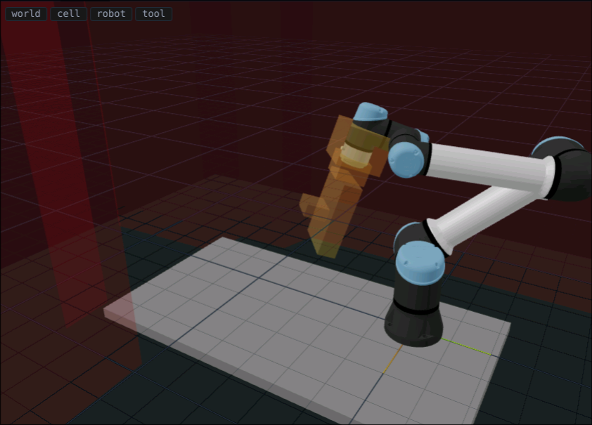
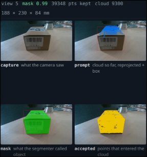

Okay lets start working towards the demo, probably we will have the small preseantration explaining what we have and what is ready and then we will move to the real robot demos

## Spine (~30 min, then live)

1. **How the AI drives the robot** — discrete action menu, computed by logic, resolved into motion. Not a VLA (yet): the model picks, the harness moves.
2. **The harness idea** — agents are eating software (Claude Code & co). Agents in robotics are next — this is the MVP of that.
3. **The harness** — general Claude agent + harness around it: `move()` → motion (robot API + path planning), `inspect()` → vision subagent, `answer()` → evidence hunts. The loop diagram.
4. **Motion & safety** — cell measured → `cell.yaml` → kinematics + collision world; object is an obstacle; operator gate (two-press approve, STOP always live).
5. **Vision, two flows** — (a) capture: image → detect → mask → depth → reconstruction. (b) the vision subagent with tools. Two diagrams.
6. **Evidence views** — box primitive fitted; orthogonal face views computed once the fit settles. The top agent decides which primitive the object is, the runtime applies it. Box only today.
7. **The answer** — verdict + structured fields + cited evidence images. A citation = a hunt; a miss bounces the answer.
8. **Everything is a recorded run** — every run traced and replayable in the UI; benchmarks run on replays.
9. **Live demo** — AI KIT box / small cam / big cam. Question → run (~9 min) → reposition the object → again. Fallback: replay of a recorded run.
10. **Limits & next** — box-only primitive, run time, oblique reads are leads not evidence. Next: more primitives, benchmark, VLA as phase two.

## Slides

### Slide 1 — A sound MVP
Title: **A sound MVP**

No text. Visual only: the three answer cards side by side.
- `pictures/card_aikit.png` — run 2209-box-ray-demo4
- `pictures/small_cam.png` — run 2209-smallcam-ray-demo5
- `pictures/bigcam_card.png` — run 2209-bigcam-ray-demo5

### Slide 2 — Agents → robotics
Title: **Agentic systems are here. Robotics is next.**

Text (3 lines max):
- Software today: a general model + tools + a harness = an agent that plans, acts, checks. (Claude Code and co.)
- Robotics next: same recipe — the model reasons, the harness moves.
- This project: that recipe on a UR5e, as an MVP.

Visual: two copies of the same loop, side by side.
  left  — agent in software:  model ⇄ tools (read, edit, run)
  right — agent in robotics:  model ⇄ tools (move, inspect, answer)
  Same shape; only the tools change.

Speaker line (from the Aug-2026 field sweep, docs/research/agentic-robotics-stack.md):
nobody ships the robot-cognition layer yet; the split both schools agree on is adopt the frontier
agent SDK for cognition, build the thin embodiment harness yourself. That harness is this project.

### Slide 3 — The harness
Title: **One general agent, one harness, three tools**

Text (3 lines max):
- A general Claude agent — no fine-tuning — sees a text menu of where it can look and what it has learned.
- The harness turns its three calls into the physical world:
  `move(address)` → motion · `inspect(question)` → vision subagent · `answer(verdict, fields, citations)` → evidence hunts
- Every turn: read the menu → decide → one call → the harness does the work → the result comes back as text.

Visual: THE LOOP DIAGRAM (diagram 1 — subagent-made):
  [ Claude agent ] ⇄ [ harness ]
      harness → move()    → machine (approval gate → plan → 3-leg move → capture) → robot
      harness → inspect() → vision subagent (detect / crop / read_text) → text summary back
      harness → answer()  → evidence hunts on cited views → answer card
  Side note on the diagram: the agent never sees pixels; the subagent never sees the robot.

Speaker line: not a VLA — the model never outputs joint targets or camera poses; it picks among
offered addresses, asks questions of views, and composes the answer. Everything physical is code.
Speaker numbers (verified, context/01): system prompt 6,651 chars / 109 lines; 4 orchestrator tools, 5 subagent tools;
the package is 44.8k lines of Python + 11.8k lines of tests; no fine-tuning anywhere; the loop itself is the Claude Agent SDK (rented, not built).
Models: main `claude-opus-5`, vision `gemini-robotics-er-2-preview`, plus SAM 3 + PP-OCRv6 behind the vision tools.

### Slide 4 — Two agents
Title: **Two agents, one boundary**
(main = Claude Opus 5, `claude-opus-5` in ai/000/airun.json · vision = Gemini Robotics ER-2, `gemini-robotics-er-2-preview`, eyes/models.py:22)

No text. Visual only — a two-level hierarchy:
  MAIN AGENT (Claude, general)        — plans, decides where to look, composes the answer. Sees text only.
      └─ VISION AGENT (Gemini Robotics ER-2) — reads pixels of ONE captured view with tools. Never sees the robot.
Between them: text goes down (a question), text comes back (the finding: evidence + reasoning + answer). Images never cross up.

### Slide 5 — What the main agent can do
Title: **Four actions**

Visual: four cards, one per tool (exact names + args from brain/loop.py:591-690):
- `plan(criteria)`                      — once, first: the question broken into checkable criteria
- `move(cell)`                          — go to an address, capture, auto-inspect against the question. One deterministic step. Blocks until the operator approves.
- `inspect(question, cell?, schema?)`   — ask the vision agent about a captured view. No robot motion. `schema` constrains the readout ("yes|no", "the text, verbatim").
- `answer(verdict, fields, evidence_cells)` — end the run. ≤3 citations {cell, find}; each becomes an evidence hunt; a miss bounces the answer.

One line under the cards: addresses are what the menu offers — numbered cells `[h, v]` on the sphere and face views `["face","x+"]` once the box is fitted. That's the whole action space; no poses, no joints.

Speaker line: served to the model as an MCP tool server; no file/shell tools. The model cannot do anything the harness did not offer.

### Slide 6 — The loop
Title: **One step of the loop**

Visual: THE STEP LOOP (diagram 2 — subagent-made), a ring:
  main agent picks `move(cell)` → operator approves → plan + 3-leg move → capture (rgb + depth)
  → reconstruct (mask → cloud → box fit; menu updates: visited, faces ready)
  → vision agent inspects the new view → finding (text) → menu + findings back to the main agent → next action

Speaker line: every arrow is code; the only two decisions the model makes per step are "where next" and "what does this view tell me".

### Slide 7 — Motion
Title: **Motion**

One line: Under the hood we have a measured model of our cell — every move is planned against it.

Visual: motion-safety diagram (subagent-made). Nothing else.

Speaker (only if asked): table probed, walls taught, tool hull measured, camera hand-eye calibrated → `cell.yaml` → collision world → IK + planner → the robot. Operator approves each move; STOP always live.

### Slide 8 — Vision, two flows
Title: **Vision**

Two lines:
- Capture: image → mask (SAM3) → depth → point cloud → box fit.

- The vision agent (Gemini Robotics ER-2) reads one view with tools: detect · segment · read_text · crop.

Visual: the two flow diagrams (subagent-made), left and right.

### Slide 9 — Evidence views
Title: **Evidence views**

Two lines:
- Once the box is fitted, every face gets its orthogonal view — a ray from the face, at the closest safe distance.
- Today: box only.

Footer number: 23 face views across 6 runs — 15 at exactly 0° off, 19 within 10°.

Visual: evidence-views diagram (subagent-made) + one real 0° face frame or the bench before/after
`investigation/ray_views/evidence/1709-demo1_frames_faces.png` (real photo, projected box, old vs ray endpoint).

### Slide 10 — The answer
Title: **The answer**

One line: A verdict, the fields it read, and the pictures it cites — every citation is a hunt on that view; if the hunt finds nothing, the answer bounces back to the agent.

Visual: one card (e.g. `pictures/bigcam_card.png`) + next to it the bounce that preceded it, verbatim from the run:
`2209-bigcam-ray-demo5`: first answer bounced on an honest "not found"; the re-answer claimed less. (context/06-07 + 08-10)

Speaker (only if asked): the hunter is never told the verdict; oblique reads are leads, not evidence — codes are read at the face view.

### Slide 11 — Everything is a recorded run
Title: **Everything is a recorded run**

One line: Every run is a folder — frames, depth, masks, the cloud, the model's full trace — and the UI replays it.

Footer numbers: 65 runs · 2.6 GB · 488 tests (5 of them drive the mock app end-to-end in a headless browser).

we will probably want to have that in future so collecting from beginning

### Slide 12 — Live demo
Title: **Live**

### Slide 13 — Limits & next
Title: **Limits & next**

Two lines:
- Limits: Model hallucinate the num,bers, this might be sloved with better camera, that happens since the images sometimes are blurry. TBD how the model will perform on other inspections tasks, like anomaly detection, where the evidence cant not be transfered that easily to text, since now the main orchestarator never sees images, only the text
