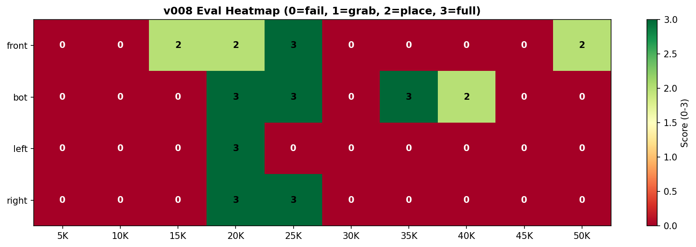
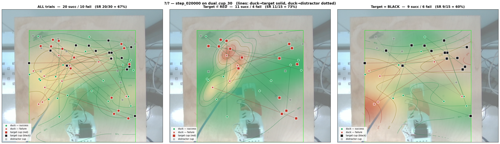
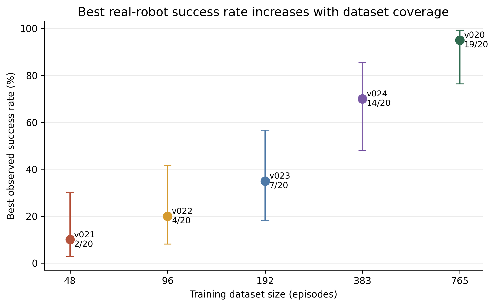
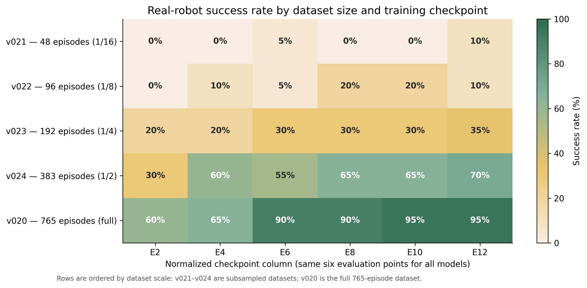
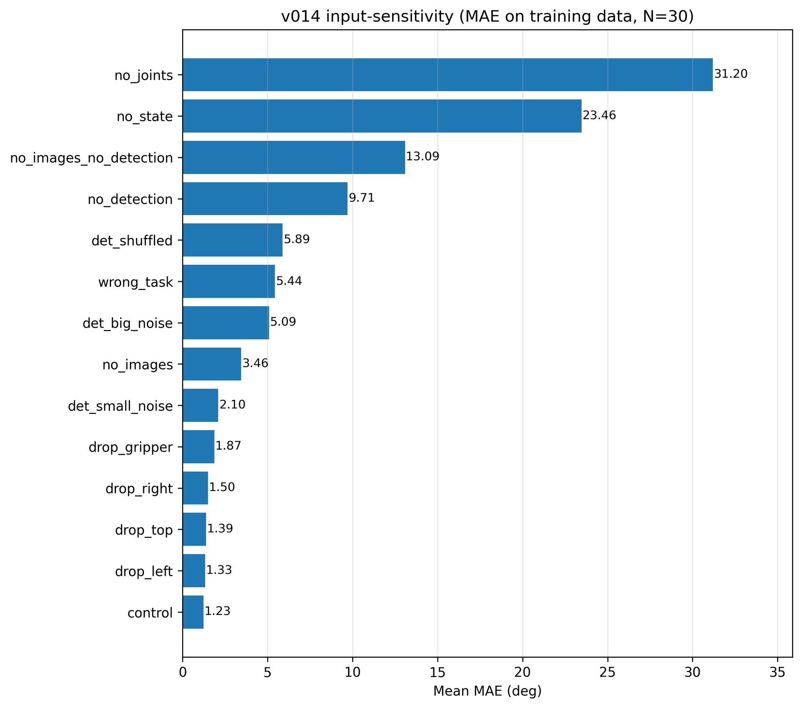

# Case study: duck → cup with SmolVLA (v001–v029)

How the framework was used on one task, and what came out. Numbers are taken from the submitted portfolio documents (Training and Evaluation Evidence Report, Masking Research, Meetings log, Validation and Transferability) and from the experiment folders in this repo. Each claim has its source in an HTML comment.

## 1. Task and setup

| | |
|---|---|
| Task | `Pick up the duck and place it in the {red\|black} cup`. One blue duck, one or two cups on the table. <!-- src: logic/inference/protocols/dual_cup_30.json --> |
| Robot | SO-101 leader/follower, Feetech STS3215 servos <!-- src: Evidence Report, Hardware & Data Collection --> |
| Cameras | 4× RealSense D405: `top`, `left`, `right`, `gripper`. From v018, gripper depth is added as a fifth image stream, `gripper_depth`. <!-- src: Evidence Report; v018/notes.md --> |
| Data | Teleoperated demonstrations, recorded as LeRobot datasets (`eternalmay33/...` on the HF Hub) |
| Model | SmolVLA, 450M params (100M trainable when vision is frozen) <!-- src: Evidence Report, Training & Remote Infrastructure: 450,046,176 / 99,880,992 --> |
| Training | Remote `lerobot-train` on an RTX 5090, batch 64 <!-- src: Evidence Report, Training & Remote Infrastructure --> |
| Evaluation | A protocol fixes the trial list in advance: duck/cup placements, target cup, prompt. The operator labels each trial success or failure. 30 fps, `action_horizon` 10. <!-- src: Evidence Report, Evaluation; Meetings log 30/04; v020 session.md config --> |

## 2. Process

### Timeline

| Version | Change | Outcome |
|---|---|---|
| v001 | SmolVLA on sim data | Actions somewhat structured, no reliable transfer to the real robot <!-- src: Evidence Report, Starting Point; v001/notes.md --> |
| v002 | Real data | Always returns to rest pose, even when started mid-motion <!-- src: v002/notes.md --> |
| v003 | Rest frames trimmed | Rest bias stays. The model predicts rest-adjacent values, not the dataset mean <!-- src: v003/notes.md; Evidence Report, Rest Bias Investigation --> |
| v004 | Koen's `08-merged_trimmed` only | Still struggles to leave rest, but moves sensibly once it does <!-- src: v004/notes.md --> |
| v005 | 2 real + sim mix (239 eps) | Loss floor at 0.050, attributed to conflicting gradients from sim data <!-- src: v005/notes.md; v006/notes.md --> |
| v006–v007 | Single dataset, official LR schedule, then official `lerobot-train` | Moves with intent but is not reliable. Diagnosis: a data problem, not a training problem <!-- src: v007/notes.md --> |
| v008 | 107 real eps | First useful window: peak at 20k–25k, collapse after 30k <!-- src: v008/notes.md --> |
| v010 | Duck restricted to the green-sticker area, 144 eps / ~90k frames | ~90% in-distribution, <10% outside. Moving the cup broke the grasp <!-- src: Evidence Report, Making the Task Learnable; v011/notes.md (hypothesis) --> |
| v011–v012 | 475 eps; delta actions | No recorded protocol result <!-- src: v011/notes.md "Results (pending)"; v012/notes.md --> |
| v013 | New baseline `01_02_03_merged_may-sim`, 6D state | 31/40 (77.5%) ID after the `action_horizon=1` inference bug was fixed <!-- src: Meetings log 30/04 --> |
| v014 | + 16 detector coords (22D state) | Easy-signal trap, dropped (§4) <!-- src: v014/notes.md --> |
| v016 | Depth design study | No training run <!-- src: v016/notes.md --> |
| v017 / v018 | RGB vs RGB + `gripper_depth`, same data | 11/30 vs 14/30 on `dual_cup_30` <!-- src: Evidence Report, Evaluation table --> |
| v019 | 671 eps / 306,669 frames, 5 streams, two cup colors | 20/30. Structured right-side / closer failures. 30k regressed <!-- src: Evidence Report, Scaling Data; v019/notes.md --> |
| **v020** | + 94 right-side eps, unfrozen SigLIP, augmentation | **30/30 `dual_cup_30`, 56/60 `dual_cup_60`** <!-- src: Evidence Report, Breaking Through with v020 --> |
| v021–v024 | 1/16, 1/8, 1/4, 1/2 of v020 data | Data-efficiency sweep (§3) <!-- src: Evidence Report, After the Baseline --> |
| v025–v029 | SmolVLA-UVA auxiliary objective | Trained, not evaluated (§6) <!-- src: Evidence Report, Open Research --> |

### What drove the loop

- **Sim-first → real-baseline-first.** The plan assumed a working real baseline of about 80%. It did not exist, so there was nothing to measure sim gains against. On 19/03 the work switched to real-data training first, and the sim assets went to Enea (TU/e) for RL-generated data. <!-- src: tech_blog_v2/02_sim_first_pivot.md; Project Plan Shift Reflection; Meetings log 19/03 -->
- **Data tooling and rest bias.** `check_utils` (schema, cameras, action distributions, per-episode trajectories) and `trim_utils` (rest-frame detection, episode drops, before/after distributions) became the main way to diagnose failures. In v003 the predictions sat at about −1.8σ / +1.5σ on `shoulder_lift` / `elbow_flex`. That is the rest pose (≈ −98 / 99), not the trimmed mean (−23 / 17). Trimming did not fix it. <!-- src: Evidence Report, Dataset Management + Rest Bias Investigation -->
- **Experiment system.** Each `vNNN/` has a frozen `config.yaml`, `notes.md`, checkpoints and eval sessions. `remote.py` syncs data and config to the 5090, launches in tmux and pulls checkpoints back. Getting the remote environment to work meant fixing 10 environment issues; the fixes now live in `remote.py`. Chain runs (`chain`, `chain_remote`) were used for v021–v024 and v025–v029. <!-- src: Evidence Report, Experiment Management + Training & Remote Infrastructure -->
- **Making the task learnable.** Duck placement was restricted to a green-sticker area until a policy worked at all (v008, v010), then the area was widened. v010 showed that in-distribution success can still hide cup-position conditioning. <!-- src: Evidence Report, Making the Task Learnable + Generalization Problems -->
- **Evaluation protocols.** Manual pen-and-paper checks were replaced by protocol JSON → overlay-guided placement → the same inference path as deployment → per-trial label → `session.md` / `session.json` / videos. The first checkpoint sweep exposed an `action_horizon=1` bug that discarded most of each action chunk. <!-- src: Evidence Report, Evaluation; Meetings log 30/04 -->
- **v019 → v020.** v020 targeted the failure cell that v019's protocol breakdown exposed. It combined the cell's data coverage with representation changes in one run, so the individual effect of each change was not isolated. <!-- src: tech_blog_v2/12_v019_to_v020_breakthrough.md -->

*v008: score per placement and checkpoint (0 = fail … 3 = full task). The good window is 20k–25k and collapses after 30k, even though training continued. Pre-protocol, manual eval.* <!-- src: ~/Documents/vbti/v008_eval_heatmap.png; v008/notes.md -->

## 3. Results

### v020: the anchor model

Setup: `eternalmay33/duck_cup_v020_all`, 765 eps / 336,940 frames. Inputs are top/left/right/gripper RGB plus `gripper_depth`, with a 6D joint state and no detector coordinates. The run added 94 right-side coverage episodes and unfroze SigLIP with gradient checkpointing. Peak LR 1e-4, vision 1e-5 (`vision_lr_scale=0.1`). Brightness/contrast/sharpness/affine augmentation was on; saturation and hue were off to keep cup color. <!-- src: Evidence Report, Breaking Through with v020; v020/notes.md Final config -->

| Protocol | Checkpoint | Result | 95% CI |
|---|---|---:|---:|
| `dual_cup_30` | 150k | 30/30 (100%) | [89–100] |
| `dual_cup_60` | 150k | 56/60 (93%) | [84–97] |
<!-- src: Evidence Report, Breaking Through with v020; v020/eval_sessions/chkpt_step_150000_ah_10_pr_dual_cup_{30_20260511_115034,60_20260511_135739}/session.md -->

`dual_cup_60` breakdown: both-cup scenes 20/20, single black 17/20, single red 19/20; black target 27/30, red target 29/30. All 8 dual-cup cells (color × side × closer) were solved. <!-- src: v020 dual_cup_60 session.md -->

**How to read the failures.** All 4 failures were single-cup trials (T11 red, T43/T45/T51 black). No failure involved picking the wrong cup when both were present, so the remaining errors are not language or disambiguation failures. Failed trials averaged 1239 steps against 425 for successes: the policy keeps retrying the placement instead of giving up. The next thing to fix is placement precision, not perception. <!-- src: v020/notes.md Failure mode; Evidence Report -->

What changed from v019, which scored 20/30 at 20k: v019 failed right-side targets, especially when the target was the closer cup (`(right, closer)` 0/6 across the 20k protocols). Its `dual_cup_15` score went 10/15 → 10/15 → 6/15 at 20k / 25k / 30k while training loss kept falling. <!-- src: Evidence Report, Scaling Data; v019/notes.md -->

*v019 @ 20k, `dual_cup_30` (20/30): the failure clusters that v020's targeted data was collected for.* <!-- src: ~/Documents/vbti/v019_dual_cup_30_heatmap.png; v019/notes.md -->

### Data-efficiency sweep (v021–v024)

The same v020 setup was trained on deterministic subsamples and evaluated with the `checkpoint_sweep` protocol, n=20 trials per cell. <!-- src: Evidence Report, After the Baseline -->

| Version | Episodes | Best ckpt | Final ckpt |
|---|---:|---:|---:|
| v021 | 48 | 2/20 (10%) | 2/20 (10%) |
| v022 | 96 | 4/20 (20%) | 2/20 (10%) |
| v023 | 192 | 7/20 (35%) | 7/20 (35%) |
| v024 | 383 | 14/20 (70%) | 14/20 (70%) |
| v020 | 765 | 19/20 (95%) | 19/20 (95%) |
<!-- src: Evidence Report, After the Baseline; tech_blog_v2/13_data_efficiency_sweep.md -->

- Caveat: with n=20 the Wilson intervals are wide. Differences of 5–10 pp mean nothing. Only the broad trend holds. <!-- src: evaluation/evaluation_visualization_audit.md, Confidence intervals -->
- v020's 19/20 here comes from a different protocol than 30/30 and 56/60. Don't mix the two sets of numbers. <!-- src: evaluation_visualization_audit.md, Known limitations -->
- Smaller datasets lost the most on the harder scene types and targets; the drop was not uniform. <!-- src: Evidence Report, After the Baseline -->
- No universal threshold follows from this: one robot, one task, one model line.

*Best observed success with 95% CI, and success per normalized checkpoint. `checkpoint_sweep` protocol, n=20 per cell.* <!-- src: oficial/docs/evaluation/figures_v2/v2_05, v2_01 -->

### Depth stream (v017 vs v018)

Same dataset (`04_05_06_07_merged_may-sim_depth`, 175 eps / 70,384 frames) and the same hyperparameters. The only difference is whether `gripper_depth` is included. Depth is clipped to 0.05–0.20 m, turbo-colorized, and fed through the normal image-token path. <!-- src: tech_blog_v2/10_depth_stream.md; v017/notes.md; v018/notes.md -->

| Version | Inputs | `dual_cup_30` @ 20k |
|---|---|---:|
| v017 | 4× RGB | 11/30 (37%) |
| v018 | 4× RGB + `gripper_depth` | 14/30 (47%) |
<!-- src: Evidence Report, Adding Depth; v017/v018 eval_sessions session.md -->

Depth helped modestly but did not fix the dual-cup failures. It was kept for v019 and v020.

## 4. Dead ends

### Masking and prompt routing

Goal: stop the policy from conditioning the grasp on cup position.

| Test | Setup | Result |
|---|---|---|
| Image masking before frozen SigLIP | 2 mask shapes × 5 fills = 10 conditions; 44,000 SigLIP embeddings | Masked embeddings form satellite clusters off the clean manifold. Cosine similarity of 0.94–0.97 looks close, but the clusters are structurally distinct in UMAP. |
| Stage-aware prompts | 55 captures × 3 prompts × 4 cams = 660 token arrays | Per-patch cosine distance between prompts is 0.0001–0.0003, effectively zero. |
<!-- src: Masking Research §3–§4 (final_porfolio/Masking Research.md) -->

Why: SigLIP is frozen, so masked images are simply out of distribution for it. The prefix is 305 tokens (256 vision + 48 language + 1 state). Language is a small share of that and cannot steer the vision tokens. Conclusion: data diversity is the lever, and a trainable vision encoder is only worth trying once the training stack supports it. v020 did exactly that. <!-- src: Masking Research §5–§6 -->

### Detector coordinates (v014)

The state became 6 joints + 16 StudentDetector coords (4 cams × {duck, cup} × (cx, cy)). Sensitivity ablation: 30 samples from the 135,846-frame dataset, MAE in degrees. <!-- src: v014/notes.md -->

| Condition | MAE |
|---|---:|
| control | 1.23° |
| no detection | 9.71° |
| no images | 3.46° |
| no joints | 31.20° |
<!-- src: v014/notes.md Sensitivity Ablation; Evidence Report, Removing Easy Shortcuts (first three rows) -->

Zeroing the detector coordinates hurt 2.8× more than blanking all four cameras. The model leaned on the coordinates and underused the images. On the real robot it jittered and drifted toward the mean action. Detection was dropped from the policy state, and later removed from the framework. <!-- src: v014/notes.md Status, Decision -->

*v014: action MAE per ablated input. With the detector coordinates removed, the error is higher than with all four cameras blanked.*
<!-- src: experiments/duck_cup_smolvla/v014/sensitivity_plots/mae_bars.png -->

## 5. Lessons

<!-- src: Evidence Report, Main Lessons From the Training Progression -->
- **Real baseline first.** Simulation gains can't be measured without one. The first sim-trained model did not transfer.
- **Dataset distribution over hyperparameters.** Rest bias, shortcut learning and spatial coverage shaped behavior more than small hyperparameter changes did.
- **Loss lied.** Checkpoints with better loss did worse on the robot (v019 at 30k). Protocols turned demos into evidence.
- **Engineered shortcuts hurt.** Detector coordinates became a load-bearing crutch.
- **Depth alone isn't enough.** 11/30 → 14/30.
- **Targeted data plus representation adaptation won.** v020 fixed the v019 failure cell with targeted coverage and an unfrozen vision encoder.

## 6. Open

- **UVA (v025–v029).** SmolVLA-UVA with an auxiliary objective, trained on `duck_cup_v020_all_uva` as a remote chain. The chain was restarted after the auxiliary loss turned out to dominate the action loss, with `aux_weight=0.003`. There has been no real-robot evaluation, so there is no improvement claim over v020. <!-- src: Evidence Report, Open Research; v025–v029/config.yaml -->
- **Sim / RL branch.** The reconstruction assets and sim environment were handed to Enea (TU/e). On 30/04 a sim/real zero-position mismatch was found and fixed. Since then Enea's pre-grasp policy runs on the real robot in the expected pose. This shows the transfer happened; it does not show that sim data improved a policy. <!-- src: Meetings log 30/04; Robotic Training Pipeline Validation and Transferability, Transfer Evidence + Boundary of the Claim -->
- **Boundaries.** This is a controlled lab task with a fixed table, two cup colors and one robot. It does not show product readiness, general manipulation, or sim-to-real improvement. Small n per protocol is enough to pick a research direction, not enough for production confidence. <!-- src: Robotic Training Pipeline Validation and Transferability; Design and Technical Advice §9 -->

## 7. Where to look

- `../../experiments/duck_cup_smolvla/vNNN/`: `config.yaml` (frozen), `notes.md` (reasoning and results, v001–v020), `eval_sessions/<ckpt>_ah_<h>_pr_<protocol>_<ts>/session.{md,json}`. v021–v029 have only `config.yaml` and `remote_session.json`, plus eval sessions for v021–v024.
- `../../logic/inference/protocols/`: protocol JSONs (`dual_cup_15/30/60`, ...) and their generators.
- `../research/`: SmolVLA and GR00T training internals and related notes.
- LeRobot fork with the SmolVLA patches used here (per-group vision LR, unfrozen vision with gradient checkpointing, transforms skipped on depth): `github.com/33may/lerobot@vbti/main`. <!-- src: v020/notes.md, Patches applied to remote LeRobot 0.4.3 -->
